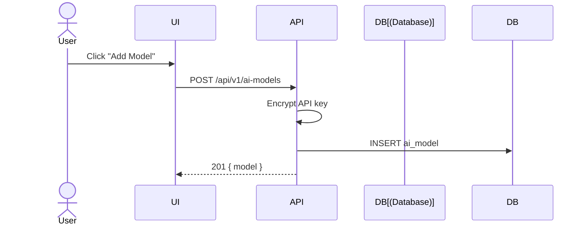
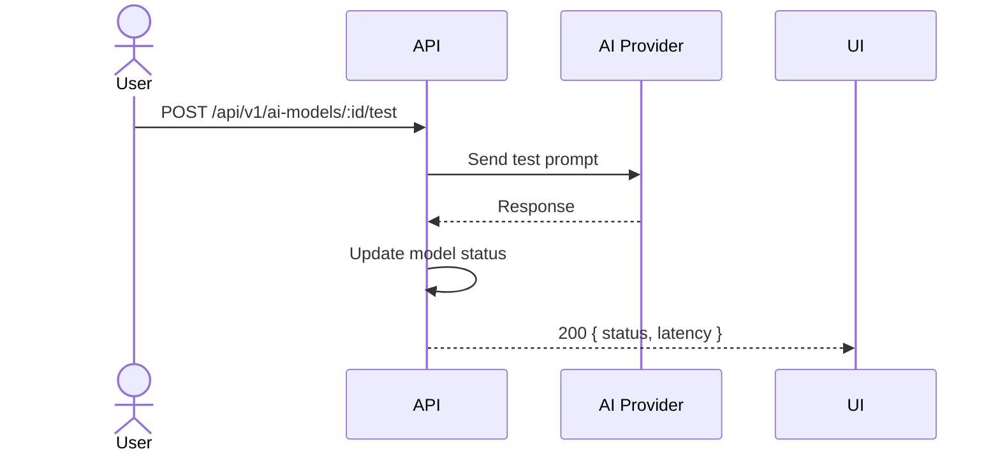
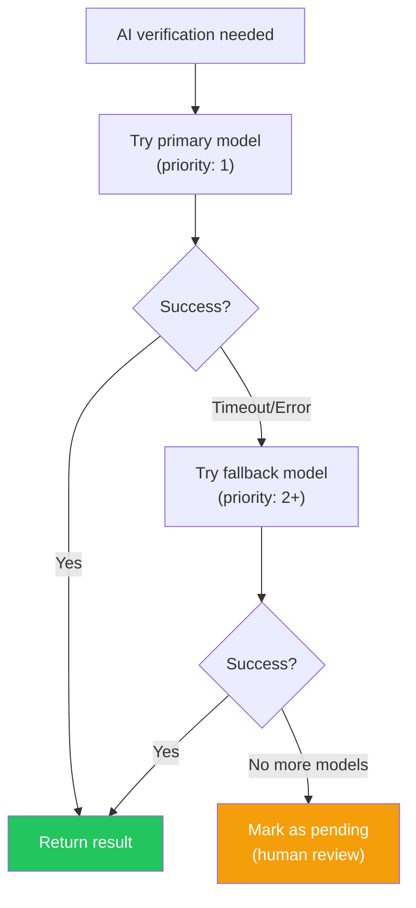

# AI Models

## Overview

Configure LLM providers for AI-powered finding verification. Each workspace can have its own model configuration.

## Supported Providers

| Provider | Default Base URL | Notes |
|----------|-----------------|-------|
| Ollama | `http://localhost:11434` | Local, free |
| OpenAI | `https://api.openai.com/v1` | Cloud, paid |
| Anthropic | `https://api.anthropic.com` | Cloud, paid |
| Groq | `https://api.groq.com/openai/v1` | Cloud, fast |
| Modal | Custom | Serverless GPU |
| Custom | User-defined | Any OpenAI-compatible API |

## Add Model

## Test Model

## Fallback Chain

## Model Roles

| Role | Purpose |
|------|---------|
| `primary` | First choice for verification |
| `fallback` | Backup when primary fails |

## Prompt Presets

| Preset | Description |
|--------|-------------|
| `strict` | Conservative, high precision |
| `balanced` | Default, good precision/recall |
| `aggressive` | Catch more, may have more FP |
