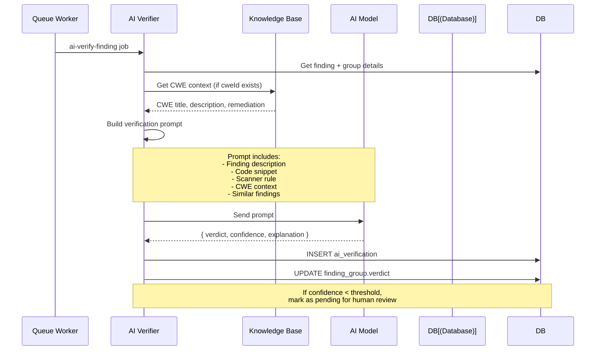
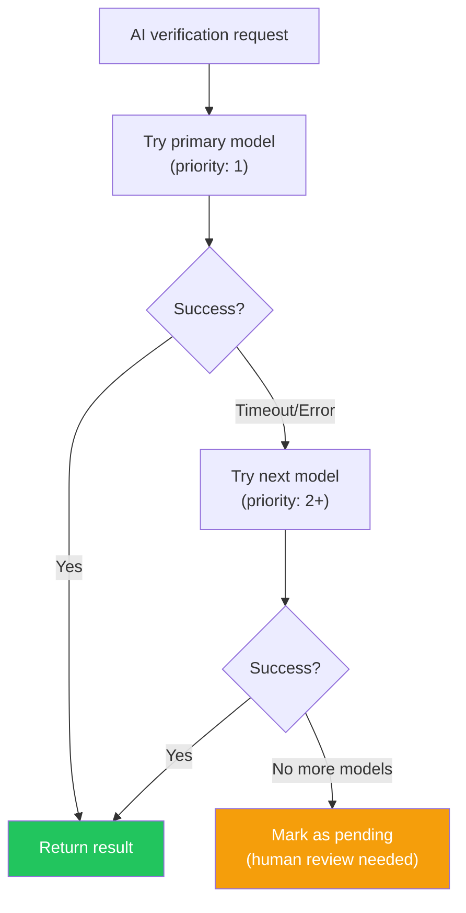
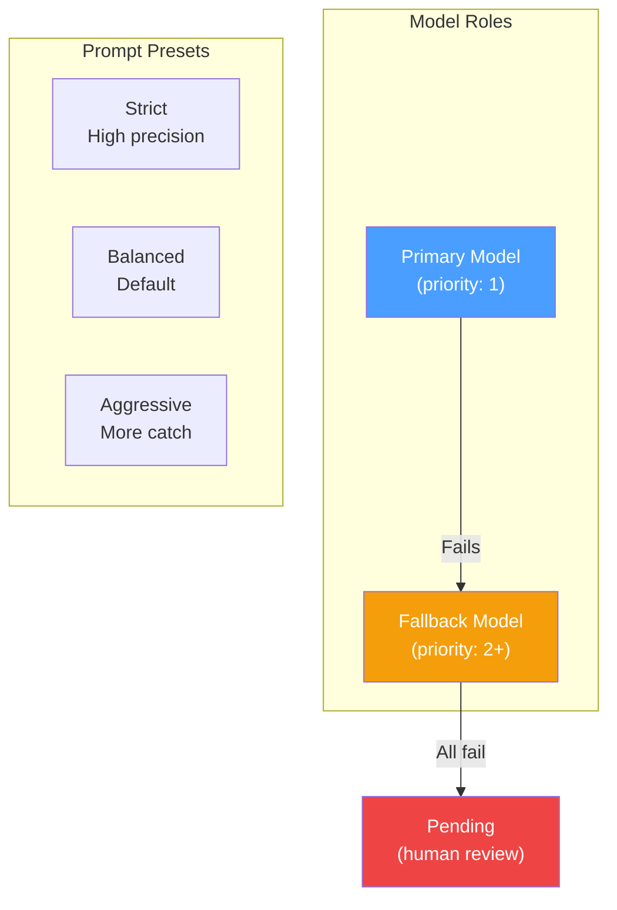
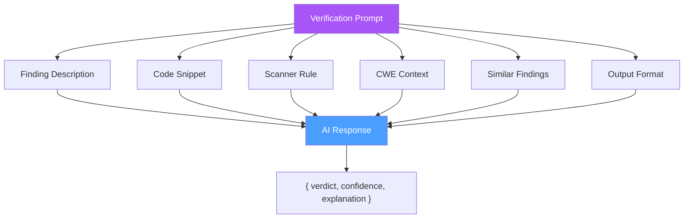
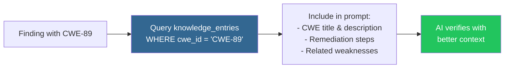

# AI Verification

## Overview

AI verification uses LLMs to reduce false positives in security findings. Each finding is analyzed with CWE context and classified as true positive or false positive.

## Verification Flow

## AI Model Fallback Chain

## Supported Providers

| Provider | Default Base URL | Notes |
|----------|-----------------|-------|
| Ollama | `http://localhost:11434` | Local, free |
| OpenAI | `https://api.openai.com/v1` | Cloud, paid |
| Anthropic | `https://api.anthropic.com` | Cloud, paid |
| Groq | `https://api.groq.com/openai/v1` | Cloud, fast |
| Modal | Custom | Serverless GPU |
| Custom | User-defined | Any OpenAI-compatible API |

## Model Configuration

| Role | Purpose |
|------|---------|
| `primary` | First choice for verification |
| `fallback` | Backup when primary fails |

## Prompt Structure

## Verification Results

| Verdict | Description | Action |
|---------|-------------|--------|
| `true_positive` | Confirmed security issue | Keep finding open |
| `false_positive` | Not a real issue | Mark as dismissed |
| `inconclusive` | AI uncertain | Mark as pending for review |
| `pending` | Awaiting verification | Default state |

## Knowledge Base Enrichment

The AI prompt is enriched with CWE context from the knowledge base:

