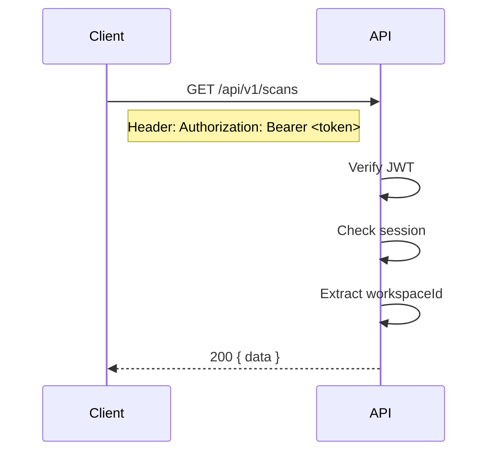

# API Overview

## Base URL

```
/api/v1
```

## Authentication



## Response Format

```json
{
  "success": true,
  "message": "Data retrieved successfully",
  "data": { ... },
  "meta": {
    "requestId": "abc-123",
    "timestamp": "2026-06-27T00:00:00Z",
    "pagination": {
      "page": 1,
      "limit": 20,
      "total": 150,
      "totalPages": 8
    }
  }
}
```

## Error Format

```json
{
  "success": false,
  "message": "Validation failed",
  "data": null,
  "error": {
    "code": "VALIDATION_ERROR",
    "details": [
      { "field": "email", "message": "Invalid email" }
    ]
  }
}
```

## HTTP Status Codes

| Code | Usage |
|------|-------|
| 200 | Success |
| 201 | Created |
| 204 | No Content (delete) |
| 401 | Unauthorized (no/invalid token) |
| 403 | Forbidden (missing permissions) |
| 404 | Not Found |
| 409 | Conflict (duplicate) |
| 410 | Gone (expired invitation) |
| 422 | Validation Error (Zod) |

## API Modules

| Module | Base Path | Endpoints |
|--------|-----------|-----------|
| Auth | `/auth` | 13 |
| Workspaces | `/workspaces` | 11 |
| Projects | `/projects` | 5 |
| Scans | `/scans` | 7 |
| Findings | `/findings` | 8 |
| Repositories | `/repositories` | 7 |
| Source Controls | `/source-controls` | 8 |
| AI Models | `/ai-models` | 2 |
| Knowledge | `/knowledge` | 7 |
| Webhooks | `/webhooks` | 3 |
| Reports | `/reports` | 4 |
| Dashboard | `/dashboard` | 4 |
| Teams | `/teams` | 3 |
| Members | `/members` | 3 |
| Schedules | `/schedules` | 3 |
| Quality Gates | `/quality-gates` | 3 |
| Scanner Engines | `/scanner-engines` | 2 |
| Notifications | `/notifications` | 2 |
| Audit Logs | `/audit-logs` | 2 |

## Rate Limiting

Rate limiting is applied per-IP for sensitive endpoints (signin, signup, password reset).

## CORS

CORS is configured for the production domain. Cross-origin requests from unauthorized origins are rejected.
