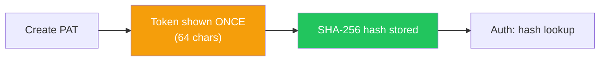

# API Tokens

## Overview

API tokens authenticate external services (CI/CD pipelines, scripts) against the platform.

## Token Types

| Type | Scope | Use Case |
|------|-------|----------|
| **Personal Access Token** | User-level | API automation, scripts |
| **Project API Token** | Project-level | CI/CD pipelines |

## Personal Access Tokens (PAT)

- Token shown to user **only once** at creation
- Only SHA-256 hash stored in database
- Configurable expiry
- Can be revoked at any time

## Project API Tokens

- Scoped to a specific project
- Default permission: `scan:upload`
- Used by CI/CD pipelines for external scan uploads
- SHA-256 hash for O(1) lookup

## Token Security

| Mechanism | Description |
|-----------|-------------|
| SHA-256 hash | Only hash stored, never plaintext |
| HttpOnly cookie | Refresh token not accessible via JS |
| CSRF header | `x-refresh-request: 1` on refresh endpoint |
| Rate limiting | Per-IP for sensitive endpoints |
| Token rotation | Refresh tokens rotate on each use |
