# Architecture

Comprehensive system architecture for SAST Integration platform.

## Table of Contents

- [System Overview](#system-overview)
- [Technology Stack](#technology-stack)
- [Directory Structure](#directory-structure)
- [Application Layers](#application-layers)
- [Authentication Flow](#authentication-flow)
- [Scan Pipeline](#scan-pipeline)
- [Findings Lifecycle](#findings-lifecycle)
- [AI Verification Flow](#ai-verification-flow)
- [Queue System](#queue-system)
- [Quality Gates](#quality-gates)
- [Source Control Integration](#source-control-integration)
- [Storage System](#storage-system)
- [Multi-Tenancy Model](#multi-tenancy-model)
- [API Architecture](#api-architecture)
- [Client Architecture](#client-architecture)

---

## System Overview

SAST Integration is a multi-tenant Static Application Security Testing platform that unifies multiple SAST scanners, enriches findings with AI-powered verification, and provides a structured workflow for triage and collaboration.

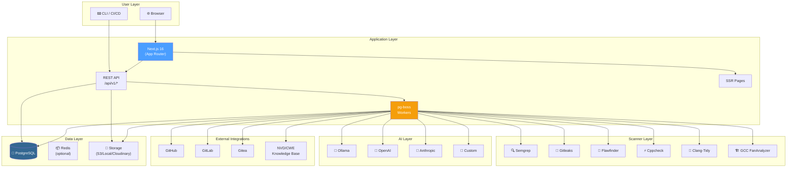

---

## Technology Stack

| Layer | Technology | Version |
|-------|-----------|---------|
| Framework | Next.js (App Router) | 16.2.9 |
| Language | TypeScript | 5 (strict) |
| UI | Ant Design | 6 |
| ORM | Drizzle ORM | 0.45.2 |
| Database | PostgreSQL | 16 |
| Queue | pg-boss | — |
| Auth | JWT (jose) + bcryptjs | — |
| Validation | Zod | — |
| Testing | Vitest + Playwright | — |
| Container | Docker (Alpine Linux) | — |
| Package Manager | pnpm | 10+ |

---

## Directory Structure

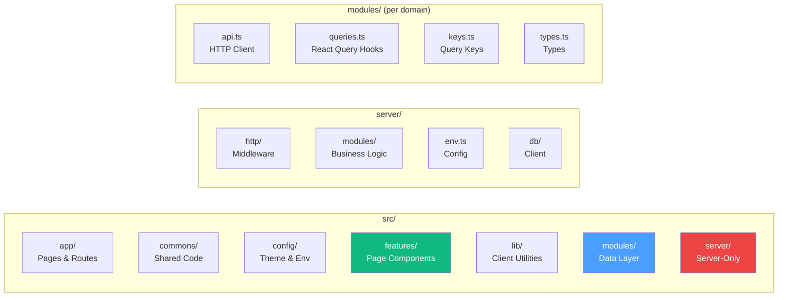

```
src/
├── app/                        # Next.js App Router
│   ├── (authenticated)/        # Protected routes (workspace-scoped)
│   │   └── [workspace]/        # 19+ page routes
│   ├── (public)/               # Public docs & landing
│   ├── (unauthenticated)/      # Auth pages (signin, signup, etc.)
│   └── api/v1/                 # REST API handlers
├── commons/                    # Shared across frontend & server
│   ├── components/             # Shared UI components (LoadingState, ErrorState, etc.)
│   │   └── layout/             # AppShell, AuthenticatedShell, SidebarNav, WorkspaceSwitcher
│   ├── constants/              # App config, permissions, routes, tokens, feature-flags
│   ├── providers/              # AntdProvider, QueryProvider
│   ├── schemas/                # Zod validation schemas (24 files)
│   ├── types/                  # TypeScript interfaces
│   └── utils/                  # slug utility
├── config/                     # antd-theme.ts, client-env.ts
├── features/                   # Page-level feature components (20 modules)
├── lib/                        # Client utilities
│   ├── api/                    # Axios client with auto-refresh
│   ├── docs/                   # MDX rendering
│   ├── hooks/                  # Custom React hooks (useBreakpoint, usePermissions, etc.)
│   ├── utils/                  # formatDate, getInitials, roleLabel, export helpers
│   └── pagination.ts           # Client-side pagination utilities
├── modules/                    # Client data layer (21 domains)
│   └── {domain}/               # api.ts, queries.ts, keys.ts, types.ts
├── server/                     # Server-only code
│   ├── env.ts                  # Zod-validated environment
│   ├── db/client.ts            # Drizzle DB client (lazy proxy)
│   ├── http/                   # HTTP middleware layer
│   └── modules/                # Server business logic (20 modules)
│       ├── auth/               # JWT, sessions, rate limiter
│       ├── workspace/          # Workspace & member management
│       ├── mail/               # Email service
│       ├── storage/            # File storage (S3/Local/Cloudinary)
│       ├── scan/               # Scanning pipeline, parsers, AI verification
│       ├── source-control/     # SCM providers (GitHub, GitLab, Gitea)
│       ├── knowledge-base/     # CWE/NVD knowledge base
│       ├── queue/              # pg-boss job queue (9 workers)
│       └── ...                 # (20 modules total)
```

---

## Application Layers

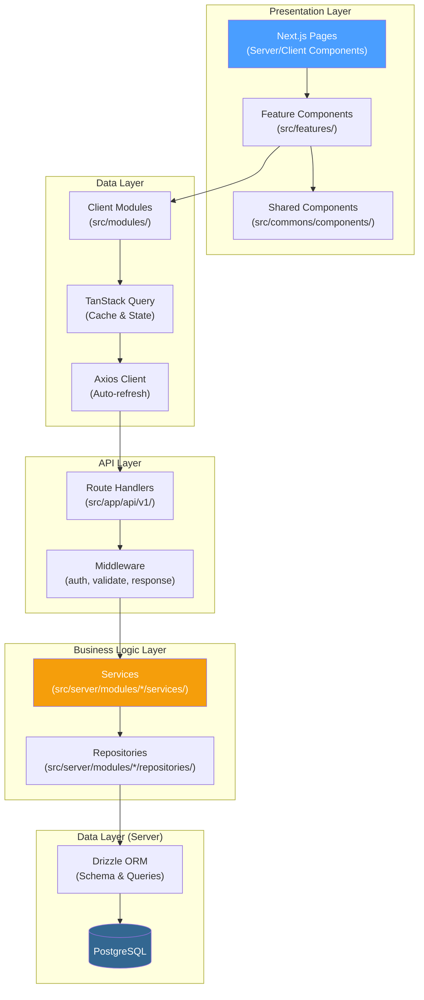

### Request Flow (API)

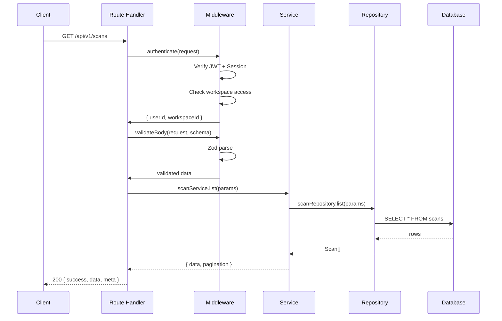

---

## Authentication Flow

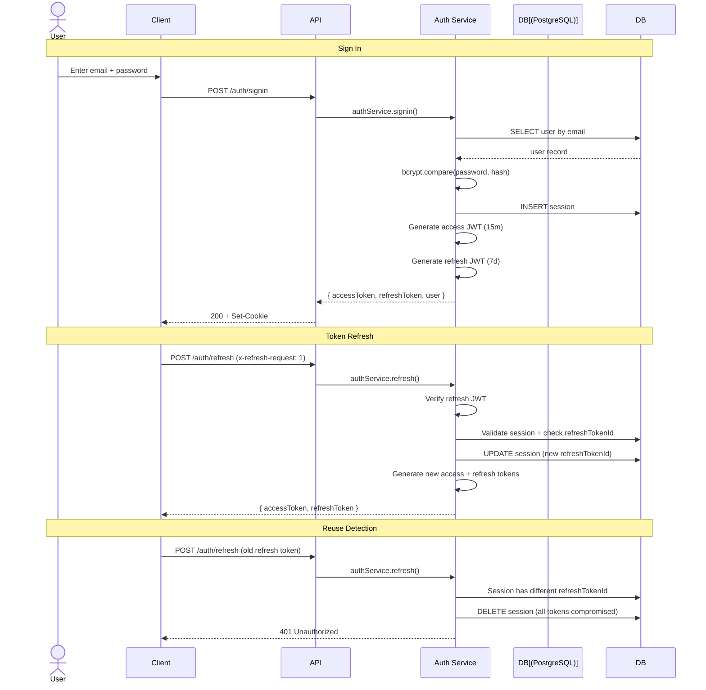

### JWT Token Flow

```mermaid
graph LR
    subgraph "Token Types"
        Access["Access Token<br/>(15 min)"]
        Refresh["Refresh Token<br/>(7 days)"]
        PAT["Personal Access<br/>Token (PAT)"]
        ProjectToken["Project API<br/>Token"]
    end

    subgraph "Storage"
        Cookie["HttpOnly Cookie<br/>(refreshToken)"]
        Memory["In-Memory<br/>(accessToken)"]
        DB[(Database<br/>(sessions))]
    end

    Access --> Memory
    Refresh --> Cookie
    Refresh --> DB
    PAT --> DB
    ProjectToken --> DB

    style Access fill:#22c55e,color:#fff
    style Refresh fill:#f59e0b,color:#fff
    style PAT fill:#4a9eff,color:#fff
    style ProjectToken fill:#a855f7,color:#fff
```

---

## Scan Pipeline

The scan pipeline is the core flow — from trigger to results.

```mermaid
stateDiagram-v2
    [*] --> pending: Trigger scan
    pending --> queued: Enqueued
    queued --> cloning: Worker picks up
    cloning --> scanning: Repo cloned
    scanning --> parsing: Scanner output
    parsing --> ai_verifying: Results parsed
    ai_verifying --> completed: AI verification done
    ai_verifying --> failed: Error occurred
    completed --> [*]
    failed --> [*]

    note right of pending: Managed: user triggers\nExternal: CI/CD upload
    note right of scanning: Multiple scanners run\nin parallel
    note right of ai_verifying: AI models verify\ntrue/false positive
```

### Scan Trigger Flow

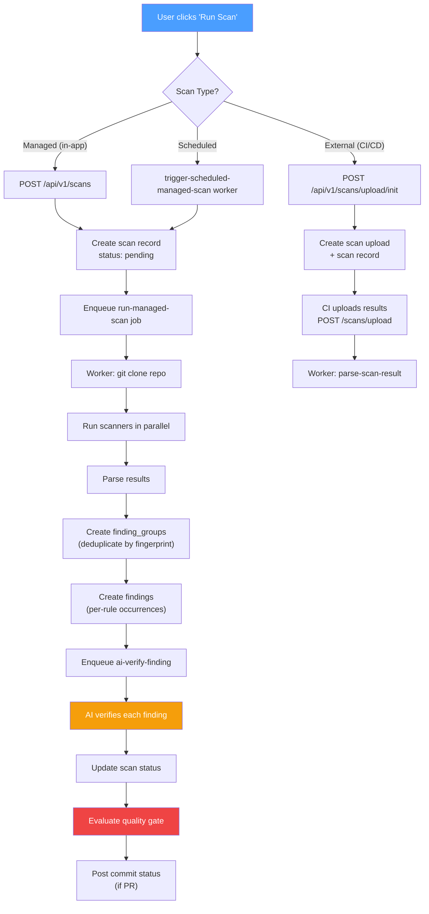

### Scanner Execution

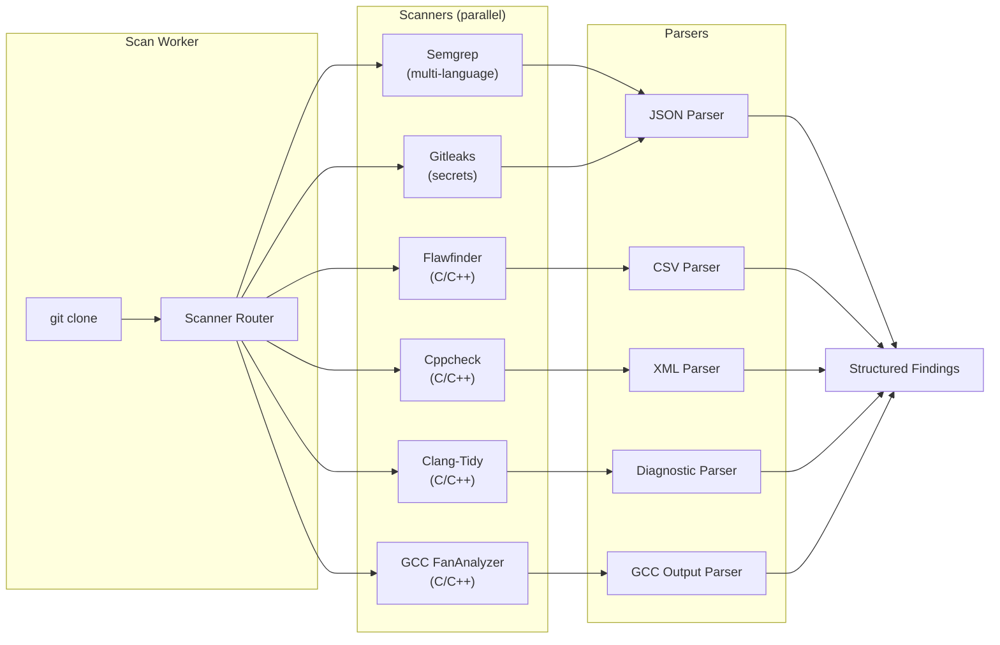

### Finding Deduplication

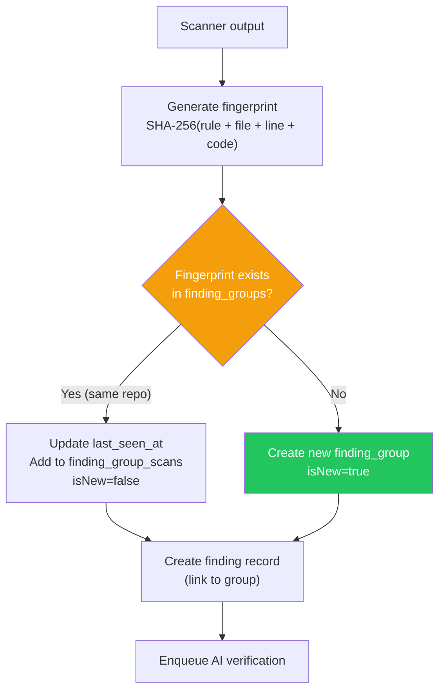

---

## Findings Lifecycle

```mermaid
stateDiagram-v2
    [*] --> open: Scan finds issue
    open --> dismissed: User dismisses
    open --> resolved: User resolves
    open --> in_progress: User starts triage
    in_progress --> open: Back to triage
    dismissed --> open: Reopens finding
    resolved --> open: Reopens finding

    note right of open: Default state\nAI verdict: pending
    note right of dismissed: Not a real issue\n(False positive)
    note right of resolved: Fixed in code
```

### Finding Status Flow

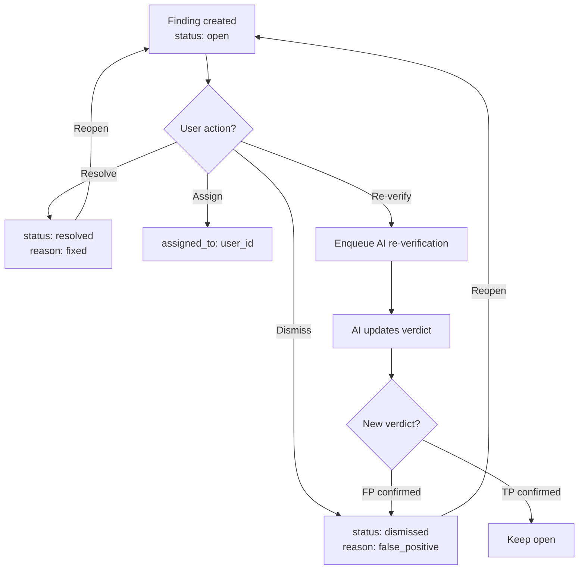

---

## AI Verification Flow

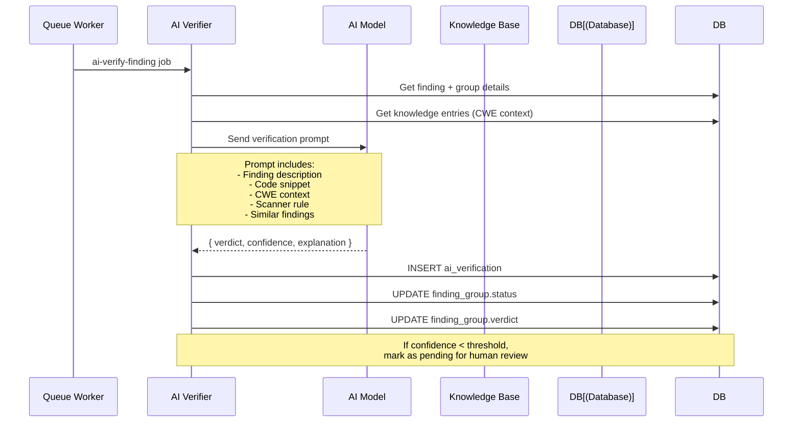

### AI Model Fallback Chain

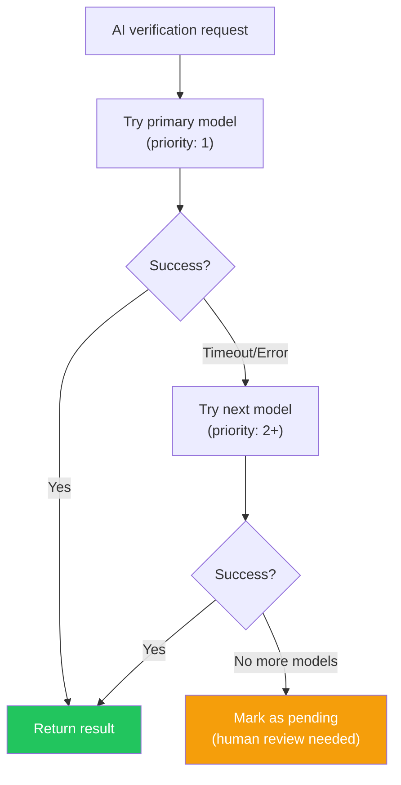

---

## Queue System

All background jobs run via **pg-boss** (in-process, no separate worker service).

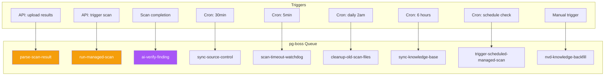

| Worker | Trigger | Purpose |
|--------|---------|---------|
| `parse-scan-result` | External upload | Parse CI/CD scan results |
| `run-managed-scan` | User action | Execute in-app managed scan |
| `ai-verify-finding` | Scan completion | AI verify each finding |
| `sync-source-control` | Every 30 min | Sync repos from SCM providers |
| `scan-timeout-watchdog` | Every 5 min | Clean orphaned/timed-out scans |
| `cleanup-old-scan-files` | Daily 2am | Remove old scan artifacts |
| `sync-knowledge-base` | Every 6 hours | Sync NVD/CWE data |
| `trigger-scheduled-managed-scan` | Cron check | Run scheduled scans |
| `nvd-knowledge-backfill` | Manual | Backfill NVD knowledge base |

---

## Quality Gates

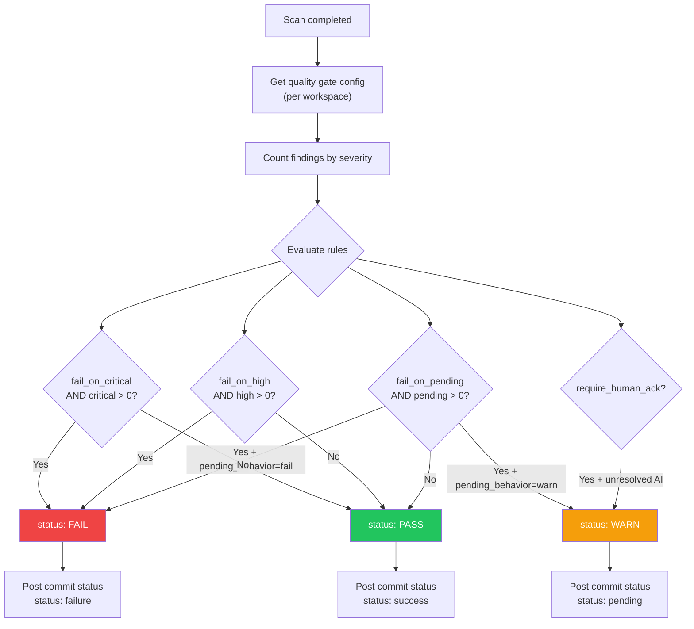

---

## Source Control Integration

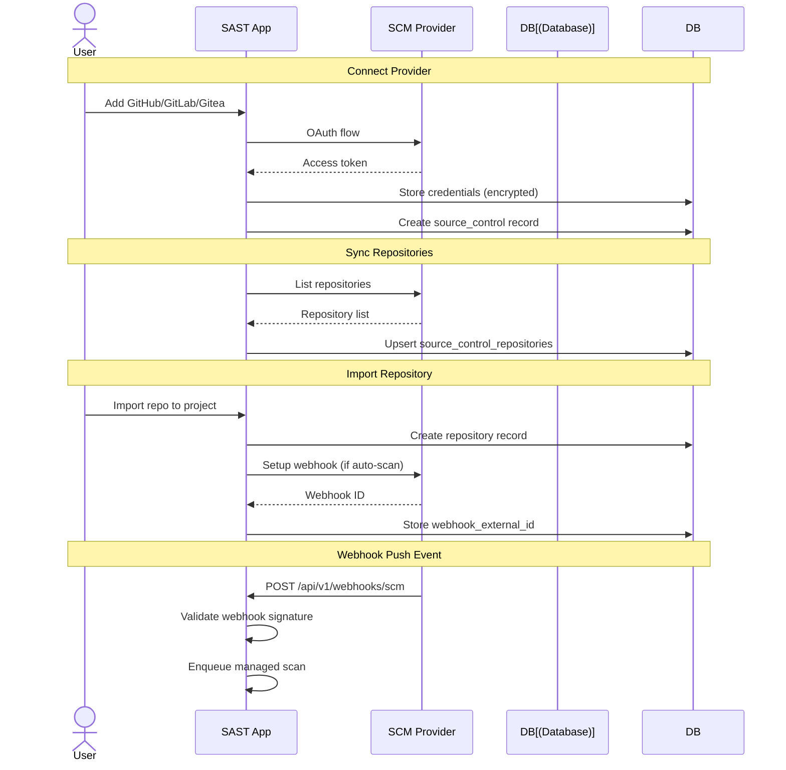

---

## Storage System

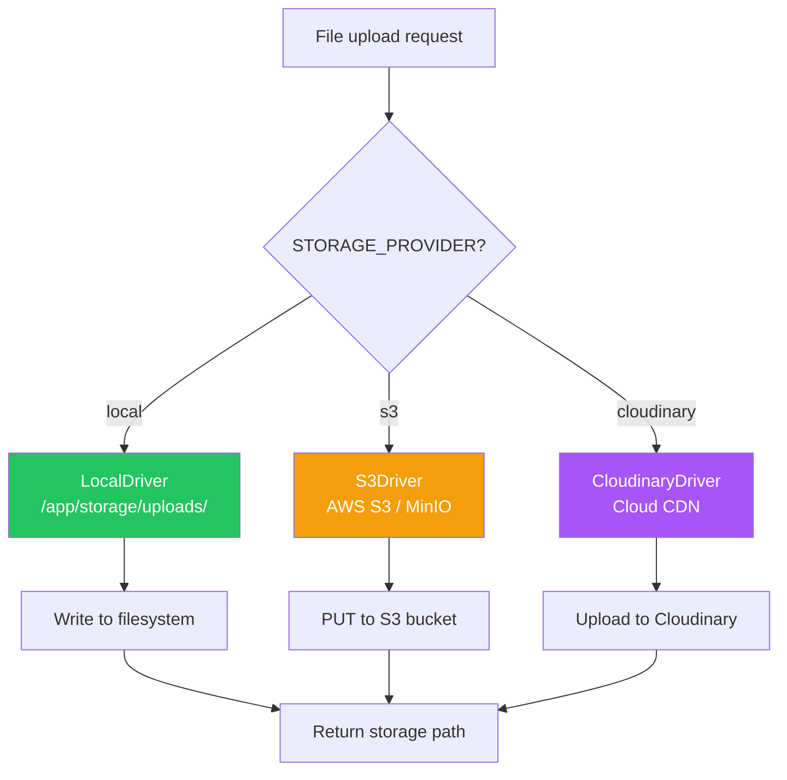

---

## Multi-Tenancy Model

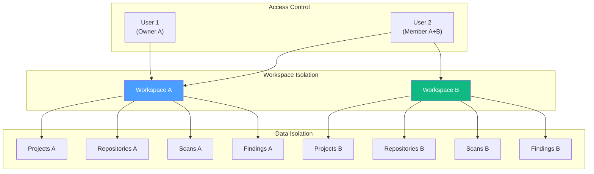

### Workspace Modes

| Mode | Description | Use Case |
|------|-------------|----------|
| `multiple` | Users create personal workspaces + join org workspaces | Default, SaaS-style |
| `single` | One shared organization workspace, invite-only | Self-hosted, enterprise |

### Role Hierarchy

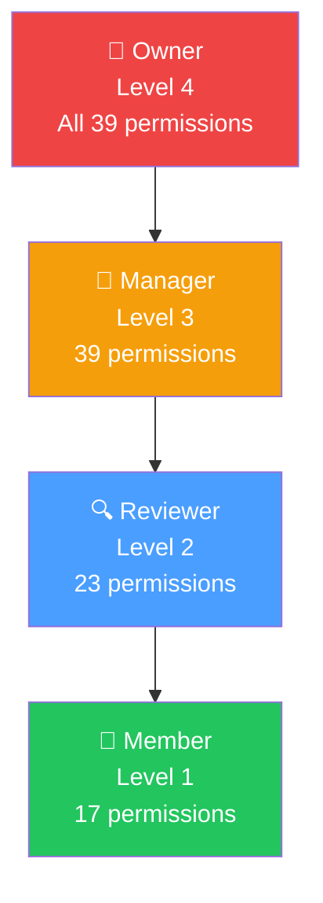

---

## API Architecture

### Endpoint Structure

```mermaid
graph LR
    subgraph "API Modules"
        Auth["/auth/*<br/>13 endpoints"]
        Workspace["/workspaces/*<br/>11 endpoints"]
        Projects["/projects/*<br/>5 endpoints"]
        Scans["/scans/*<br/>7 endpoints"]
        Findings["/findings/*<br/>8 endpoints"]
        Repos["/repositories/*<br/>7 endpoints"]
        SCM["/source-controls/*<br/>8 endpoints"]
        AI["/ai-models/*<br/>2 endpoints"]
        KB["/knowledge/*<br/>7 endpoints"]
        Webhooks["/webhooks/*<br/>3 endpoints"]
        Reports["/reports/*<br/>4 endpoints"]
        Dashboard["/dashboard/*<br/>4 endpoints"]
        Others["/teams, /members,<br/>/schedules, etc."]
    end
```

### Response Format

```json
{
  "success": true,
  "message": "Data retrieved successfully",
  "data": { ... },
  "meta": {
    "requestId": "abc-123",
    "timestamp": "2026-06-27T00:00:00Z",
    "pagination": {
      "page": 1,
      "limit": 20,
      "total": 150,
      "totalPages": 8
    }
  }
}
```

### HTTP Status Codes

| Code | Usage |
|------|-------|
| 200 | Success |
| 201 | Created |
| 204 | No Content (delete) |
| 401 | Unauthorized (no/invalid token) |
| 403 | Forbidden (missing permissions) |
| 404 | Not Found |
| 409 | Conflict (duplicate) |
| 410 | Gone (expired invitation) |
| 422 | Validation Error (Zod) |

---

## Client Architecture

### Module Pattern

```mermaid
graph TB
    subgraph "Module: {domain}/"
        API["api.ts<br/>HTTP calls"]
        Keys["keys.ts<br/>Query key factory"]
        Queries["queries.ts<br/>React Query hooks"]
        Types["types.ts<br/>TypeScript types"]
        Index["index.ts<br/>Barrel export"]
    end

    API --> Queries
    Keys --> Queries
    Types --> API
    Types --> Queries

    subgraph "Consumer"
        Feature["Feature Component"]
    end

    Feature --> Queries
    Feature --> Types

    style Queries fill:#4a9eff,color:#fff
    style API fill:#f59e0b,color:#fff
```

### Data Flow (Client → Server → DB)

```mermaid
flowchart LR
    A["React Component"] --> B["useQuery / useMutation"]
    B --> C["module/queries.ts"]
    C --> D["module/api.ts"]
    D --> E["Axios Client<br/>(auto-refresh)"]
    E --> F["Route Handler"]
    F --> G["Service"]
    G --> H["Repository"]
    H --> I["Drizzle ORM"]
    I --> J[("PostgreSQL")]
    J --> I
    I --> H
    H --> G
    G --> F
    F --> E
    E --> D
    D --> C
    C --> B
    B --> A

    style A fill:#4a9eff,color:#fff
    style J fill:#336791,color:#fff
```

### Layout Architecture

```mermaid
graph TB
    Root["Root Layout<br/>AntdProvider"] --> AuthLayout["Unauthenticated Layout<br/>QueryProvider + AuthWrapper"]
    Root --> PubLayout["Public Layout<br/>Landing/Docs Navbar"]
    Root --> AppLayout["Authenticated Layout<br/>QueryProvider + AuthShell"]

    AuthLayout --> Signin["Signin"]
    AuthLayout --> Signup["Signup"]
    AuthLayout --> ForgotPw["Forgot Password"]
    AuthLayout --> ResetPw["Reset Password"]

    PubLayout --> Landing["Landing Page"]
    PubLayout --> Docs["Documentation"]

    AppLayout --> Shell["AppShell"]
    Shell --> Sidebar["Sidebar (260px)<br/>18 nav items"]
    Shell --> Topbar["Topbar (56px)<br/>Workspace Switcher"]
    Shell --> Content["Content Area<br/>(scrollable)"]

    Sidebar --> Nav1["Navigate: 6 items"]
    Sidebar --> Nav2["Manage: 4 items"]
    Sidebar --> Nav3["Configure: 8 items"]

    style AppLayout fill:#4a9eff,color:#fff
    style Shell fill:#1e293b,color:#fff
```

---

## Database Schema Overview

### Entity Relationship (Simplified)

```mermaid
erDiagram
    users ||--o{ workspace_members : "joins"
    workspaces ||--o{ workspace_members : "has"
    workspaces ||--o{ teams : "contains"
    teams ||--o{ team_members : "has"
    users ||--o{ team_members : "joins"
    workspaces ||--o{ projects : "contains"
    projects ||--o{ project_members : "has"
    users ||--o{ project_members : "joins"
    projects ||--o{ repositories : "owns"
    repositories ||--o{ scans : "triggers"
    scans ||--o{ findings : "produces"
    scans ||--o{ scan_results : "stores"
    findings ||--o{ finding_groups : "groups into"
    finding_groups ||--o{ ai_verifications : "verified by"
    scans ||--o{ quality_gate_results : "evaluated by"
    workspaces ||--o{ quality_gates : "configures"
    workspaces ||--o{ source_controls : "connects"
    source_controls ||--o{ source_control_repositories : "syncs"
    workspaces ||--o{ webhooks : "creates"
    workspaces ||--o{ schedules : "manages"
    workspaces ||--o{ ai_models : "uses"
    workspaces ||--o{ knowledge_sources : "imports"
    knowledge_sources ||--o{ knowledge_entries : "contains"
    workspaces ||--o{ reports : "generates"
    users ||--o{ sessions : "has"
```

### Table Count: 36 tables

| Domain | Tables | File |
|--------|--------|------|
| Users & Auth | users, sessions, user_settings, workspace_invitations, password_reset_tokens, email_verification_tokens, personal_access_tokens | users.ts, auth.ts |
| Workspaces | workspaces, workspace_members, workspace_settings | workspaces.ts |
| Teams | teams, team_members | teams.ts |
| Projects | projects, project_members, project_teams, environments, project_api_tokens | projects.ts |
| Source Control | source_controls, source_control_repositories, source_control_imports, repositories | source-controls.ts |
| Scans | scans, scan_results, quality_gates, quality_gate_results, schedules, scan_uploads, commit_statuses | scans.ts |
| Findings | finding_groups, findings, ai_verifications, finding_history, finding_group_scans | findings.ts |
| Integrations | ai_models, webhooks, webhook_deliveries, audit_logs, activity_logs, knowledge_sources, knowledge_entries, knowledge_backfill_jobs | integrations.ts |
| Reports | reports, storage_files | reports.ts |

---

## Environment Architecture

```mermaid
graph TB
    subgraph "Client-Side (Browser)"
        PUBLIC["NEXT_PUBLIC_*<br/>12 feature flags<br/>+ app URL"]
    end

    subgraph "Server-Side (Node.js)"
        REQUIRED["Required<br/>DATABASE_URL<br/>JWT_SECRET<br/>NODE_ENV"]
        OPTIONAL["Optional<br/>PORT, MAIL_PROVIDER<br/>STORAGE_PROVIDER<br/>WORKSPACE_MODE"]
        FEATURES["Feature Flags<br/>FEATURE_FLAG_*<br/>(17 flags)"]
    end

    subgraph "Build-Time"
        NEXT_PUBLIC["NEXT_PUBLIC_*<br/>Bundled into client"]
    end

    PUBLIC --> NEXT_PUBLIC
    REQUIRED --> Server["Server Runtime"]
    OPTIONAL --> Server
    FEATURES --> Server

    style Server fill:#ef4444,color:#fff
    style NEXT_PUBLIC fill:#4a9eff,color:#fff
```
