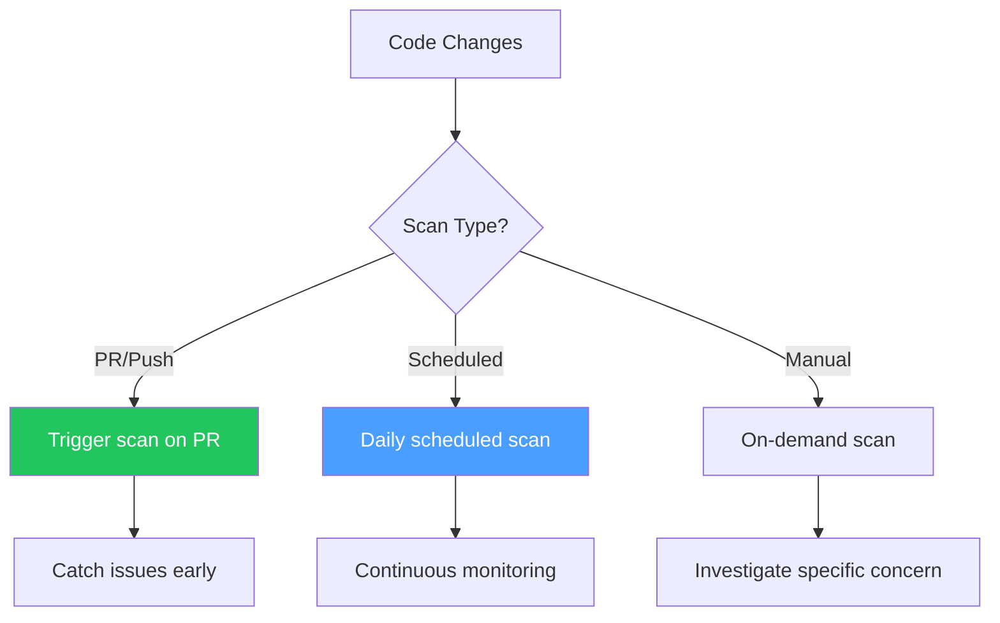
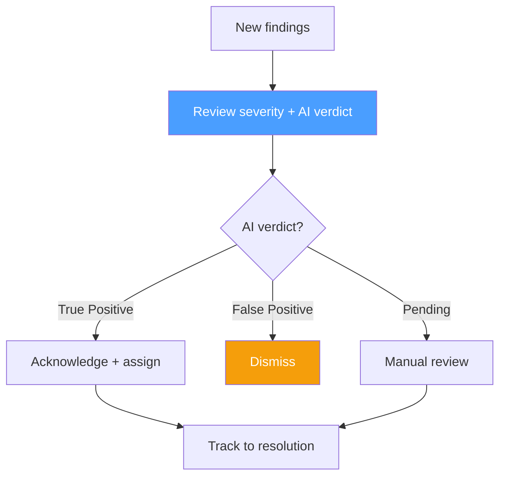

# Best Practices

## Scanner Selection

| Codebase | Recommended Scanners |
|----------|---------------------|
| Multi-language | Semgrep + Gitleaks |
| C/C++ | Semgrep + Flawfinder + Cppcheck + Clang-Tidy + GCC FanAnalyzer |
| JavaScript/TypeScript | Semgrep + Gitleaks |
| Python | Semgrep + Gitleaks |
| Java | Semgrep + Gitleaks |

## Scan Frequency

## Finding Triage Workflow

## Repository Organization

- Group related repositories in projects
- Use descriptive names and descriptions
- Set appropriate default branches
- Enable auto-scan for critical repositories

## Team-Based Access Control

- Assign appropriate roles (Owner/Manager/Reviewer/Member)
- Use teams for project-level access
- Review permissions regularly

## Quality Gate Configuration

- Enable `fail_on_critical` for all workspaces
- Set `fail_on_high` for production codebases
- Use `pending_behavior: warn` during initial adoption
- Enable `require_human_ack` for high-security projects
