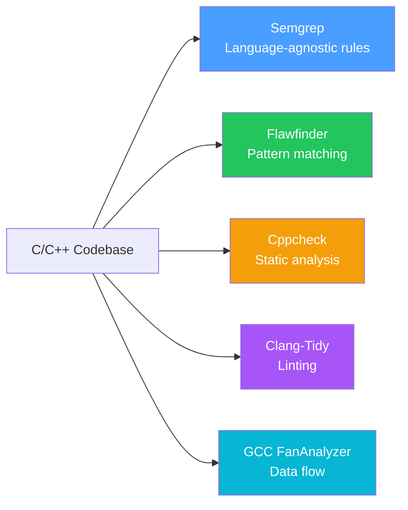

# C/C++ Security Guide

## Overview

C/C++ code requires special attention due to memory safety issues. This guide covers common vulnerabilities and scanner recommendations.

## Common Vulnerabilities

| Vulnerability | CWE | Scanner | Description |
|---------------|-----|---------|-------------|
| Buffer Overflow | CWE-120 | Flawfinder, Cppcheck | Writing beyond array bounds |
| Format String | CWE-134 | Flawfinder | User input in format strings |
| Use-After-Free | CWE-416 | Clang-Tidy, GCC | Accessing freed memory |
| Integer Overflow | CWE-190 | Cppcheck | Arithmetic overflow |
| Null Dereference | CWE-476 | Cppcheck, Clang-Tidy | Pointer used without null check |
| Memory Leak | CWE-401 | Cppcheck, GCC | Unallocated memory |

## Recommended Scanner Combination

## Scanner Capabilities

| Scanner | Strengths | Weaknesses |
|---------|-----------|------------|
| **Flawfinder** | Fast, pattern-based, low false negatives | High false positives |
| **Cppcheck** | Deep analysis, no compilation needed | Slower, requires source |
| **Clang-Tidy** | Rich checks, fix suggestions | Requires compilation setup |
| **GCC FanAnalyzer** | Data flow analysis, deep | Requires GCC, slower |

## Best Practices

1. Use **Semgrep + Gitleaks** for all languages
2. Add **Flawfinder** for quick C/C++ checks
3. Use **Cppcheck** for deeper analysis
4. Enable **Clang-Tidy** if build system is available
5. Use **GCC FanAnalyzer** for critical C/C++ code
