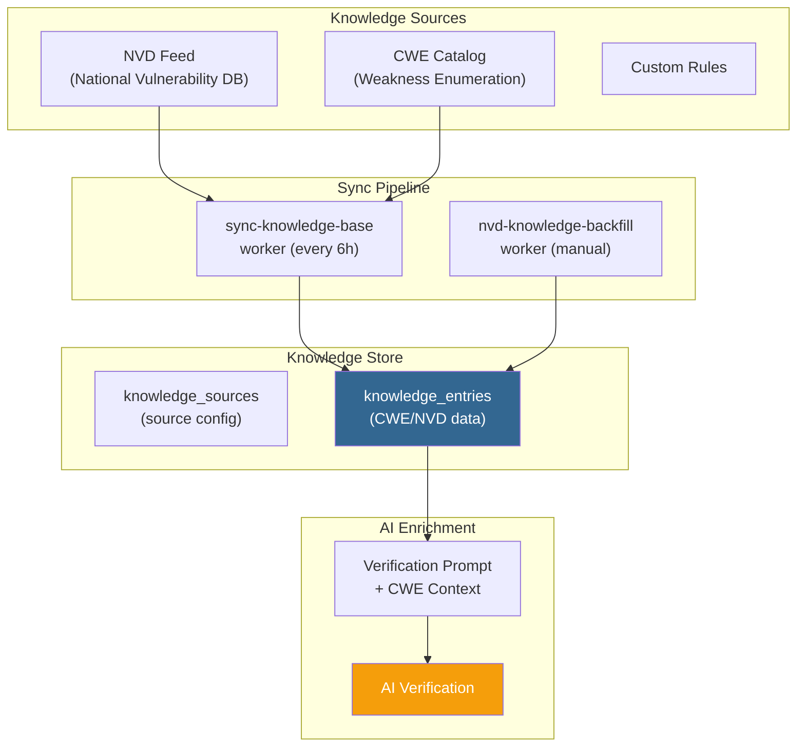
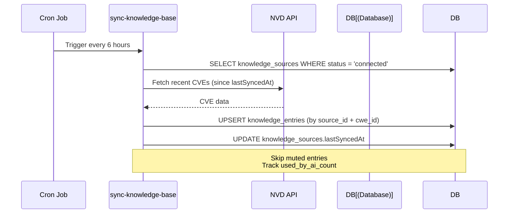
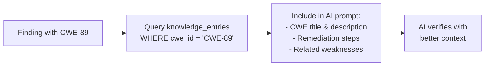

# Knowledge Base Flow

CWE/NVD knowledge management for AI verification context.

## Pre-conditions
- Knowledge sources configured (NVD/CWE)
- User has KNOWLEDGE_VIEW permission

## Role Context
| Action | Owner | Manager | Reviewer | Member |
|--------|-------|---------|----------|--------|
| View entries | ✅ | ✅ | ✅ | ✅ |

## Architecture

## Sync Flow

Server-managed background sync (no user action required):

## AI Usage

During AI verification, the system enriches prompts with relevant knowledge:

## User Scenarios

### 1. View Knowledge Base
1. User navigates to Knowledge Base page
2. Table shows entries with:
   - Name
   - Source (NVD/CWE)
   - Severity
   - Status (Active/Muted)
3. Filterable by source and severity

### 2. Search Entries
1. User types in search box
2. Results filtered by name, description
3. Pagination updates

### 3. View Entry Details
1. User clicks entry row
2. Modal shows:
   - Full description
   - Affected versions
   - References
   - Related findings

## Knowledge Sources
| Source | Description |
|--------|-------------|
| NVD | National Vulnerability Database |
| CWE | Common Weakness Enumeration |
| Custom | Workspace-specific rules |

## Pre-condition Checks
- Knowledge base requires KNOWLEDGE_VIEW permission
- All sync and backfill operations are server-managed
