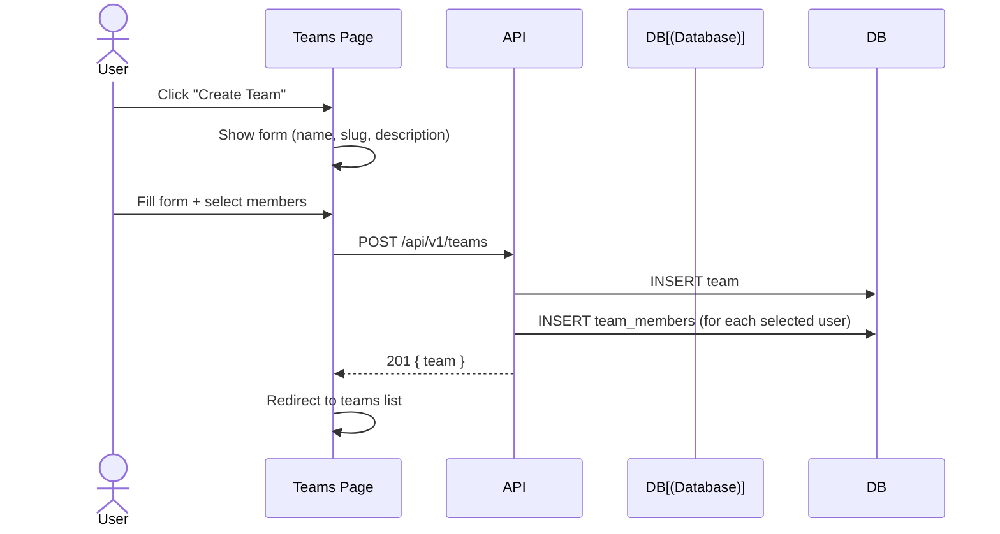
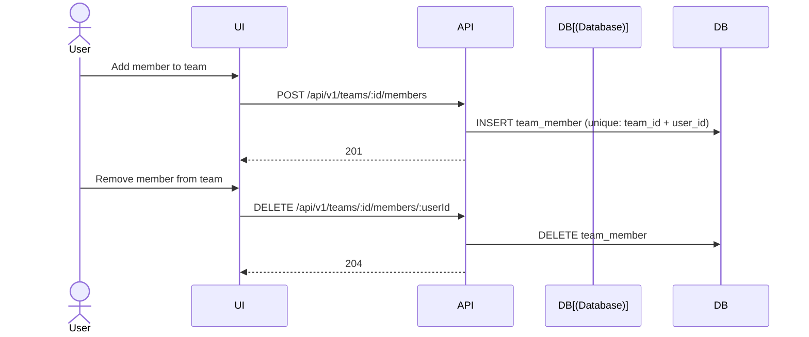
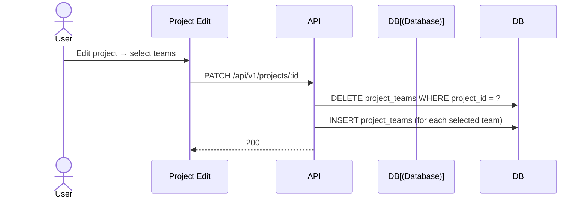

# Teams Flow

Team management within a workspace.

## Pre-conditions
- User has TEAMS feature flag enabled
- User has appropriate permissions

## Role Context
| Action | Owner | Manager | Reviewer | Member |
|--------|-------|---------|----------|--------|
| View teams | ✅ | ✅ | ✅ | ✅ |
| Create team | ✅ | ✅ | ❌ | ❌ |
| Edit team | ✅ | ✅ | ❌ | ❌ |
| Delete team | ✅ | ✅ | ❌ | ❌ |
| Add member | ✅ | ✅ | ❌ | ❌ |
| Link project | ✅ | ✅ | ❌ | ❌ |

## Sequence Diagrams

### Create Team

### Add/Remove Members

### Assign Team to Project

## User Scenarios

### 1. Create Team
1. User navigates to Teams page
2. Clicks "New team"
3. Enters name and description
4. Clicks "Create"
5. Team created, user becomes Manager

### 2. View Team List
1. Table shows all teams with:
   - Name
   - Member count
   - Project count
   - Created date
2. Searchable by name

### 3. View Team Details
1. User clicks team row
2. Detail drawer shows:
   - Team info
   - Members list
   - Linked projects

### 4. Manage Members
1. Team Manager clicks "Add member"
2. Selects from workspace members
3. Member added to team
4. Can remove members later

### 5. Link Projects
1. Team Manager clicks "Add project"
2. Selects from workspace projects
3. Project linked to team
4. Team members get project access

### 6. Edit Team
1. Manager clicks "Edit"
2. Can update: name, description
3. Changes saved

### 7. Delete Team
1. Owner clicks "Delete"
2. Confirmation dialog
3. Team removed
4. Project links removed
5. Members lose team-based access

## Pre-condition Checks
- Team creation requires TEAM_MANAGE permission
- Member management requires TEAM_MANAGE permission
- Delete requires TEAM_MANAGE permission
