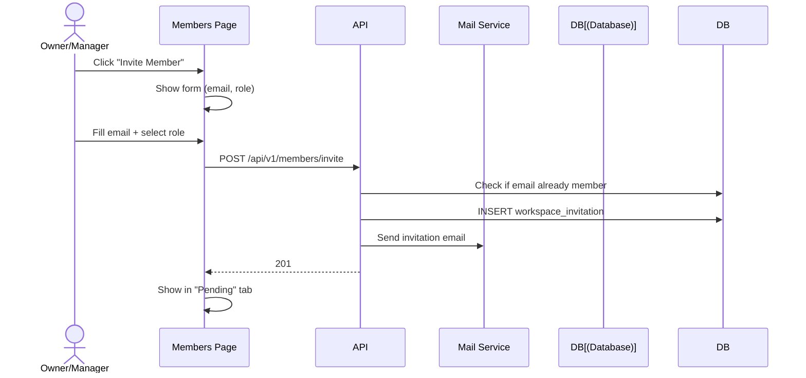
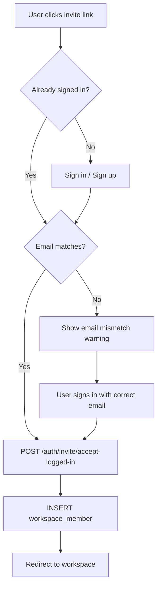
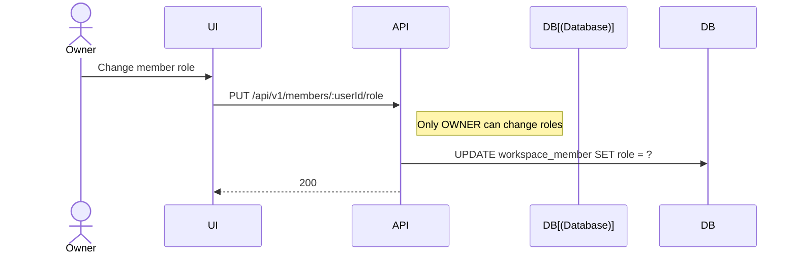
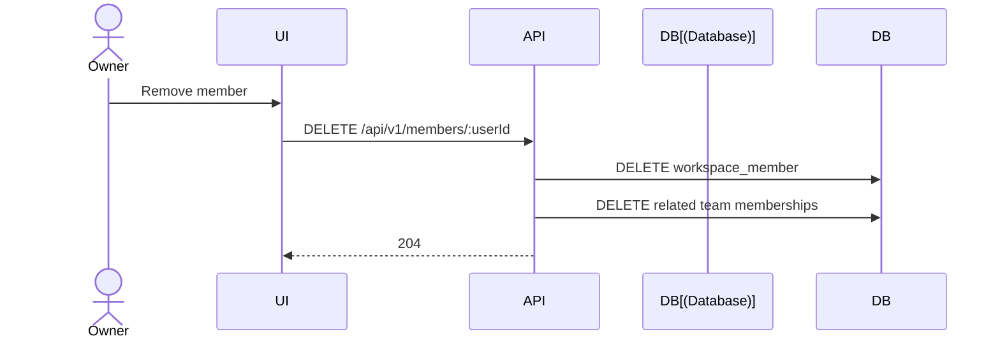

# Members Flow

Workspace member management and invitations.

## Invite Member

## Accept Invitation

## Change Role

## Remove Member

## Role Permissions

| Role | Can Invite | Can Remove | Can Change Roles |
|------|-----------|------------|-----------------|
| Owner | ✅ | ✅ | ✅ |
| Manager | ✅ | ✅ | ❌ |
| Reviewer | ❌ | ❌ | ❌ |
| Member | ❌ | ❌ | ❌ |
