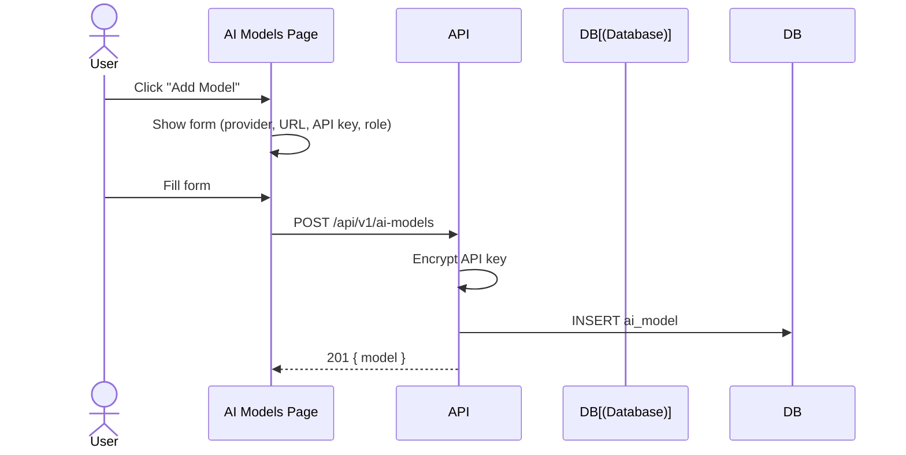
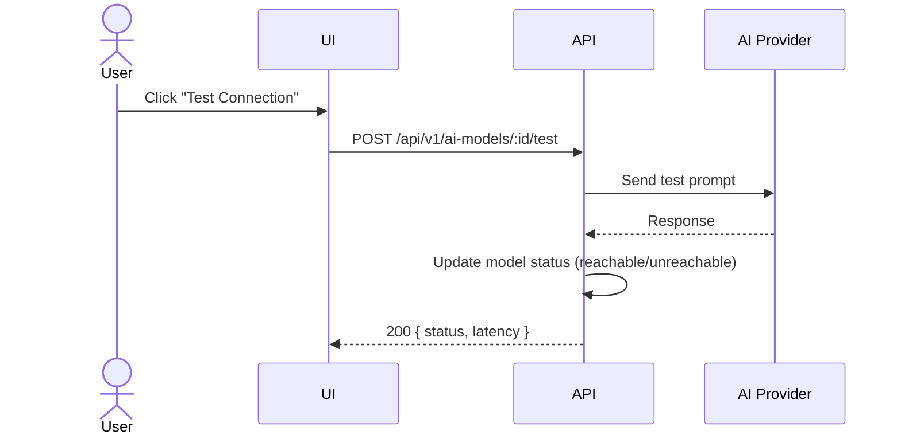
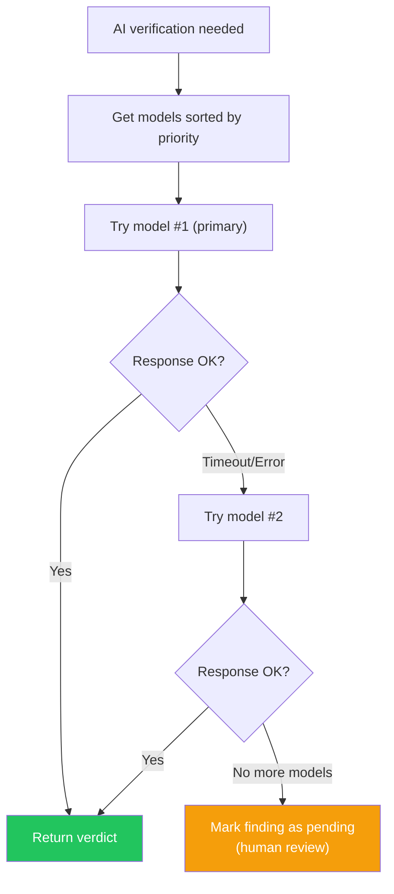

# AI Models Flow

AI model configuration for finding verification.

## Pre-conditions
- User has AI_MODELS permission
- Provider API key configured

## Role Context
| Action | Owner | Manager | Reviewer | Member |
|--------|-------|---------|----------|--------|
| View models | ✅ | ✅ | ✅ | ✅ |
| Add model | ✅ | ✅ | ❌ | ❌ |
| Remove model | ✅ | ✅ | ❌ | ❌ |
| Set active | ✅ | ✅ | ❌ | ❌ |
| Test model | ✅ | ✅ | ❌ | ❌ |

## User Scenarios

### 1. View Models
1. User navigates to AI Models page
2. Table shows all models with:
   - Name
   - Provider
   - Role (Primary/Fallback)
   - Status (Reachable/Unreachable)
3. Sorted by priority

### 2. Add Model
1. User clicks "Add model"
2. Selects provider (OpenAI/Anthropic/Ollama/etc)
3. Fills in: name, API key, model ID
4. Clicks "Test connection"
5. If successful, clicks "Add"
6. Model added to chain

### 3. Configure Fallback Chain
1. User sees model list with reorder buttons
2. Can move models up/down
3. Primary model runs first
4. Fallbacks tried in order on timeout

### 4. Set Active Model
1. User clicks "Set Active" on fallback model
2. Model promoted to primary
3. Previous primary demoted to fallback
4. Chain order updated

### 5. Remove Model
1. User clicks "Remove" on model
2. Confirmation dialog
3. Model removed from chain
4. Chain re-ordered

### 6. Test Model
1. User clicks "Test" on model
2. Sends test prompt
3. Shows response time and quality
4. Updates status (Reachable/Unreachable)

## Fallback Chain

## Model Roles
| Role | Purpose | Behavior |
|------|---------|----------|
| `primary` | First choice for verification | Tried first in fallback chain |
| `fallback` | Backup when primary fails | Tried after primary timeout/error |

## Supported Providers
| Provider | Default Base URL | Auth Type | Notes |
|----------|-----------------|-----------|-------|
| Ollama | `http://localhost:11434` | URL only | Local, free |
| OpenAI | `https://api.openai.com/v1` | API Key | Cloud, paid |
| Anthropic | `https://api.anthropic.com` | API Key | Cloud, paid |
| Groq | `https://api.groq.com/openai/v1` | API Key | Cloud, fast |
| Modal | Custom | API Key | Serverless GPU |
| Custom | User-defined | API Key + Base URL | Any OpenAI-compatible API |

## Prompt Presets
| Preset | Description |
|--------|-------------|
| `strict` | Conservative, high precision |
| `balanced` | Default, good precision/recall |
| `aggressive` | Catch more, may have more FP |

## Pre-condition Checks
- Model requires valid API key
- Primary model must always exist
- Fallback chain max 5 models
