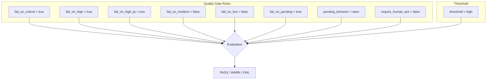
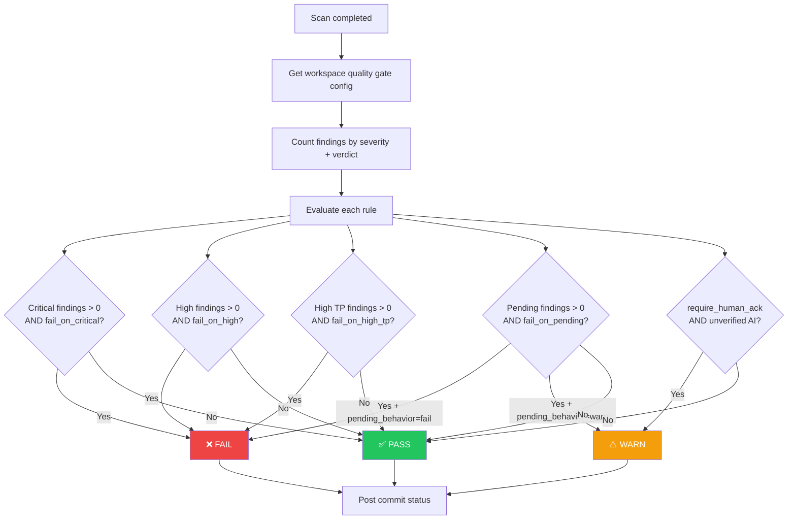
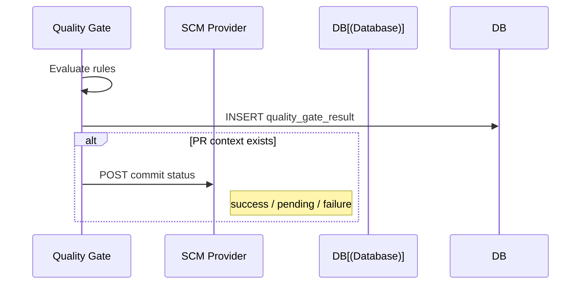

# Quality Gates Flow

Automated scan quality evaluation.

## Pre-conditions
- User has QUALITY_GATES permission
- At least one scan completed

## Role Context
| Action | Owner | Manager | Reviewer | Member |
|--------|-------|---------|----------|--------|
| View gate config | ✅ | ✅ | ✅ | ✅ |
| Configure gate | ✅ | ✅ | ❌ | ❌ |
| Override (project) | ✅ | ✅ | ❌ | ❌ |
| View gate results | ✅ | ✅ | ✅ | ✅ |

## Configuration

## Evaluation Flow

## Commit Status Integration

## PR Context (Diff Analysis)

When scanning a PR, quality gates also track:

| Metric | Description |
|--------|-------------|
| `new_findings` | Findings new in this PR |
| `fixed_findings` | Findings fixed in this PR |
| `persistent_findings` | Pre-existing findings |
| `blocking_findings` | Findings that fail the gate |

## User Scenarios

### 1. Configure Quality Gate
1. User navigates to Quality Gates page
2. Toggles settings:
   - Fail on critical findings
   - Fail on high TP findings
   - Warn on pending AI verification
   - Require human acknowledgement
3. Sets thresholds and behaviors
4. Clicks "Save settings"

### 2. View Gate Results
1. User goes to scan detail page
2. Gate evaluation shown:
   - Pass/Fail status
   - Which rules triggered
   - Findings that caused failure

### 3. Override Gate (Project Level)
1. Project Manager goes to project settings
2. Overrides workspace-level gate rules
3. Project-specific rules applied

### 4. PR Review Integration
1. Source control sends PR event
2. Gate evaluated against PR changes
3. Pass/Fail status posted to PR
4. Comments with finding details

## Gate Rules
| Rule | Description |
|------|-------------|
| Fail on Critical | Block merge if critical finding |
| Fail on High TP | Block if AI confirms high severity |
| Warn on Pending | Show warning for unverified findings |
| Require Human Ack | Manual approval required |

## Pre-condition Checks
- Gate requires QUALITY_GATES feature flag enabled
- PR review requires source control connected
- Override requires PROJECT_MANAGE permission
