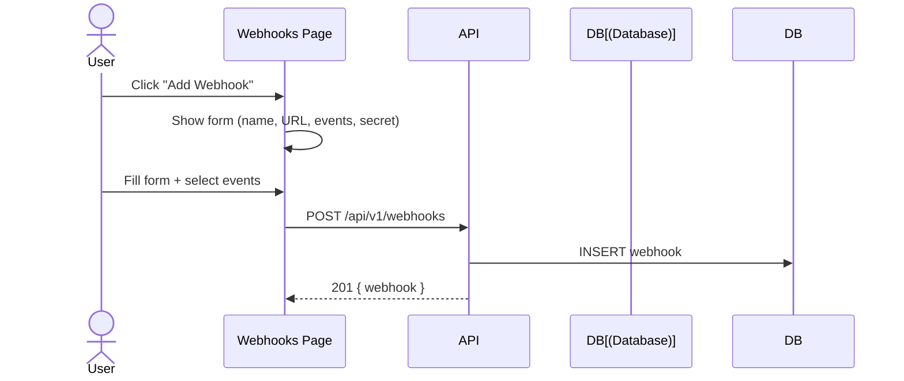
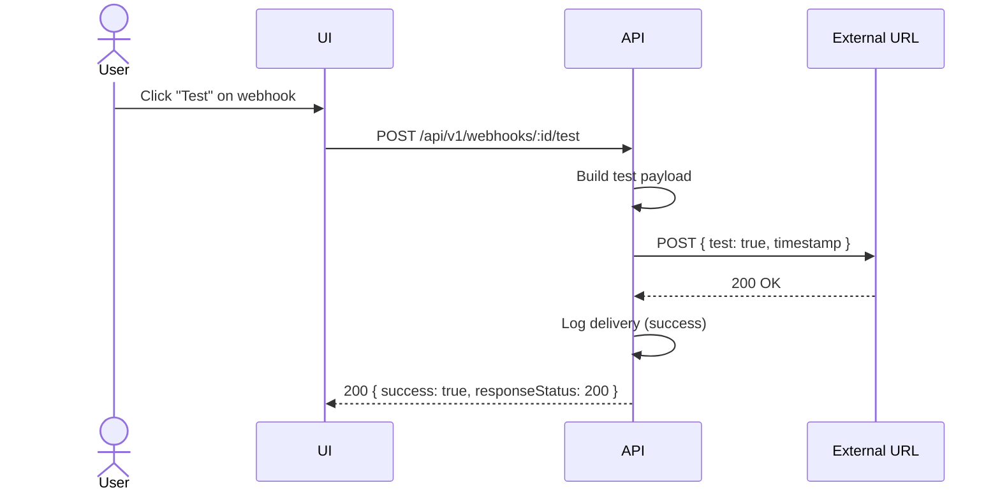
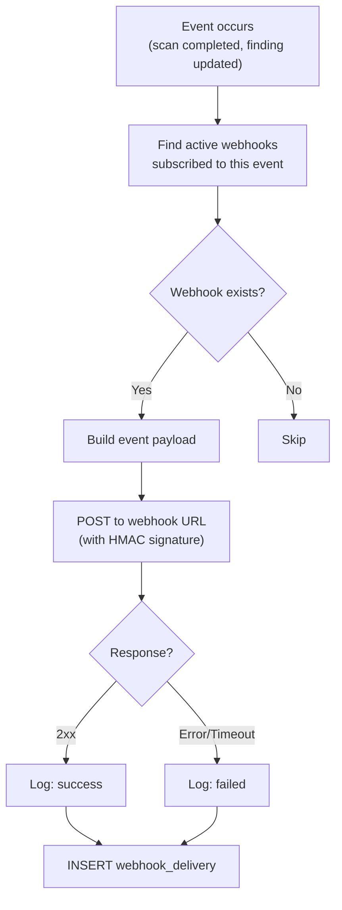

# Webhooks Flow

Outgoing webhook management for external integrations.

## Pre-conditions
- User has WEBHOOKS feature flag enabled
- Source control connected

## Role Context

| Action | Owner | Manager | Reviewer | Member |
|--------|-------|---------|----------|--------|
| View webhooks | ✅ | ✅ | ✅ | ✅ |
| Create webhook | ✅ | ✅ | ❌ | ❌ |
| Edit webhook | ✅ | ✅ | ❌ | ❌ |
| Delete webhook | ✅ | ✅ | ❌ | ❌ |
| View deliveries | ✅ | ✅ | ✅ | ✅ |

## Sequence Diagrams

### Create Webhook

### Test Webhook

## Event Delivery Flowchart

## User Scenarios

### 1. Create Webhook
1. User navigates to Webhooks page
2. Clicks "New webhook"
3. Selects events to subscribe
4. Enters target URL
5. Clicks "Create"
6. Webhook created, test event sent

### 2. View Webhook List
1. Table shows all webhooks with:
   - Name
   - Events
   - Status (Active/Inactive)
   - Last delivery

### 3. Test Webhook
1. User clicks "Test" on webhook
2. Test event sent to URL
3. Response shown (success/failure)

### 4. View Delivery History
1. User clicks "View deliveries" on webhook
2. Drawer shows delivery log:
   - Event type
   - Status (Success/Failed/Pending)
   - HTTP status code
   - Duration
   - Timestamp

### 5. Edit Webhook
1. User clicks "Edit"
2. Can update: name, events, URL
3. Changes saved

### 6. Toggle Webhook
1. User clicks toggle switch
2. Webhook enabled/disabled
3. Events stop/start flowing

### 7. Delete Webhook
1. User clicks "Delete"
2. Confirmation dialog
3. Webhook removed
4. Events stop flowing

## Supported Events
| Event | Trigger |
|-------|---------|
| `scan.completed` | Scan finishes |
| `scan.failed` | Scan fails |
| `finding.created` | New finding detected |
| `finding.resolved` | Finding resolved |
| `finding.dismissed` | Finding dismissed |

## Delivery Status
| Status | Meaning |
|--------|---------|
| Success | 2xx response received |
| Failed | Error or timeout |
| Pending | Awaiting delivery |

## Delivery Log
Each delivery is recorded in `webhook_deliveries`:
- `event`: Which event triggered it
- `status`: success/failed/pending
- `response_status`: HTTP status code
- `request_body`: What was sent
- `response_body`: What was received
- `duration_ms`: Round-trip time

## Pre-condition Checks
- Webhook requires WEBHOOK_MANAGE permission
- Target URL must be reachable
- Events must be valid for provider type
