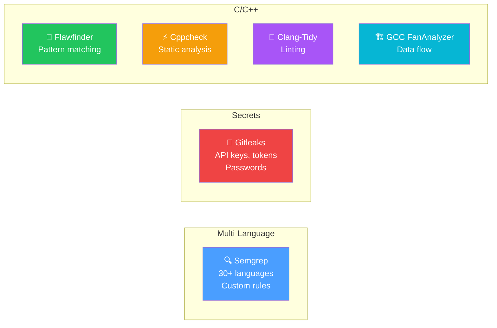
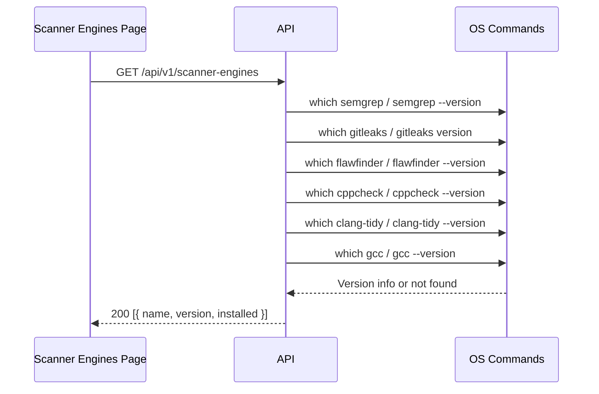
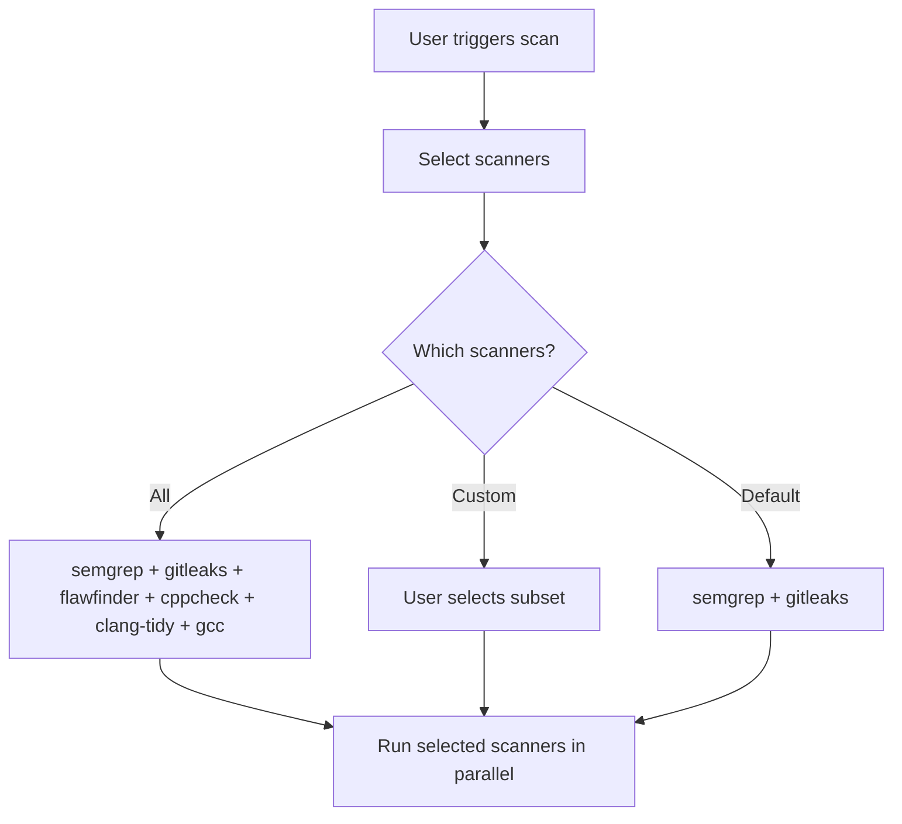

# Scanner Engines Flow

Scanner engine management and configuration.

## Pre-conditions
- User has SCANNER_ENGINES feature flag enabled
- User has SCANNER_VIEW permission

## Role Context
| Action | Owner | Manager | Reviewer | Member |
|--------|-------|---------|----------|--------|
| View engines | ✅ | ✅ | ✅ | ✅ |
| Browse rules | ✅ | ✅ | ✅ | ✅ |
| Probe all | ✅ | ✅ | ❌ | ❌ |
| Enable/Disable | ✅ | ✅ | ❌ | ❌ |

## Available Scanners



## Scanner Availability Check



## Scanner Selection per Scan



## Custom Rules

### Semgrep Rules
Custom rules directory: `./rules/semgrep/`

```yaml
# Example custom rule
rules:
  - id: custom-sql-injection
    pattern: |
      $QUERY = "SELECT ..." + $INPUT
      ...
    message: Potential SQL injection
    severity: ERROR
    languages: [python]
```

### Gitleaks Rules
Custom config: `GITLEAKS_CONFIG_PATH` env var

### Flawfinder Rules
Custom rules directory: `./rules/flawfinder/`

## User Scenarios

### 1. View Scanner Engines
1. User navigates to Scanner Engines page
2. Table shows all engines with:
   - Name
   - Status (Ready/Not installed)
   - Rules count
   - Enabled status

### 2. Probe All Engines
1. User clicks "Probe all"
2. System checks each engine's availability
3. Status updated for each engine
4. Success message shown

### 3. Browse Rules
1. User clicks "Browse rules" on engine
2. Drawer opens showing:
   - Rule name
   - Severity
   - CWE reference
   - File pattern
3. Searchable by rule name

### 4. Enable/Disable Engine
1. User toggles engine switch
2. Engine enabled/disabled
3. Scans skip disabled engines

### 5. View Rule Details
1. User clicks rule in rules browser
2. Shows:
   - Full description
   - Code pattern
   - Fix suggestion
   - References

## Scanner Engine Status
| Status | Meaning |
|--------|---------|
| Ready | Installed and available |
| Not installed | Engine not configured |

## Pre-condition Checks
- Probe requires SCANNER_MANAGE permission
- Rules browser read-only for viewers
- Engine toggle requires SCANNER_MANAGE permission
