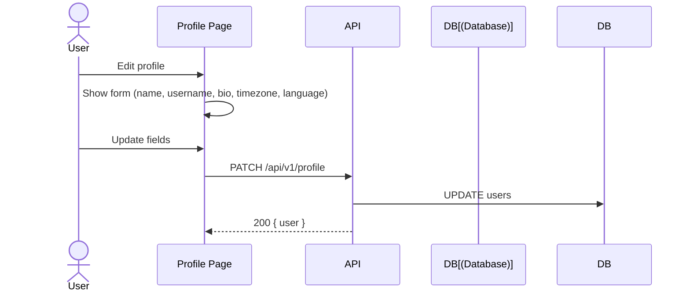
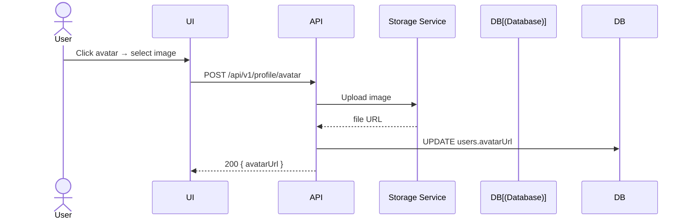
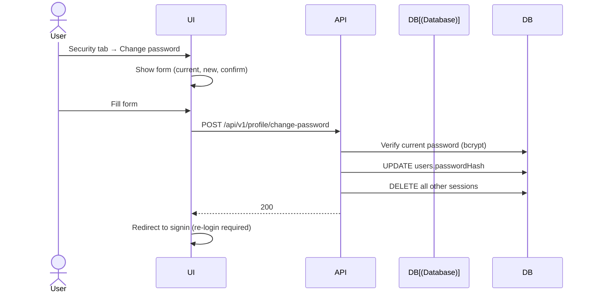
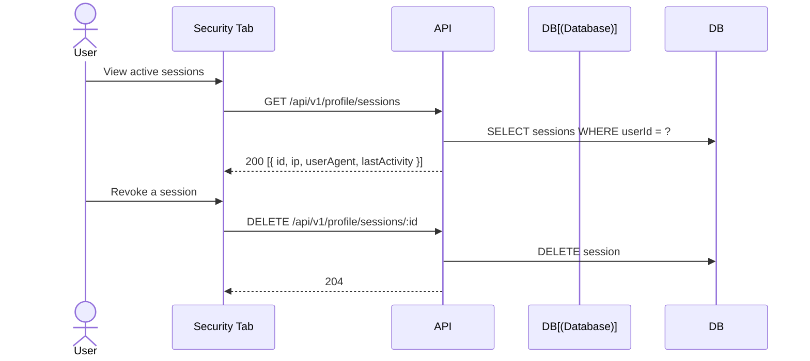

# Profile Flow

User profile and security management.

## Profile Management

## Avatar Upload

## Password Change

## Session Management

## Two-Factor Authentication (2FA)

| Status | Notes |
|--------|-------|
| Schema ready | `two_factor_secret` + `two_factor_confirmed_at` columns exist |
| Not yet implemented | Placeholder in Security tab UI |
| Future: TOTP | Will support Google Authenticator, Authy, etc. |
