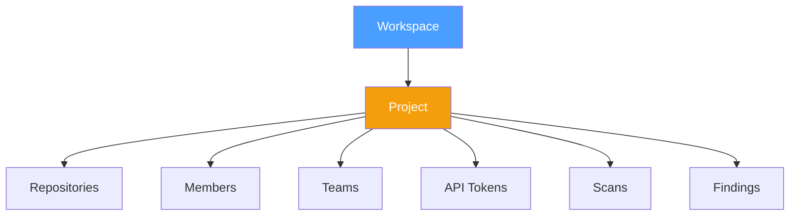
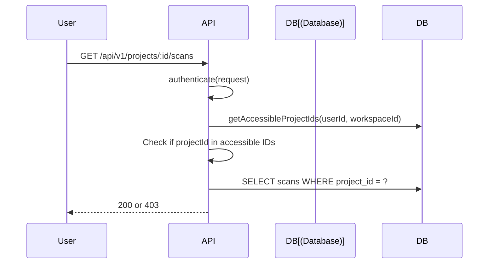
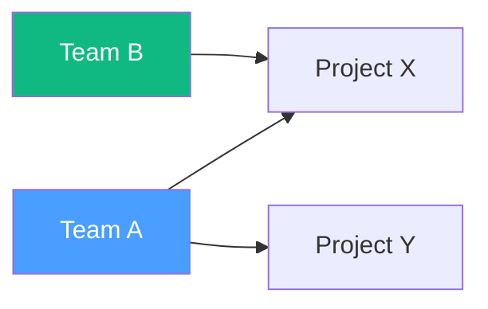

# Project Access Control

## Overview

Projects provide an additional layer of access control within workspaces.

## Project Structure

## Access Methods

| Method | Description |
|--------|-------------|
| **Direct membership** | User → project via `project_members` |
| **Team assignment** | Team → project via `project_teams` |
| **Workspace role** | Owner/Manager have full project access |

## Access Check Flow

## Project Members

| Role | Permissions |
|------|------------|
| Admin | Full project management |
| Member | View project data |

## Project Teams

Teams can be assigned to projects for group-based access:

