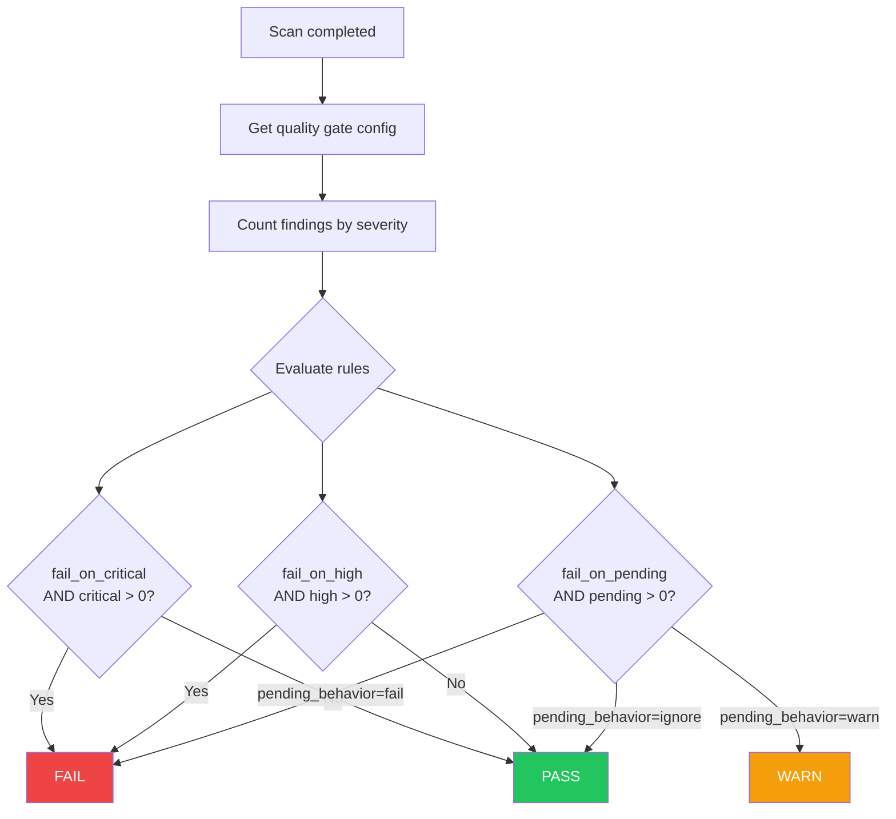
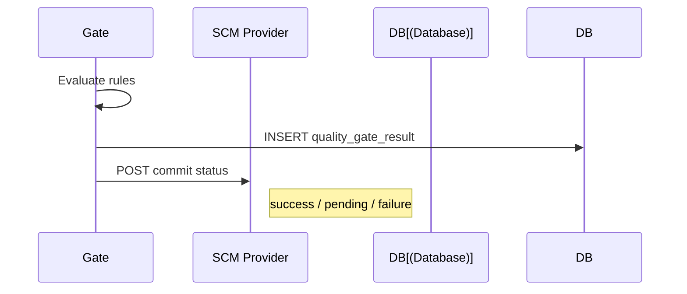

# Quality Gates

## Overview

Quality gates evaluate scan results against configurable thresholds and block merges when criteria are not met.

## Configuration

| Setting | Description | Default |
|---------|-------------|---------|
| `fail_on_critical` | Block on critical findings | `true` |
| `fail_on_high` | Block on high findings | `true` |
| `fail_on_high_tp` | Block on high true-positive findings | `true` |
| `fail_on_medium` | Block on medium findings | `false` |
| `fail_on_low` | Block on low findings | `false` |
| `fail_on_pending` | Block on pending findings | `true` |
| `pending_behavior` | How to handle pending | `warn` |
| `require_human_ack` | Require human acknowledgment | `false` |

## Evaluation Flow

## Commit Status Integration

## PR Context

When scanning a PR, quality gates track:

| Metric | Description |
|--------|-------------|
| `new_findings` | Findings new in this PR |
| `fixed_findings` | Findings fixed in this PR |
| `persistent_findings` | Pre-existing findings |
| `blocking_findings` | Findings that fail the gate |
