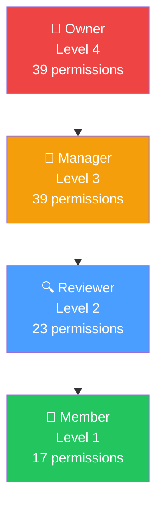
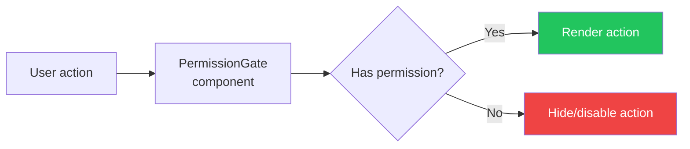

# Role-Based Access Control (RBAC)

## Overview

SAST Integration implements granular RBAC with 4 roles and 39 permissions.

## Role Hierarchy

## Permission Matrix

| Capability | Owner | Manager | Reviewer | Member |
|------------|:-----:|:-------:|:--------:|:------:|
| View dashboard | ✅ | ✅ | ✅ | ✅ |
| View findings | ✅ | ✅ | ✅ | ✅ |
| Trigger scans | ✅ | ✅ | ✅ | ❌ |
| Triage findings | ✅ | ✅ | ✅ | ❌ |
| Override AI verdict | ✅ | ✅ | ✅ | ❌ |
| Export reports | ✅ | ✅ | ✅ | ❌ |
| Manage members | ✅ | ✅ | ✅ | ❌ |
| Change member roles | ✅ | ✅ | ❌ | ❌ |
| Workspace settings | ✅ | ✅ | ❌ | ❌ |

## Permission Resources

| Resource | Permissions |
|----------|------------|
| `dashboard` | view |
| `repository` | view, manage |
| `scan` | view, run, upload |
| `finding` | view, triage, override_ai |
| `report` | view, export |
| `arena` | view, manage |
| `member` | view, invite, manage |
| `team` | view, manage |
| `project` | view, manage |
| `integration` | view, manage |
| `webhook` | view, manage |
| `schedule` | view, manage |
| `policy` | view, manage |
| `quality_gate` | view, manage |
| `scanner` | view, manage |
| `ai_model` | view, manage |
| `knowledge` | read, manage |
| `workspace` | view, settings |
| `audit` | read |

## Permission Checking

