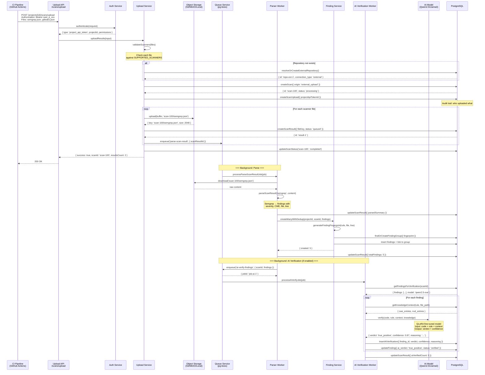
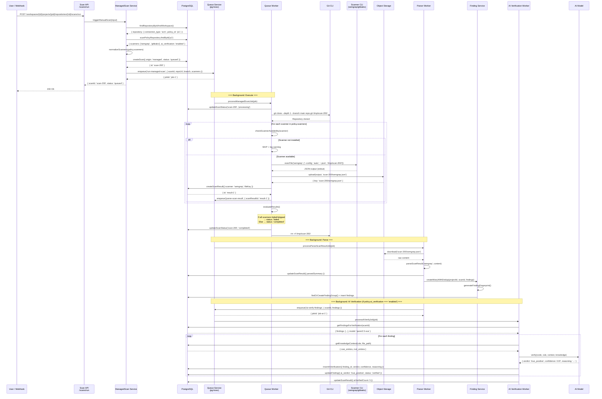
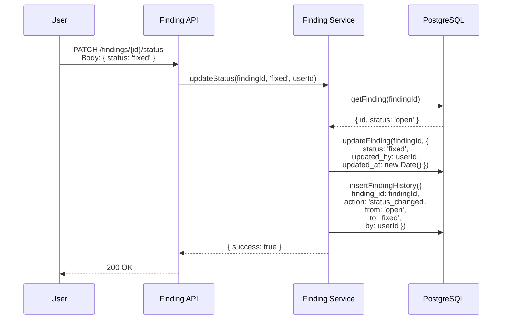
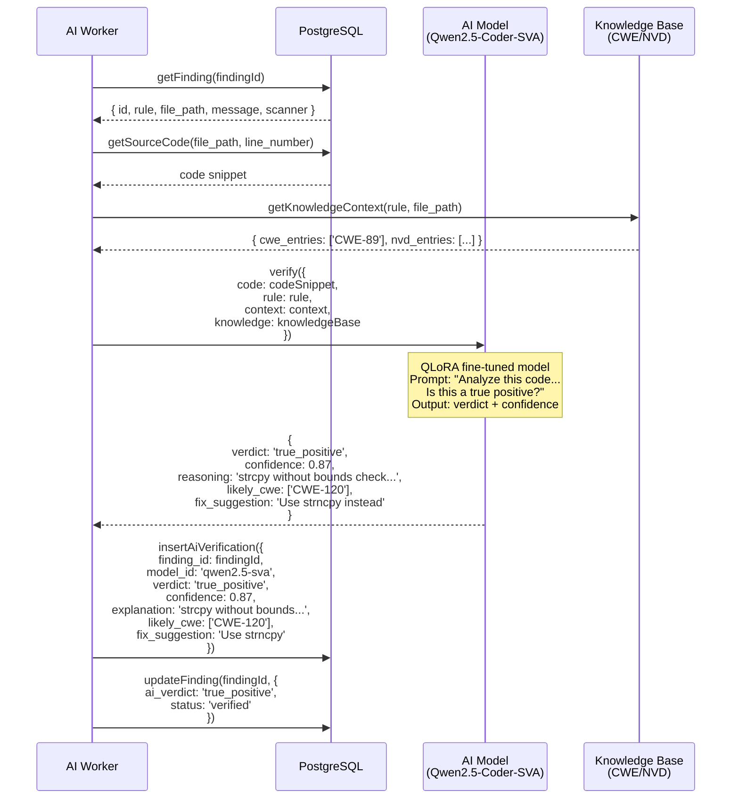

# Scan Flow Sequence Diagram

**Purpose**: This document provides detailed sequence diagrams for both scanning flows, showing the exact interaction between components including AI verification.

---

## Flow 1: External CI Upload (Complete Pipeline)



---

## Flow 2: Managed SCM Scan (Complete Pipeline)



---

## Flow 3: Finding Status Workflow



---

## AI Verification Detail



---

## Queue Job Chain

```
Upload/Trigger
    │
    ├──→ enqueue('run-managed-scan')  [Managed flow only]
    │         │
    │         ▼
    │    processManagedScanJob()
    │         │
    │         ├──→ enqueue('parse-scan-result')  [per scanner]
    │         │
    │         └──→ enqueue('ai-verify-findings')  [if policy.ai_verification = 'enabled']
    │
    └──→ enqueue('parse-scan-result')  [External flow]
              │
              ├──→ processParseScanResultJob()
              │         │
              │         ├──→ create findings with dedup
              │         │
              │         └──→ enqueue('ai-verify-findings')  [if enabled]
              │
              └──→ processAiVerifyJob()
                        │
                        ├──→ for each finding:
                        │      ├──→ getKnowledgeContext()
                        │      ├──→ LLM.verify()
                        │      ├──→ insertAiVerification()
                        │      └──→ updateFinding()
                        │
                        └──→ updateScanResult({ aiVerifiedCount })
```

---

## Storage Layout

```
/storage/
├── artifacts/                    # Scan reports (30-day retention)
│   └── scan-{id}/
│       ├── semgrep.json         # Raw scanner output
│       ├── gitleaks.json        # Raw scanner output
│       └── trivy.json           # Raw scanner output
├── reports/                      # Generated reports
│   └── report-{id}.pdf
├── backups/                      # Database dumps (7-day retention)
│   └── backup-{date}.sql
└── logs/                         # Application logs (7-day retention)
    └── app-{date}.log

/tmp/
└── scan-{id}/                   # Cloned repos (ephemeral)
    └── repo/                    # Git checkout
```

---

## Key Database Tables

| Table | Purpose | Key Columns |
|-------|---------|-------------|
| `scans` | Scan execution record | `origin`, `status`, `branch`, `commit_sha` |
| `scan_results` | Per-scanner results | `scanner`, `file_key`, `parsed_summary` |
| `scan_uploads` | Audit trail | `project_api_token_id`, `source` |
| `findings` | Individual findings | `severity`, `status`, `ai_verdict` |
| `finding_groups` | Deduplication groups | `fingerprint`, `first_seen_at` |
| `ai_verifications` | AI verification results | `verdict`, `confidence`, `reasoning` |
| `ai_models` | AI model configuration | `provider`, `base_url`, `role` |
| `scan_policies` | Reusable scan configs | `scanners[]`, `ai_verification` |

---

## Constants Reference

```ts
// src/server/modules/scan/constants.ts
SUPPORTED_SCANNERS = ['semgrep', 'cppcheck', 'gitleaks', 'trivy', 'flawfinder', 'sarif']
SCAN_ORIGINS = { MANAGED: 'managed', EXTERNAL_UPLOAD: 'external_upload' }
ASYNC_PARSE_THRESHOLD_BYTES = 5 * 1024 * 1024  // 5MB
MAX_UPLOAD_TOTAL_SIZE_BYTES = 50 * 1024 * 1024  // 50MB
RETENTION_DAYS = 30

// src/server/modules/scan/scanners.ts
DEFAULT_SCANNER_TIMEOUT_SECONDS = 300
DEFAULT_GIT_CLONE_DEPTH = 1
DEFAULT_MANAGED_SCAN_BRANCH = 'main'
MAX_SCANNER_OUTPUT_BUFFER_BYTES = 20 * 1024 * 1024  // 20MB
```
