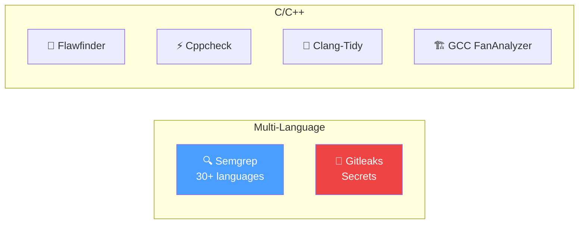
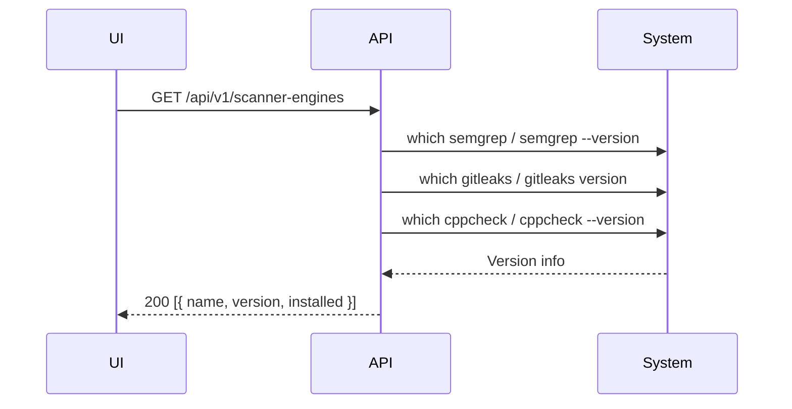

# Scanner Engines

## Overview

Configure and manage the 6 scanner engines available in the platform.

## Scanner Overview

| Scanner | Languages | Output | Binary |
|---------|-----------|--------|--------|
| Semgrep | 30+ | JSON | `semgrep` |
| Gitleaks | All | JSON | `gitleaks` |
| Flawfinder | C/C++ | SARIF | `flawfinder` |
| Cppcheck | C/C++ | XML | `cppcheck` |
| Clang-Tidy | C/C++ | Text | `clang-tidy` |
| GCC FanAnalyzer | C/C++ | Text | `gcc -fanalyzer` |

## Availability Check

## Custom Rules

| Scanner | Config | Directory |
|---------|--------|-----------|
| Semgrep | `SEMGREP_RULES_DIR` | `./rules/semgrep/` |
| Gitleaks | `GITLEAKS_CONFIG_PATH` | `./.gitleaks.toml` |
| Flawfinder | `FLAWFINDER_RULES_DIR` | `./rules/flawfinder/` |
