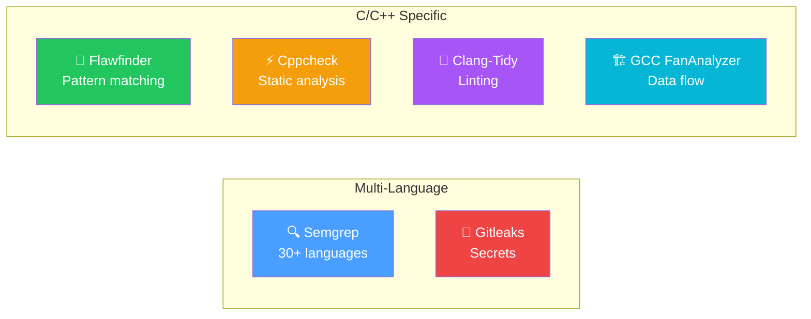

# Scanner Installation

SAST Integration supports 6 scanner engines. All are optional — install what your codebase needs.

## Scanner Overview

| Scanner | Languages | Detection | Install |
|---------|-----------|-----------|---------|
| **Semgrep** | 30+ | Vulnerabilities, code quality | `pip install semgrep` |
| **Gitleaks** | All | Secrets, API keys, tokens | Binary download |
| **Flawfinder** | C/C++ | Buffer overflows, format strings | `pip install flawfinder` |
| **Cppcheck** | C/C++ | Memory leaks, null derefs | `apt install cppcheck` |
| **Clang-Tidy** | C/C++ | Linting, security checks | `apt install clang-tidy` |
| **GCC FanAnalyzer** | C/C++ | Data flow analysis | GCC 10+ with `-fanalyzer` |



## Semgrep

```bash
pip install semgrep
semgrep --version
```

**Configuration:**
- Uses local rules from `rules/semgrep/` directory
- Custom rules: `SEMGREP_RULES_DIR` env var
- Metrics disabled by default (`--metrics=off`)
- Supports 30+ languages with 247+ built-in security rules

## Gitleaks

```bash
# Linux
wget https://github.com/gitleaks/gitleaks/releases/download/v8.18.4/gitleaks_8.18.4_linux_x64.tar.gz
tar xzf gitleaks_8.18.4_linux_x64.tar.gz
sudo mv gitleaks /usr/local/bin/

# macOS
brew install gitleaks
```

**Notes:**
- Runs with `--no-git` flag (shallow clone has incomplete history)
- Exit code 1 when leaks are found (expected behavior)
- Custom config: `GITLEAKS_CONFIG_PATH` env var

## Flawfinder

```bash
pip install flawfinder
flawfinder --version
```

**Output:** SARIF format with `--sarif --columns` flags.

## Cppcheck

```bash
# Ubuntu/Debian
sudo apt install cppcheck

# macOS
brew install cppcheck

# Verify
cppcheck --version
```

**Configuration:**
- Enables: warning, style, performance, portability, information
- Uses `--xml --xml-version=2` for structured output
- Optional suppressions: `CPPCHECK_SUPPRESSIONS_PATH` env var

## Clang-Tidy

```bash
# Ubuntu/Debian
sudo apt install clang-tidy

# macOS
brew install llvm
```

**Checks enabled:**
- `clang-analyzer-*`
- `cert-*`
- `bugprone-*`
- `security-*`

## GCC FanAnalyzer

Requires GCC 10+ with the analyzer feature:

```bash
# Verify GCC version
gcc --version

# Test analyzer support
echo 'int main(){}' > test.c
gcc -fanalyzer test.c
```

## Docker Installation

When building with `INCLUDE_SCANNERS=true`, all scanners are pre-installed:

```bash
docker build --build-arg INCLUDE_SCANNERS=true -t sast-integration .
```

This includes: semgrep, flawfinder, cppcheck, clang-tidy (via `clang18-extra-tools`), gcc, and gitleaks.

## Availability Check

The platform checks scanner availability before each scan:

```bash
GET /api/v1/scanner-engines
```

Unavailable scanners are skipped gracefully. Scans continue even if some scanners fail.
