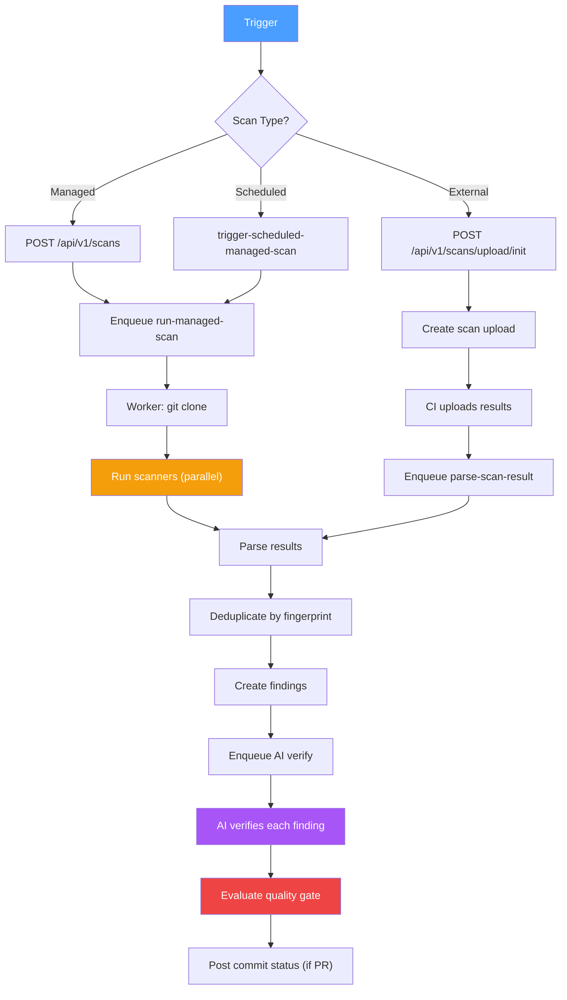
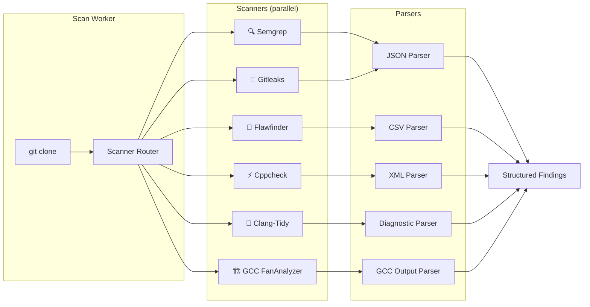
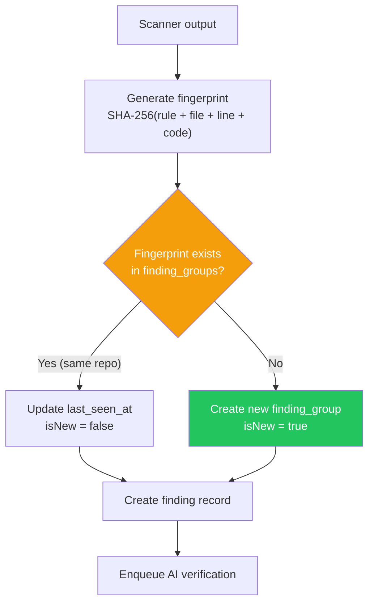
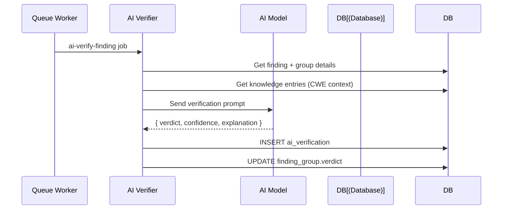
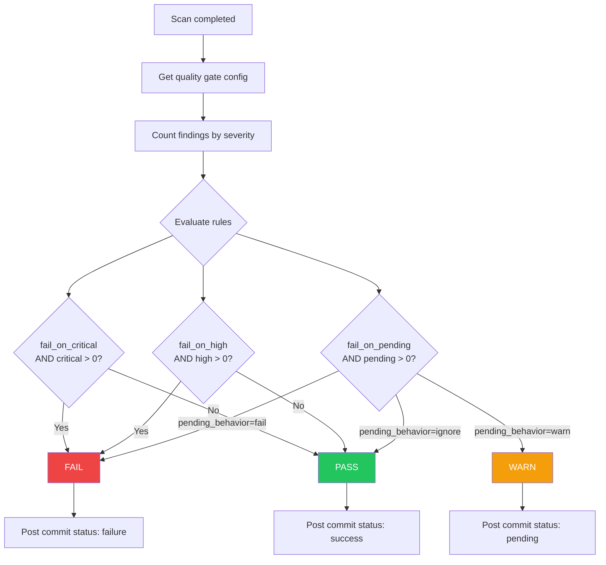
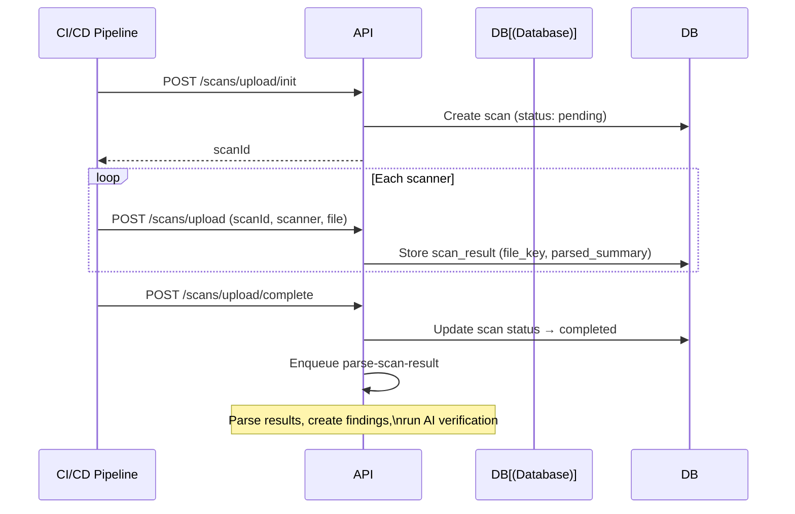

# Scan Pipeline

## Overview

The scan pipeline handles the complete lifecycle from trigger to findings.

## Pipeline Architecture



## Scan Lifecycle

```mermaid
stateDiagram-v2
    [*] --> pending: Trigger scan
    pending --> queued: Enqueued
    queued --> cloning: Worker picks up
    cloning --> scanning: Repo cloned
    scanning --> parsing: Scanner output
    parsing --> ai_verifying: Results parsed
    ai_verifying --> completed: AI verification done
    ai_verifying --> failed: Error occurred
    completed --> [*]
    failed --> [*]

    note right of pending: Managed: user triggers\nExternal: CI/CD upload
    note right of scanning: Multiple scanners run\nin parallel
```

| Stage | Description | Duration |
|-------|-------------|----------|
| `pending` | Scan record created | — |
| `queued` | Enqueued in pg-boss | Seconds |
| `cloning` | Git clone in progress | 10-30s |
| `scanning` | Scanners executing in parallel | 30s-5min |
| `parsing` | Output parsed into findings | 5-15s |
| `ai_verifying` | AI models verifying findings | 1-10min |
| `completed` | Scan finished | — |

## Scanner Execution



## Finding Deduplication



## Finding Deduplication

Each finding generates a **fingerprint** (SHA-256 hash of rule + file + line + code snippet). If a matching fingerprint exists in `finding_groups` for the same repository, it's an existing finding. Otherwise, a new `finding_group` is created.

## AI Verification

After findings are created, each finding is enqueued for AI verification:



## Quality Gate Evaluation



## External Upload (CI/CD)


