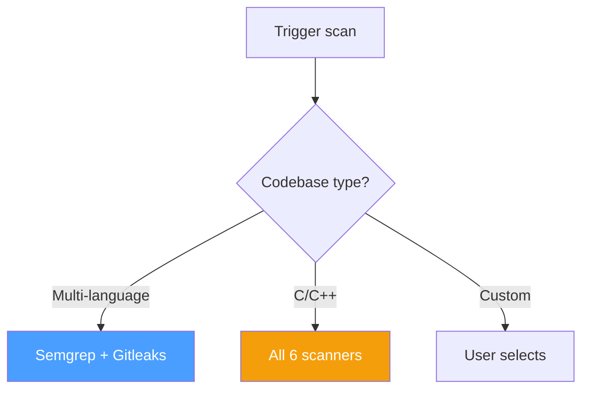

# Scan Policies

## Overview

Scan policies define which scanners to run and how to handle results.

## Default Scanners

| Scanner | Default | Notes |
|---------|:-------:|-------|
| Semgrep | ✅ | Always recommended |
| Gitleaks | ✅ | Always recommended |
| Flawfinder | ❌ | C/C++ only |
| Cppcheck | ❌ | C/C++ only |
| Clang-Tidy | ❌ | C/C++ only |
| GCC FanAnalyzer | ❌ | C/C++ only |

## Scanner Selection

## Branch Patterns

| Pattern | Description |
|---------|-------------|
| `main` | Default branch |
| `develop` | Development branch |
| `feature/*` | Feature branches |
| `release/*` | Release branches |
