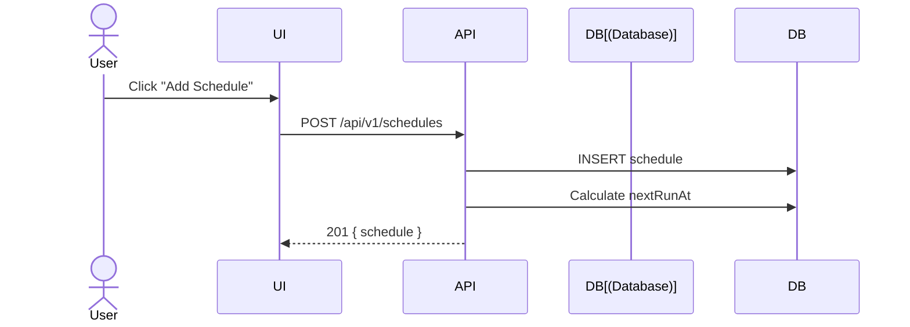
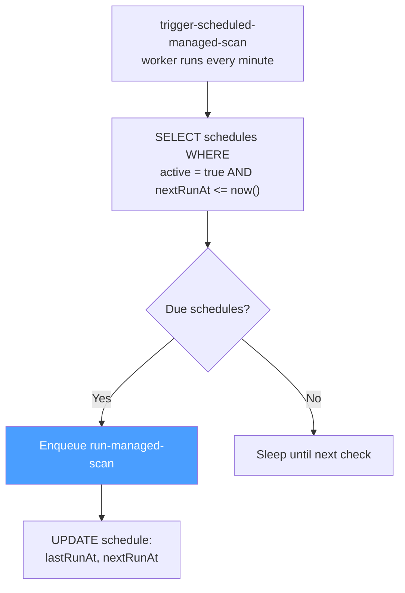
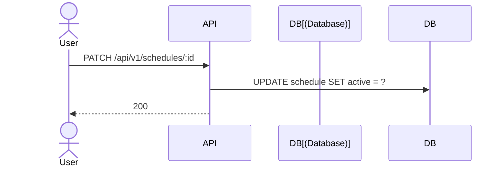

# Schedules

## Overview

Schedules automate recurring scans using cron expressions.

## Create Schedule

## Cron Examples

| Expression | Description |
|-----------|-------------|
| `0 2 * * *` | Daily at 2:00 AM |
| `0 */6 * * *` | Every 6 hours |
| `0 9 * * 1-5` | Weekdays at 9:00 AM |
| `0 0 1 * *` | First day of each month |

## Execution Flow

## Toggle Schedule

