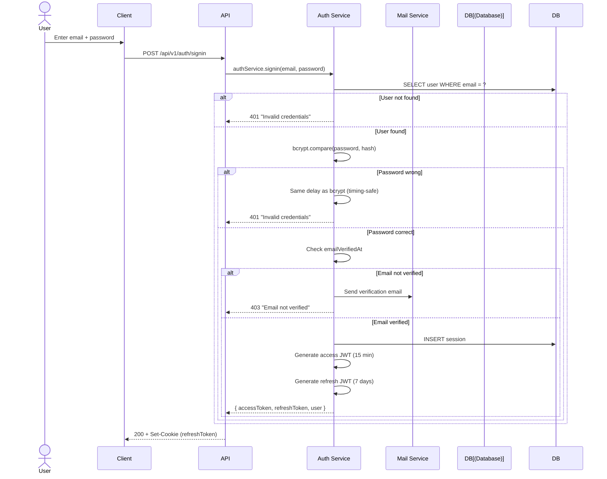
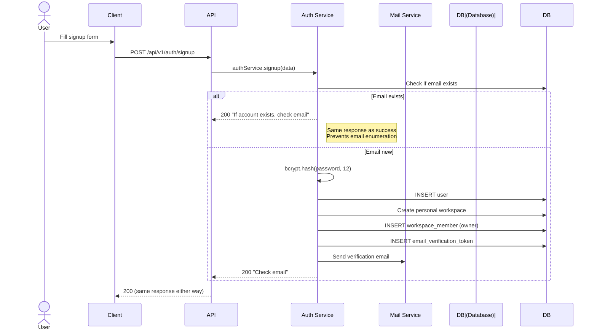
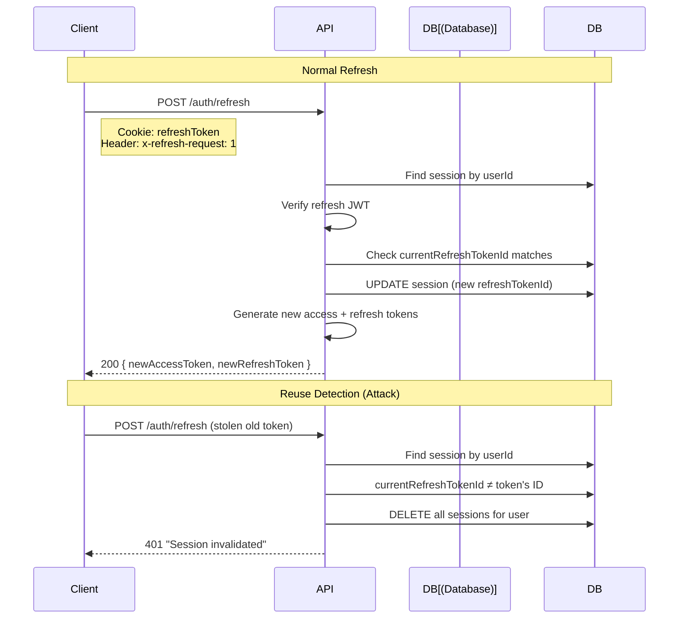
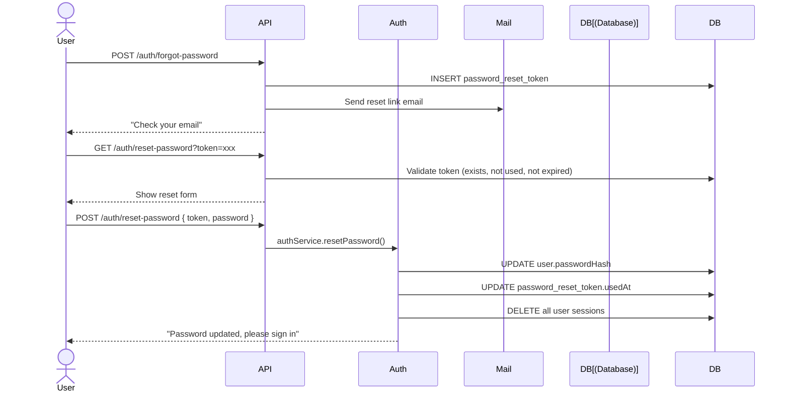
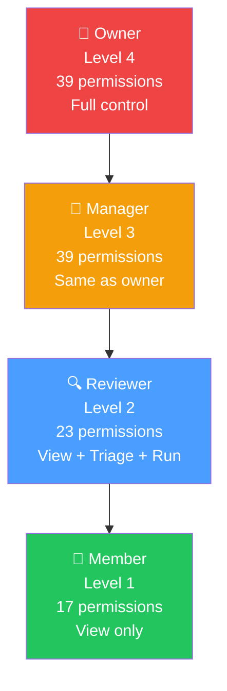
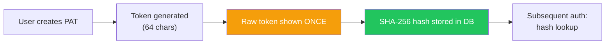

# Security

Security architecture, authentication, authorization, and protection mechanisms.

## Table of Contents

- [Authentication](#authentication)
- [JWT Tokens](#jwt-tokens)
- [Session Management](#session-management)
- [Refresh Token Rotation](#refresh-token-rotation)
- [Password Security](#password-security)
- [Authorization (RBAC)](#authorization-rbac)
- [CSRF Protection](#csrf-protection)
- [Rate Limiting](#rate-limiting)
- [API Tokens](#api-tokens)
- [Data Protection](#data-protection)
- [Security Checklist](#security-checklist)

---

## Authentication

### Sign In Flow



### Sign Up Flow



---

## JWT Tokens

### Token Types

| Token | Lifetime | Purpose | Storage |
|-------|----------|---------|---------|
| Access Token | 15 minutes | API authentication | In-memory (JavaScript variable) |
| Refresh Token | 7 days | Token renewal | HttpOnly cookie + DB session |
| Personal Access Token | Configurable | API automation | DB only |
| Project API Token | Configurable | CI/CD integration | DB only (SHA-256 hash) |

### JWT Payload

```json
{
  "sub": "user-uuid",
  "sessionId": "session-id",
  "iat": 1782400000,
  "exp": 1782400900
}
```

### Token Security

- **Access tokens**: Short-lived (15m), stored in memory only, never persisted
- **Refresh tokens**: Stored in HttpOnly cookie (not accessible via JavaScript)
- **JWT signing**: HMAC-SHA256 with `JWT_SECRET` (min 32 chars)
- **Production**: Rejects default/insecure JWT_SECRET values

---

## Session Management

### Session Lifecycle

```mermaid
stateDiagram-v2
    [*] --> Active: Sign in
    Active --> Active: Refresh token
    Active --> Expired: 7 days pass
    Active --> Revoked: User signs out
    Active --> Revoked: Admin revokes
    Active --> Compromised: Reuse detection
    Expired --> [*]
    Revoked --> [*]
    Compromised --> [*]

    note right of Active: DB tracks:<br/>- currentRefreshTokenId<br/>- lastActivity<br/>- expiresAt
    note right of Compromised: All sessions deleted<br/>for this user
```

### Session Fields

| Field | Purpose |
|-------|---------|
| `id` | Session identifier (not JWT) |
| `userId` | Associated user |
| `ipAddress` | Client IP (for audit) |
| `userAgent` | Client browser (for audit) |
| `lastActivity` | Last API call timestamp |
| `expiresAt` | Session expiration |
| `currentRefreshTokenId` | For rotation + reuse detection |

---

## Refresh Token Rotation



**Key points:**
- Each refresh generates a new `refreshTokenId`
- Presenting an old `refreshTokenId` = token was stolen
- On detection: **all sessions for the user are deleted**
- CSRF protection: `x-refresh-request: 1` header required

---

## Password Security

| Mechanism | Implementation |
|-----------|---------------|
| Hashing | bcryptjs with cost factor 12 |
| Minimum length | 8 characters (validated by Zod) |
| Password strength | Visual indicator (Weak/Fair/Good/Strong) |
| Storage | Only bcrypt hash stored, never plaintext |
| Reset flow | Token-based, single-use, 1-hour expiry |
| Timing safety | bcrypt.compare is timing-safe |

### Password Reset Flow



---

## Authorization (RBAC)

### Role Hierarchy



### Permission Resources & Actions

| Resources (19) | Actions (10) |
|----------------|-------------|
| dashboard, repository, scan, finding, report, arena, member, team, project, integration, webhook, schedule, policy, quality_gate, scanner, ai_model, knowledge, workspace, audit | view, manage, run, upload, triage, override_ai, export, invite, settings, read |

### Key Permission Differences

| Capability | Owner | Manager | Reviewer | Member |
|------------|-------|---------|----------|--------|
| Manage members (invite/remove) | ✅ | ✅ | ✅ | ❌ |
| Change member roles | ✅ | ✅ | ❌ | ❌ |
| Trigger scans | ✅ | ✅ | ✅ | ❌ |
| Triage findings | ✅ | ✅ | ✅ | ❌ |
| Override AI verdict | ✅ | ✅ | ✅ | ❌ |
| Export reports | ✅ | ✅ | ✅ | ❌ |
| View all data | ✅ | ✅ | ✅ | ✅ |

---

## CSRF Protection

```
POST /api/v1/auth/refresh
Header: x-refresh-request: 1
```

The refresh endpoint requires a custom header (`x-refresh-request: 1`) that cannot be set by cross-origin forms or simple requests. This prevents CSRF attacks on the token refresh flow.

---

## Rate Limiting

Rate limiting is available via the `rateLimiter` service. Configuration:

| Variable | Default | Description |
|----------|---------|-------------|
| `RATE_LIMIT_ENABLED` | `true` | Enable/disable rate limiting |

Rate limiting is applied per-IP for sensitive endpoints (signin, signup, password reset).

---

## API Tokens

### Personal Access Tokens (PAT)



- Token shown to user **only once** at creation
- Only SHA-256 hash stored in database
- Configurable expiry
- Can be revoked at any time
- `abilities` field controls permissions (JSON array)

### Project API Tokens

- Scoped to a specific project
- Default permission: `["scans:upload"]`
- Used by CI/CD pipelines for external scan uploads
- SHA-256 hash for O(1) lookup
- Token prefix (8-12 chars) shown for identification

---

## Data Protection

| Data Type | Protection |
|-----------|-----------|
| Passwords | bcrypt hash (cost 12) |
| JWT Secret | Min 32 chars, production rejects defaults |
| API Keys (AI) | `api_key_encrypted` column |
| SCM Credentials | `credentials` JSONB (encrypted) |
| PAT Tokens | SHA-256 hash only |
| Session tokens | HttpOnly cookie, not accessible via JS |
| Database connections | SSL required (`sslmode=require`) |

### Soft Delete Pattern

Most entities use soft delete (`deleted_at` + `deleted_by`) instead of hard delete:
- Users, Workspaces, Projects, Repositories, Teams, Webhooks

### Audit Trail

| Log Type | Records |
|----------|---------|
| `audit_logs` | User actions (who, what, when, where) |
| `activity_logs` | System events (scan completed, finding updated) |
| `finding_history` | Finding field changes (old → new value) |

---

## Security Checklist

### Infrastructure
- [ ] `JWT_SECRET` is 32+ random characters
- [ ] `DATABASE_URL` uses SSL (`sslmode=require`)
- [ ] HTTPS enforced via reverse proxy
- [ ] Container runs as non-root user
- [ ] Rate limiting enabled

### Authentication
- [ ] Password hashing with bcrypt (cost 12+)
- [ ] Email verification required
- [ ] Refresh token rotation enabled
- [ ] Session invalidation on password change
- [ ] Brute-force protection via rate limiting

### Authorization
- [ ] RBAC enforced on all API endpoints
- [ ] Feature flags control UI visibility
- [ ] Workspace isolation (no cross-workspace data access)
- [ ] Project-level access control

### Data
- [ ] `.env` not committed to git
- [ ] Secrets stored in cloud secret manager (production)
- [ ] No sensitive data in logs
- [ ] SQL injection prevented (Drizzle ORM parameterized queries)
- [ ] XSS prevented (React auto-escaping + CSP headers)

### API
- [ ] CORS configured for production domain
- [ ] Request validation (Zod) on all endpoints
- [ ] Error responses don't leak internals
- [ ] API rate limiting enabled
- [ ] CSRF protection on state-changing operations
