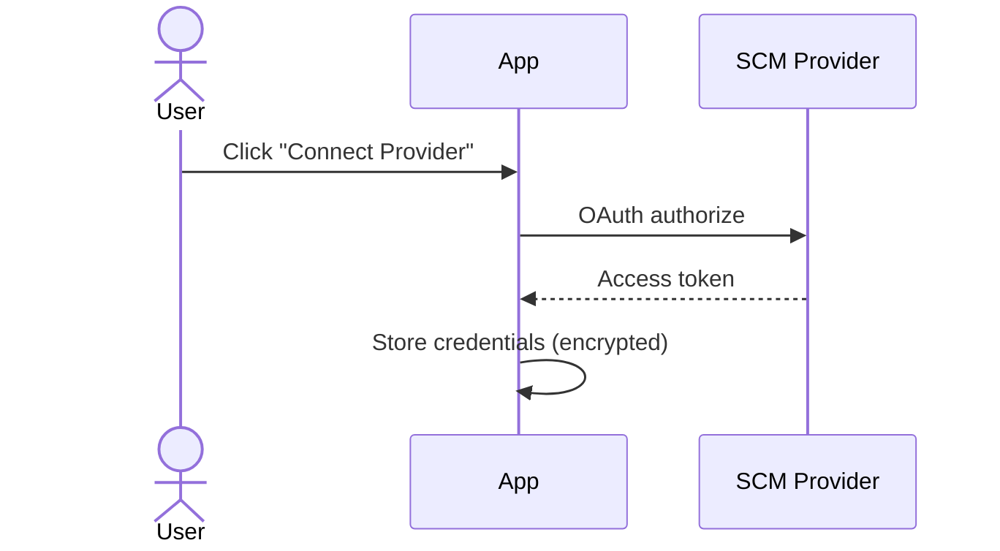
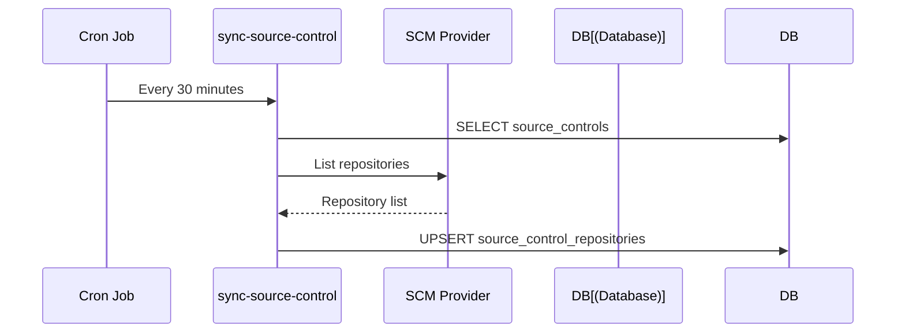
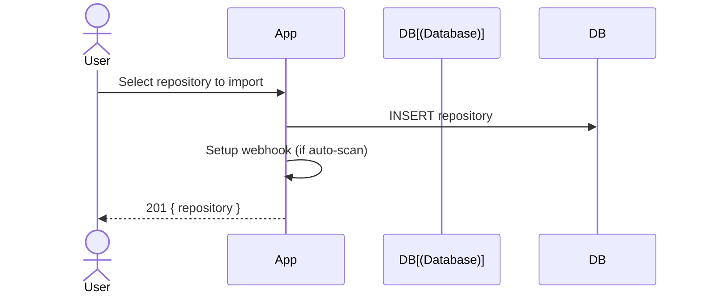
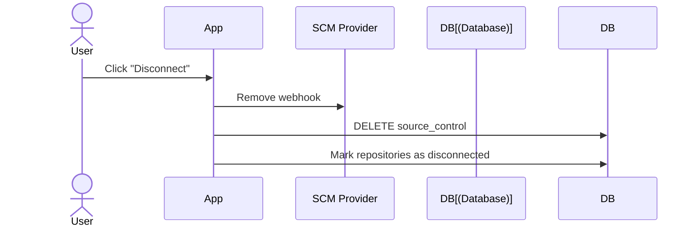

# Source Control Integration

## Supported Providers

| Provider | OAuth | GitHub App | PAT | Webhooks | PR Comments | Commit Status |
|----------|:-----:|:----------:|:---:|:--------:|:-----------:|:-------------:|
| GitHub | ✅ | ✅ | ✅ | ✅ | ✅ | ✅ |
| GitLab | ✅ | — | ✅ | ✅ | ✅ | ✅ |
| Gitea | ✅ | — | ✅ | ✅ | ✅ | ✅ |

## Provider Permissions (Required Scopes)

### GitHub

| Connection Type | Required Scopes / Permissions |
|----------------|-------------------------------|
| **Classic PAT** | `repo` (full control — covers PR comments, commit status, contents) |
| **OAuth App** | `repo` scope during authorization |
| **Fine-grained PAT** | `Pull requests` (read/write), `Commit statuses` (read/write), `Contents` (read-only), `Metadata` (read-only) |
| **GitHub App** | `Pull requests` (read/write), `Commit statuses` (read/write), `Contents` (read-only), `Metadata` (read-only) |

> **Note:** GitHub uses the Issues API for PR comments (`/repos/{o}/{r}/issues/{n}/comments`). The `repo` scope covers both issues and pull requests.

### GitLab

| Connection Type | Required Scopes |
|----------------|----------------|
| **PAT** | `api` (full access) or `read_api` + `write_repository` |
| **OAuth** | `api` scope during authorization |

### Gitea

| Connection Type | Required Scopes |
|----------------|----------------|
| **PAT** | `repo`, `issue`, `write:issue` |
| **OAuth** | `repo:issue` scope during authorization |

## Connection Flow

## CI/CD Provider Detection

When a CI/CD scan is initiated, the system **auto-detects the SCM provider** from the repository URL to determine whether PR comments and commit statuses can be posted.

| URL Pattern | Detected Provider |
|------------|-------------------|
| `github.com` | `github` |
| `gitlab` | `gitlab` |
| `gitea` | `gitea` |

**Behavior:**
- If a matching SCM connection exists → PR comments and commit statuses are posted automatically.
- If no matching connection exists → PR comments/commit statuses are skipped (scan and findings still work).
- If no `repoUrl` is provided → provider detection is skipped.

> **Important:** PR comment and commit status features require a matching SCM connection. Without it, CI/CD upload and scan completion still work — only SCM integration features are unavailable.

## Repository Sync

## Import Repository

## Disconnect Provider

