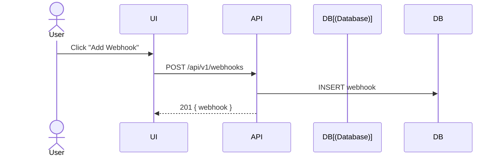
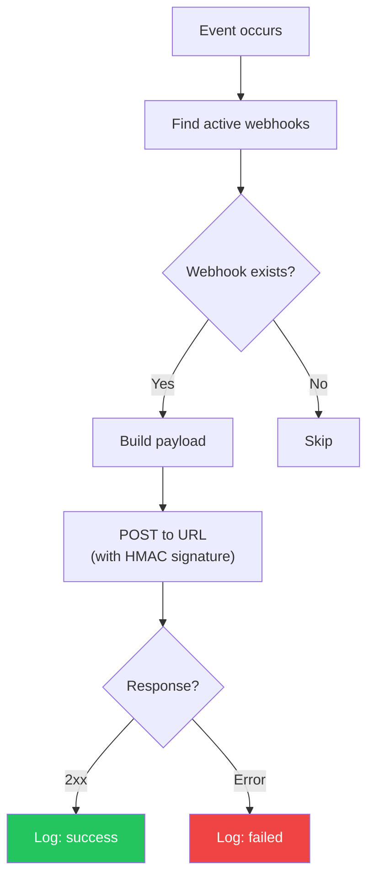
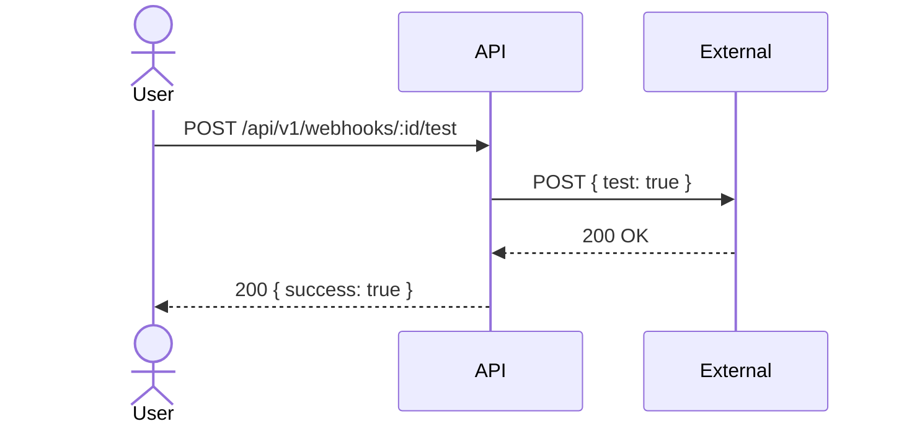

# Webhooks

## Overview

Webhooks send real-time notifications to external services when events occur in your workspace.

## Supported Events

| Event | Trigger |
|-------|---------|
| `scan.completed` | Scan finishes successfully |
| `scan.failed` | Scan fails |
| `finding.created` | New finding detected |
| `finding.resolved` | Finding resolved |
| `finding.dismissed` | Finding dismissed |

## Create Webhook

## Event Delivery

## Delivery Log

Each delivery is recorded with:
- `event`: Which event triggered it
- `status`: success/failed/pending
- `response_status`: HTTP status code
- `request_body`: Payload sent
- `response_body`: Response received
- `duration_ms`: Round-trip time

## Test Webhook

