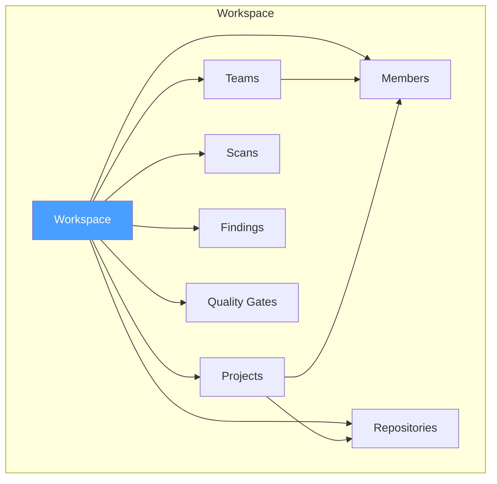
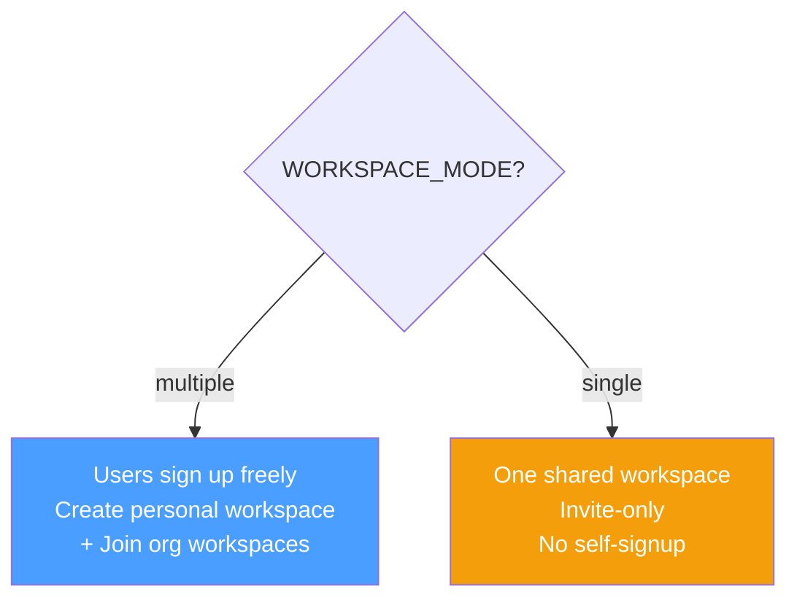
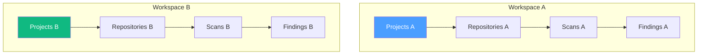
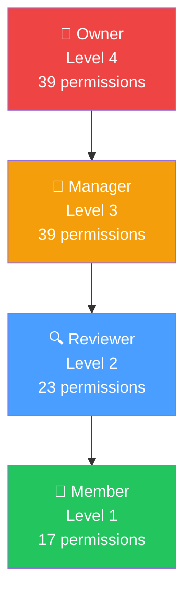
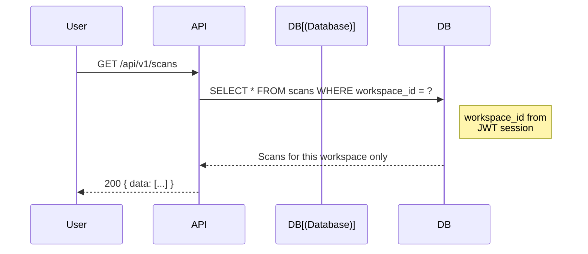
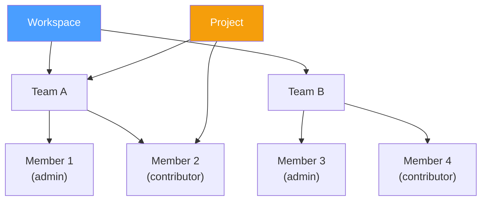
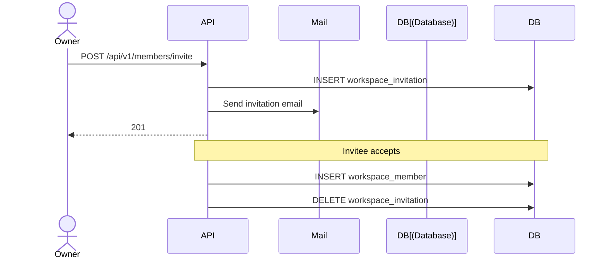

# Workspace Model

## Overview

SAST Integration uses a workspace-based multi-tenant architecture. Workspaces isolate data, members, and configurations.

## Hierarchy

## Workspace Modes

| Mode | Description | Use Case |
|------|-------------|----------|
| `multiple` | Users create personal workspaces + join org workspaces | Default, SaaS-style |
| `single` | One shared organization workspace, invite-only | Self-hosted, enterprise |

## Data Isolation

All database queries are scoped by `workspaceId`. Users can only access data within their assigned workspaces.

## Role Hierarchy

## Permission Matrix

| Capability | Owner | Manager | Reviewer | Member |
|------------|:-----:|:-------:|:--------:|:------:|
| View dashboard | ✅ | ✅ | ✅ | ✅ |
| View findings | ✅ | ✅ | ✅ | ✅ |
| Trigger scans | ✅ | ✅ | ✅ | ❌ |
| Triage findings | ✅ | ✅ | ✅ | ❌ |
| Override AI verdict | ✅ | ✅ | ✅ | ❌ |
| Export reports | ✅ | ✅ | ✅ | ❌ |
| Manage members | ✅ | ✅ | ❌ | ❌ |
| Change member roles | ✅ | ❌ | ❌ | ❌ |
| Workspace settings | ✅ | ✅ | ❌ | ❌ |

## Access Control Flow

## Team Model

| Role | Permissions |
|------|------------|
| Admin | Full team management (add/remove members, edit team) |
| Contributor | View team, participate in team projects |

## Invitation Flow

## Workspace Settings

| Setting | Description |
|---------|-------------|
| `name` | Workspace display name |
| `slug` | URL-friendly identifier |
| `description` | Workspace description |
| `type` | `personal` or `organization` |
| `features` | JSONB feature flags override |
