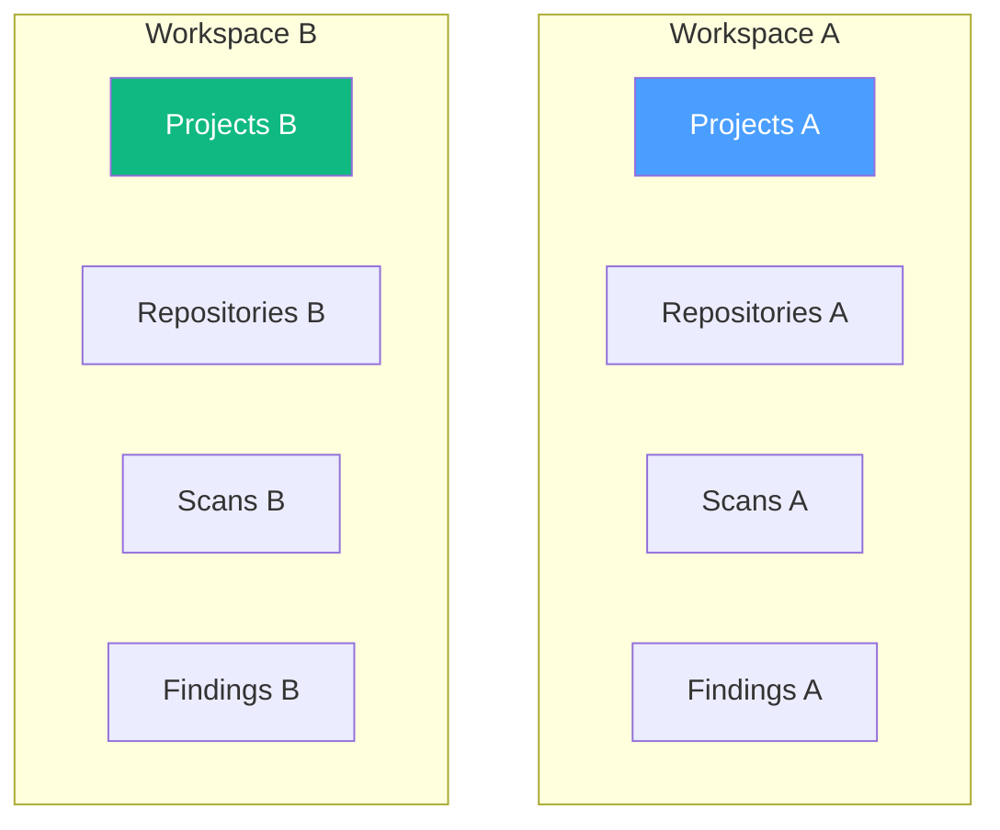
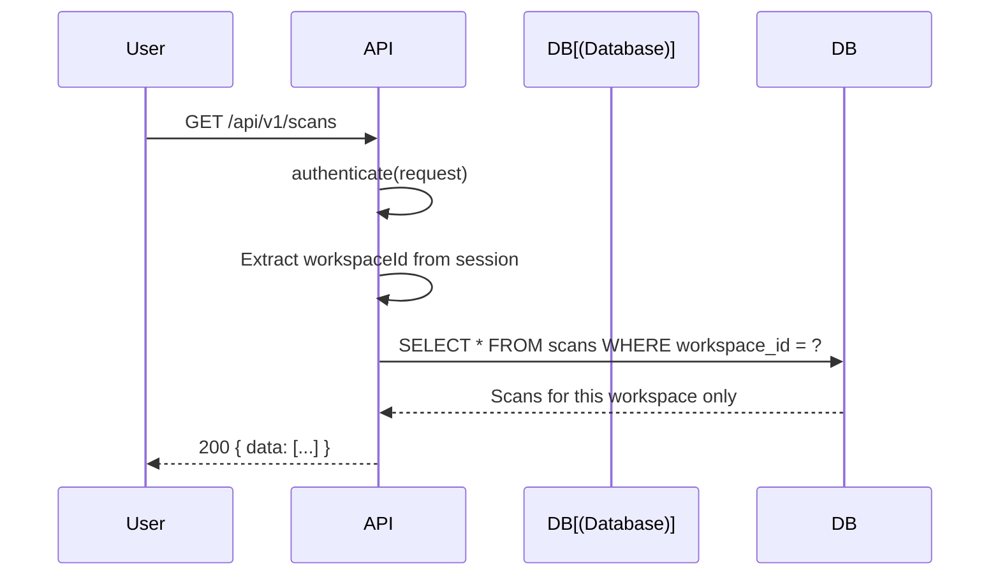

# Workspace Permissions

## Overview

Permissions are workspace-scoped. Each workspace member has a role that determines their access level.

## Data Isolation



All database queries are scoped by `workspaceId`. Users can only access data within their assigned workspaces.

## Access Control Flow



## Workspace Membership

| Field | Description |
|-------|-------------|
| `workspace_id` | Workspace identifier |
| `user_id` | User identifier |
| `role` | owner/manager/reviewer/member |
| `joined_at` | When member joined |

## Role Hierarchy

| Role | Level | Capabilities |
|------|-------|-------------|
| Owner | 4 | Full access, all permissions |
| Manager | 3 | Manage all resources, invite members |
| Reviewer | 2 | View all, run scans, triage findings |
| Member | 1 | View-only, basic access |

## Permission Architecture

Permissions use the `resource:action` format. All checks flow through `ROLE_PERMISSIONS` constant.

```
permissions.ts (single source of truth)
    ↓
Route middleware → requirePermission(PERMISSION.XXX)
    ↓
Service layer → assertHasPermission(role, PERMISSION.XXX)
    ↓
FE pages → <PermissionGate permission={PERMISSION.XXX}>
    ↓
FE sidebar → has(PERMISSION.XXX)
```

## Permission Matrix

| Resource | Action | Owner | Manager | Reviewer | Member |
|----------|--------|-------|---------|----------|--------|
| dashboard | view | ✅ | ✅ | ✅ | ✅ |
| repository | view | ✅ | ✅ | ✅ | ✅ |
| repository | manage | ✅ | ✅ | — | — |
| scan | view | ✅ | ✅ | ✅ | ✅ |
| scan | run | ✅ | ✅ | ✅ | — |
| scan | upload | ✅ | ✅ | ✅ | — |
| finding | view | ✅ | ✅ | ✅ | ✅ |
| finding | triage | ✅ | ✅ | ✅ | — |
| finding | override_ai | ✅ | ✅ | ✅ | — |
| report | view | ✅ | ✅ | ✅ | ✅ |
| report | export | ✅ | ✅ | ✅ | — |
| member | view | ✅ | ✅ | ✅ | ✅ |
| member | invite | ✅ | ✅ | — | — |
| member | manage | ✅ | ✅ | — | — |
| team | view | ✅ | ✅ | ✅ | ✅ |
| team | manage | ✅ | ✅ | — | — |
| project | view | ✅ | ✅ | ✅ | ✅ |
| project | manage | ✅ | ✅ | — | — |
| integration | view | ✅ | ✅ | ✅ | ✅ |
| integration | manage | ✅ | ✅ | — | — |
| webhook | view | ✅ | ✅ | ✅ | ✅ |
| webhook | manage | ✅ | ✅ | — | — |
| schedule | view | ✅ | ✅ | ✅ | ✅ |
| schedule | manage | ✅ | ✅ | — | — |
| policy | view | ✅ | ✅ | ✅ | — |
| policy | manage | ✅ | ✅ | — | — |
| quality_gate | view | ✅ | ✅ | ✅ | ✅ |
| quality_gate | manage | ✅ | ✅ | — | — |
| scanner | view | ✅ | ✅ | ✅ | ✅ |
| scanner | manage | ✅ | ✅ | — | — |
| ai_model | view | ✅ | ✅ | ✅ | ✅ |
| ai_model | manage | ✅ | ✅ | — | — |
| knowledge | view | ✅ | ✅ | ✅ | ✅ |
| knowledge | manage | ✅ | ✅ | — | — |
| workspace | view | ✅ | ✅ | ✅ | ✅ |
| workspace | settings | ✅ | ✅ | — | — |
| audit | read | ✅ | ✅ | ✅ | ✅ |
