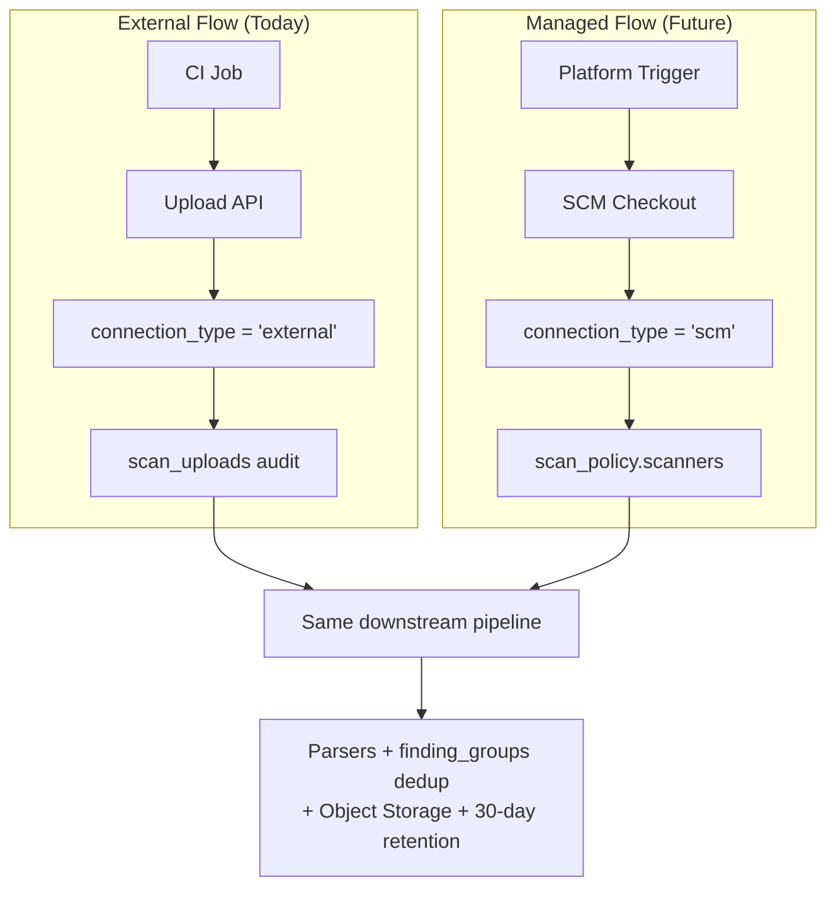

# Dual-Flow Architecture Cheat Sheet

**One-page reference for the two scanning models.**

---

## The Two Flows — Side by Side

| Aspect                    | **External / CI Upload** (Current)                  | **Managed SCM** (Foundation Ready)                  |
|---------------------------|-----------------------------------------------------|-----------------------------------------------------|
| **Trigger**               | CI pipeline (GitHub Actions, GitLab CI, etc.)      | Platform (webhook, schedule, PR, manual)           |
| **Repository Type**       | `connection_type = 'external'`                     | `connection_type = 'scm'`                          |
| **How Repository is Created** | Auto-created on first upload (lazy)              | User imports via SCM integration                   |
| **Does platform clone code?** | No                                               | Yes                                                |
| **Auth on Upload / Trigger** | Project API Token (`sast_p_...`) or User JWT     | Workspace membership + SCM credentials             |
| **Scanner Selection**     | Implicit (whatever files CI sends)                 | Explicit via `scan_policy.scanners[]`              |
| **Validation**            | `validateScanners()` on every upload               | `validateScanners()` on policy create/update + before execution |
| **Raw Files**             | Stored in object storage (30-day retention)        | Same (future)                                      |
| **Best For**              | Teams that already run scanners in CI              | Organizations that want centralized control        |

**Golden Rule**: Same `SUPPORTED_SCANNERS` list is used for **both** flows.

### Visual: Two Flows at a High Level

```mermaid
flowchart TD
    subgraph "External / CI Upload Flow (Today)"
        direction TB
        CI[CI Pipeline<br/>GitHub Actions / GitLab CI] 
        --> Upload[POST /projects/{id}/scans/upload]
        Upload --> Auth{Auth?}
        Auth -->|Project API Token| Token[Project-scoped Token]
        Auth -->|User JWT| User[Workspace Member]
        Token & User --> Validate1[validateScanners()]
        Validate1 --> RepoCheck{Repository exists?}
        RepoCheck -->|No| AutoCreate[Auto-create Repository<br/>connection_type = 'external']
        RepoCheck -->|Yes| ExistingExt[Existing 'external' Repo]
        AutoCreate & ExistingExt --> Store1[Upload raw file to Storage<br/>+ Parse + Dedup]
    end

    subgraph "Managed SCM Flow (Future)"
        direction TB
        Trigger[Platform Trigger<br/>Webhook / Schedule / PR]
        --> Policy[Load scan_policy]
        Policy --> Validate2[validateScanners(policy.scanners)]
        Validate2 --> SCM[Checkout via SCM<br/>connection_type = 'scm']
        SCM --> RunScanners[Run selected scanners<br/>from policy]
        RunScanners --> Store2[Store results + Parse + Dedup]
    end

    Store1 & Store2 --> Findings[Same findings + finding_groups]
```

---

## Single Source of Truth

```ts
// src/server/modules/scan/constants.ts
export const SUPPORTED_SCANNERS = [
  'semgrep', 'cppcheck', 'gitleaks', 'trivy', 'flawfinder', 'sarif'
] as const;

export function validateScanners(scanners: string[])
```

- Used today in `/upload` route
- Will be used by future `scan_policy` service
- **Never hardcode** scanner names elsewhere

---

## Repository Connection Type

**Table**: `repositories`

| Value     | Meaning                                      | Typical Flow          | Auto-created? |
|-----------|----------------------------------------------|-----------------------|---------------|
| `scm`     | Connected via GitHub App / GitLab / etc.     | Managed SCM           | No            |
| `external`| No SCM connection. Results only come via upload | External CI Upload   | **Yes**       |

**Key behavior**:
- When uploading with a new `repository_url`, the system calls `resolveOrCreateExternalRepository()` and sets `connectionType: 'external'`.
- This was the main enabler for "upload without giving us git access".

### Visual: How Repositories Are Created

```mermaid
flowchart LR
    subgraph "External Flow (No SCM needed)"
        CI[CI Job<br/>sends reports] -->|First time| Upload1[Upload Endpoint]
        Upload1 --> CreateExt[Create Repository<br/>connection_type = 'external'<br/>(auto-created)]
        
        CI2[CI Job<br/>later runs] --> Upload2[Upload Endpoint]
        Upload2 --> FindExt[Find existing<br/>'external' repo]
    end

    subgraph "SCM Flow (Platform has access)"
        Admin[Workspace Admin] --> Connect[Connect via<br/>GitHub App / GitLab]
        Connect --> CreateScm[Create Repository<br/>connection_type = 'scm']
        
        Webhook[Webhook / Schedule] --> FindScm[Find 'scm' repo]
        FindScm --> PlatformScan[Platform runs scan<br/>itself]
    end
```

---

## Important Tables & Columns

| Table                | New/Important Columns                              | Purpose |
|----------------------|----------------------------------------------------|--------|
| `repositories`       | `connection_type` (`'scm'` \| `'external'`)       | Dual flow support |
| `scan_uploads`       | `project_api_token_id`, `personal_access_token_id` | Full audit of who uploaded what |
| `scans`              | `origin` (`'external_upload'` \| `'managed'`)     | Know where the scan came from |
| `scan_results`       | `file_key`, `file_size`, `parsed_summary`         | Raw file lives in storage, not DB |
| `project_api_tokens` | `token_hash`, `permissions`, `revoked_at`         | Narrow, auditable CI tokens |
| `finding_groups`     | `fingerprint`, `first_seen_at`, `last_seen_at`    | Deduplication |
| `scan_policies`      | `scanners` (jsonb array)                          | Future governance |

---

## Critical Files (Know These)

| File | Why You Must Know It |
|------|----------------------|
| `src/server/modules/scan/constants.ts` | `SUPPORTED_SCANNERS` + `validateScanners()` + `RETENTION_DAYS` |
| `src/server/modules/scan/upload.service.ts` | `resolveOrCreateExternalRepository()` — the heart of external flow |
| `src/app/api/v1/projects/[projectId]/scans/upload/route.ts` | Where validation + dual auth happens |
| `drizzle/schema/source-controls.ts` | `repositories` table definition (including `connection_type`) |
| `docs/managed-scanning-and-scanner-policies.md` | The full story (this cheat sheet is the summary) |

---

## Anti-Patterns (Do Not Do This)

- Hardcode scanner names (`'semgrep'`, etc.) outside of `SUPPORTED_SCANNERS`
- Create a second list called "managed scanners"
- Assume every repository has `connection_type = 'scm'`
- Skip `validateScanners()` when handling `scan_policies` in the future
- Store raw scanner reports in `scan_results` JSONB (they go to object storage)

---

## Quick Mental Model



**Key Insight**: Both flows eventually converge into the **exact same** parsing, deduplication, storage, and finding systems. The difference is only in **how** the scan is triggered and **how** the repository was registered.

---

## UI Surfaces (Mature State — April 2026)

All UI now strictly uses the centralized constants:

- `REPOSITORY_CONNECTION_TYPES` (no more `'scm' | 'external'` literals)
- `SCAN_ORIGINS` (no more `'managed' | 'external_upload'` literals)
- `SUPPORTED_SCANNERS` + `validateScanners`

**Production pages:**
- `/[workspace]/scan` — Main hub: Policies CRUD + Repository table + `<RepositoryScanPolicy>` integration + manual runs + history
- `/[workspace]/projects/[projectId]/repositories/[repoId]` — Dedicated real repository detail page (full component integration + history + manual run)
- `/[workspace]/projects` — Project-level overview
- `/[workspace]/teams` — Team-level scan oversight foundation view

Navigation follows prototype.html patterns + UI_UX_GUIDELINES.md.

**Last updated**: 2026 (hardcode cleanup + full UI pages completed)
**Read the full version when you need depth**: `docs/managed-scanning-and-scanner-policies.md`

Keep this cheat sheet in your bookmarks when working on scanner-related code.