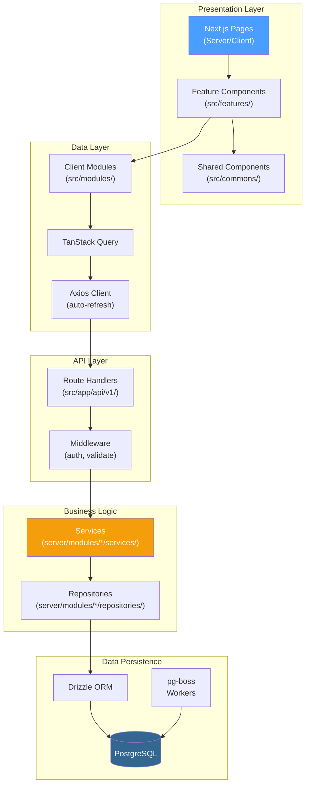
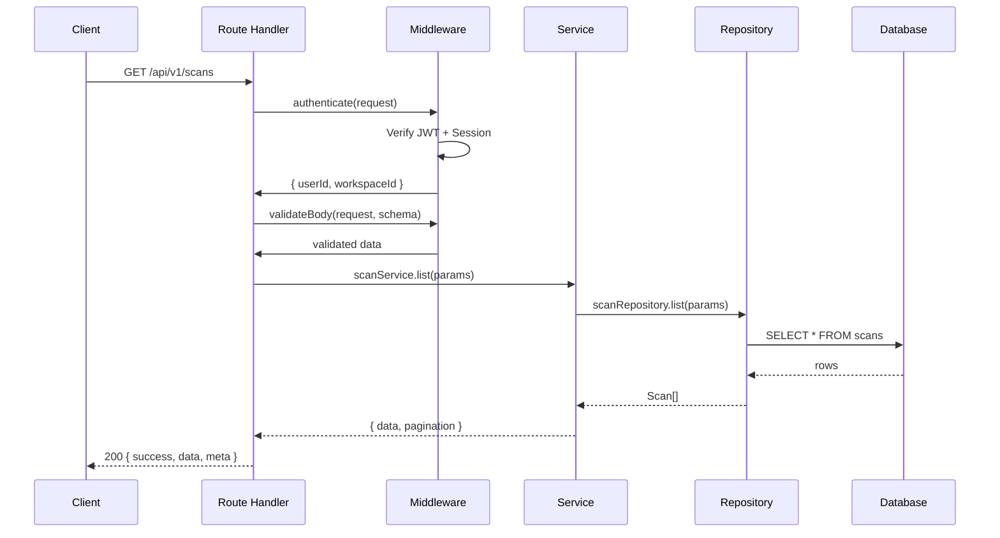
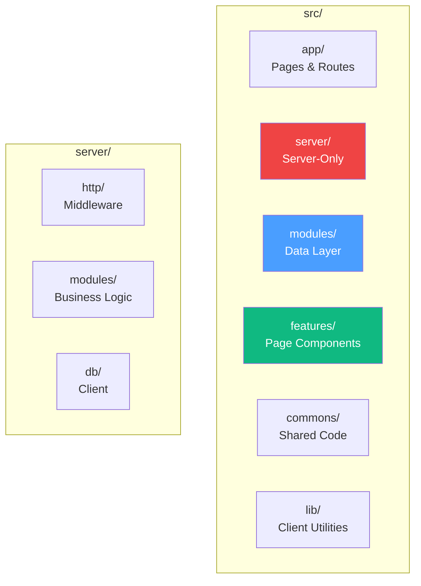
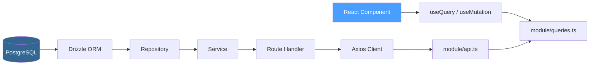
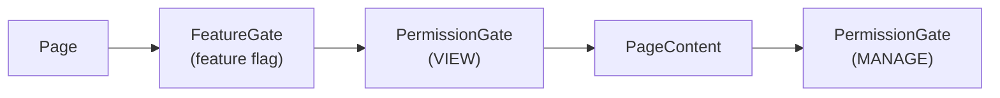
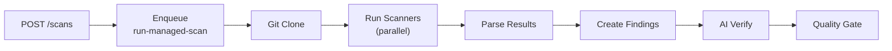

# Architecture Overview

## System Architecture



## Request Flow



## Directory Structure



```
src/
├── app/                    # Next.js App Router
│   ├── (authenticated)/    # Protected routes (workspace-scoped)
│   │   └── [workspace]/    # 19+ page routes
│   ├── (public)/           # Public docs & landing
│   ├── (unauthenticated)/  # Auth pages
│   └── api/v1/             # REST API handlers
├── commons/                # Shared code
│   ├── constants/          # App config, permissions, routes
│   ├── schemas/            # Zod validation schemas
│   └── components/         # Shared UI components
├── features/               # Page-level feature components
├── lib/                    # Client utilities
│   ├── api/                # Axios client with auto-refresh
│   ├── hooks/              # Custom React hooks
│   └── docs/               # MDX rendering
├── modules/                # Client data layer (21 domains)
│   └── {domain}/           # api.ts, queries.ts, keys.ts
├── server/                 # Server-only code
│   ├── env.ts              # Zod-validated environment
│   ├── db/client.ts        # Drizzle DB client
│   ├── http/               # Middleware layer
│   └── modules/            # Business logic
│       ├── auth/           # JWT, sessions, rate limiter
│       ├── workspace/      # Workspace & member management
│       ├── mail/           # Email service
│       └── storage/        # File storage
└── config/                 # Theme & environment
```

## Data Flow



| Layer | Location | Responsibility |
|-------|----------|---------------|
| Page | `app/**/page.tsx` | Compose features, fetch data |
| Feature UI | `features/*/` | Render UI, handle interactions |
| Query Hook | `modules/*/queries.ts` | TanStack Query cache layer |
| Client API | `modules/*/api.ts` | HTTP calls to API routes |
| API Route | `app/api/v1/**/` | Validate input, call service |
| Service | `server/modules/*/services/` | Business logic orchestration |
| Repository | `server/modules/*/repositories/` | Database queries (Drizzle) |
| Database | PostgreSQL | Data persistence |

## Key Design Decisions

### Server/Client Separation

Server modules (`server/`) are never imported from client code. Client data access goes through API routes via `modules/api.ts`.

### Feature Module Pattern

Each feature is self-contained:

```
features/
└── scan/
    ├── ScanTable.tsx
    ├── ScanDetailDrawer.tsx
    ├── ScanTimeline.tsx
    ├── NewScanModal.tsx
    └── index.ts
```

### Permission-First UI

Every page uses a layered guard system:



### Queue-Based Scan Processing

Scans are processed asynchronously via pg-boss:



## Database Schema

37 tables organized by domain:

| Domain | Tables | File |
|--------|--------|------|
| Users & Auth | users, sessions, user_settings, tokens, notifications | users.ts, auth.ts |
| Workspaces | workspaces, workspace_members, workspace_settings | workspaces.ts |
| Teams | teams, team_members | teams.ts |
| Projects | projects, project_members, project_teams, environments, api_tokens | projects.ts |
| Source Control | source_controls, source_control_repositories, source_control_imports, repositories | source-controls.ts |
| Scans | scans, scan_results, quality_gates, quality_gate_results, schedules, scan_uploads, commit_statuses | scans.ts |
| Findings | finding_groups, findings, ai_verifications, finding_history, finding_group_scans | findings.ts |
| Integrations | ai_models, webhooks, webhook_deliveries, audit_logs, activity_logs, knowledge_sources, knowledge_entries, knowledge_backfill_jobs | integrations.ts |
| Reports | reports, storage_files | reports.ts |

See [Database Reference](../reference/environment-variables.md) for complete schema documentation.
