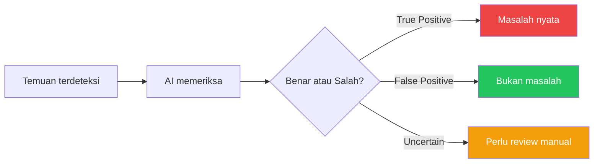
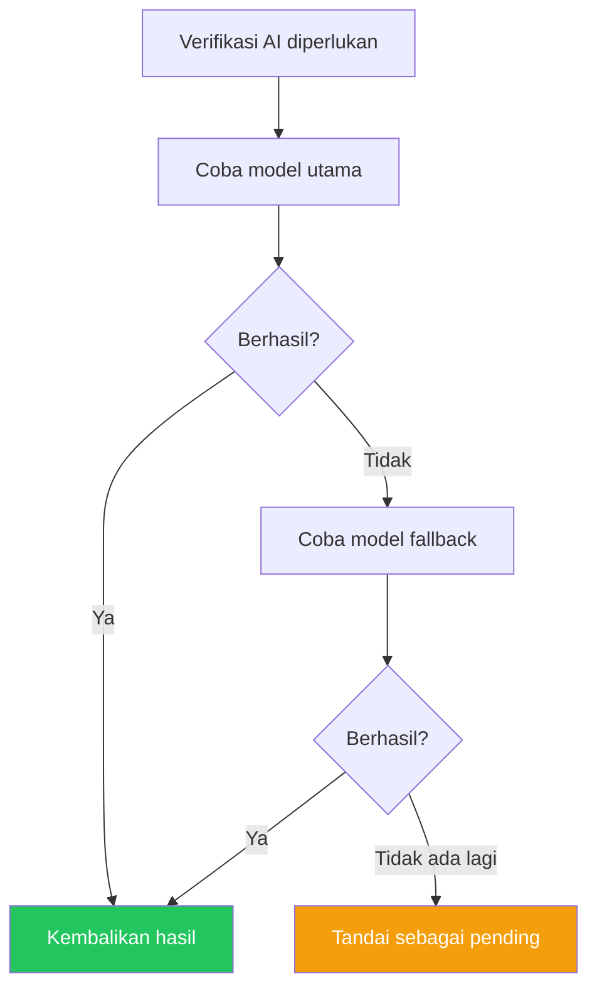

# AI Models

## Overview

AI Models memungkinkan kamu mengkonfigurasi model AI yang digunakan untuk memverifikasi temuan keamanan. AI menentukan apakah temuan adalah True Positive (masalah nyata) atau False Positive (salah deteksi).

## Siapa yang Butuh Ini?

- **Admin** — mengatur model AI untuk verifikasi otomatis
- **Tim Keamanan** — memastikan AI memberikan verdict yang akurat

## Cara Kerja AI Verification

## Provider yang Didukung

| Provider | Keterangan |
|----------|-----------|
| **Ollama** | Lokal, gratis |
| **OpenAI** | Cloud, berbayar |
| **Anthropic** | Cloud, berbayar |
| **Groq** | Cloud, cepat |
| **Custom** | API compatible OpenAI lainnya |

## Tambah Model

1. Buka **AI Models** di sidebar
2. Klik **Add Model**
3. Isi:
   - **Name** — nama deskriptif
   - **Provider** — Ollama, OpenAI, dll
   - **Base URL** — endpoint API
   - **API Key** — kunci API kamu
   - **Model** — nama model (contoh: `gpt-4`, `llama3`)
4. Klik **Create**

## Test Model

1. Buka **AI Models**
2. Klik **Test** pada model
3. Tunggu respons
4. Lihat status (berhasil/gagal) dan waktu respons

## Fallback Chain

Jika model utama gagal, sistem mencoba model berikutnya:

## Prompt Presets

| Preset | Perilaku |
|--------|---------|
| **Strict** | Konservatif, presisi tinggi |
| **Balanced** | Default, presisi/recall seimbang |
| **Aggressive** | Lebih banyak terdeteksi, mungkin lebih banyak false positive |

## Tips

- **Mulai dengan Ollama** — gratis dan bisa dijalankan lokal
- **Test sebelum dipakai** — pastikan model merespons dengan benar
- **Gunakan fallback** — jika model utama down, ada cadangan
- **Pilih preset yang tepat** — Strict untuk production, Aggressive untuk eksplorasi

## Kesalahan Umum

| Masalah | Solusi |
|---------|--------|
| Model tidak merespons | Periksa Base URL dan API Key |
| Verifikasi lambat | Normal untuk model lokal, coba model cloud |
| Verdict tidak akurat | Coba ganti preset atau model lain |
| Model tidak ditemukan | Pastikan nama model benar dan tersedia di provider |

## Permissions

| Aksi | Owner | Manager | Reviewer | Member |
|------|:-----:|:-------:|:--------:|:------:|
| Lihat model | ✅ | ✅ | ✅ | ✅ |
| Tambah model | ✅ | ✅ | ❌ | ❌ |
| Test model | ✅ | ✅ | ❌ | ❌ |
| Hapus model | ✅ | ✅ | ❌ | ❌ |

## Langkah Selanjutnya

- [Jalankan Scan](scans.md) untuk menguji AI verification
- Lihat [Temuan](findings.md) untuk melihat hasil verifikasi AI
- [Knowledge Base](knowledge-base.md) untuk konteks CWE yang digunakan AI
