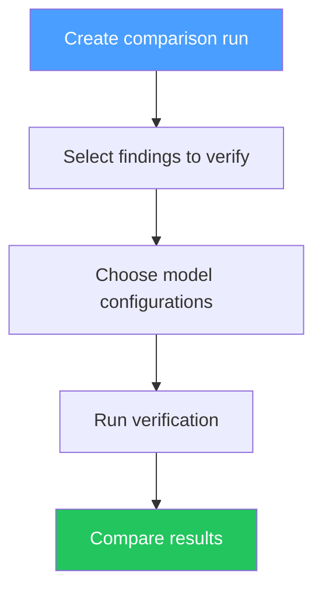

# Arena

## Overview

Arena provides A/B comparison of AI model configurations. Test different models, prompts, and settings to find the optimal verification setup.

> **Note:** Arena is currently behind a feature flag (`FEATURE_FLAG_ARENA=false` by default). Enable it in your `.env` to access this feature.

## How It Works

1. **Create comparison run** — Select a set of findings
2. **Choose models** — Pick 2+ model configurations to compare
3. **Run verification** — Each model verifies the same findings
4. **Compare results** — See accuracy, speed, and cost differences

## Use Cases

| Use Case | Description |
|----------|-------------|
| Model selection | Compare Ollama vs OpenAI vs Anthropic |
| Prompt tuning | Test strict vs balanced vs aggressive presets |
| Threshold optimization | Find optimal confidence threshold |
| Cost analysis | Compare cost per verification |
