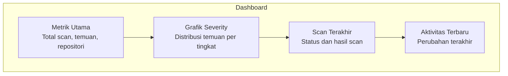

# Dashboard

## Overview

Dashboard adalah halaman utama yang memberikan ringkasan kesehatan keamanan workspace kamu. Dari sini, kamu bisa melihat tren temuan, scan terakhir, dan status proyek — tanpa harus membuka menu satu per satu.

## Siapa yang Butuh Ini?

Semua peran bisa melihat dashboard. Ini adalah titik awal sebelum melakukan aktivitas lain:
- **Owner/Manager** — melihat status keseluruhan workspace
- **Reviewer** — melihat temuan yang perlu ditinjau
- **Member** — melihat ringkasan aktivitas terbaru

## Yang Ditampilkan

| Bagian | Penjelasan |
|--------|-----------|
| **Total Scans** | Jumlah scan yang sudah dijalankan di workspace ini |
| **Open Findings** | Temuan yang masih perlu ditinjau |
| **Critical/High** | Temuan mendesak yang perlu perhatian segera |
| **Repositories** | Jumlah repositori yang sudah terhubung |
| **Recent Scans** | Scan terakhir dengan statusnya |
| **Severity Chart** | Distribusi temuan berdasarkan tingkat keparahan |
| **Trend Chart** | Perubahan temuan dari waktu ke waktu |

## Cara Membaca Metrik

| Metrik | Arti |
|--------|------|
| **Total Scans** | Semua scan (berhasil + gagal) |
| **Open Findings** | Temuan dengan status `open` |
| **Dismissed** | Temuan yang ditandai sebagai false positive |
| **Resolved** | Temuan yang sudah diperbaiki di kode |
| **AI Accuracy** | Persentase temuan yang sudah diverifikasi oleh AI |

## Tips

- **Cek dashboard setiap hari** — untuk mengetahui apakah ada temuan baru yang kritis
- **Perhatikan tren** — jika jumlah temuan terus naik, mungkin ada masalah di kode terbaru
- **Gunakan filter** — beberapa dashboard memungkinkan filter berdasarkan proyek atau rentang waktu

## Langkah Selanjutnya

Dari dashboard, kamu bisa:
- Lihat [Temuan](findings.md) yang perlu ditinjau
- [Jalankan Scan](scans.md) baru
- Buat [Laporan](reports.md) untuk stakeholder
