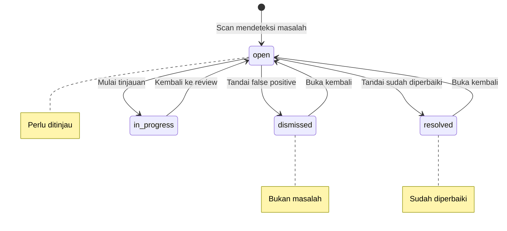

# Findings

## Overview

Findings adalah masalah keamanan yang terdeteksi oleh scanner. Setiap finding dilengkapi dengan verifikasi AI, klasifikasi CWE, dan saran perbaikan.

## Siapa yang Butuh Ini?

- **Tim Keamanan** — meninjau semua temuan keamanan
- **Developer** — memahami masalah di kode yang ditulis
- **Reviewer** — memutuskan temuan mana yang perlu diperbaiki

## Lifecycle Temuan

## Tinjau Temuan

1. Buka **Findings** di sidebar
2. Filter berdasarkan:
   - **Severity** — Critical / High / Medium / Low / Info
   - **Status** — Open / Dismissed / Resolved
   - **Scanner** — Semgrep / Gitleaks / dll
   - **Repository** — Filter per repo
3. Klik temuan untuk melihat detail

## Detail Temuan

| Bagian | Penjelasan |
|--------|-----------|
| **Code Snippet** | Potongan kode sumber dengan highlight baris |
| **AI Verdict** | True Positive / False Positive / Pending |
| **Confidence Score** | Skor keyakinan AI (0-100%) |
| **CWE Classification** | Jenis kelemahan (contoh: CWE-89 SQL Injection) |
| **Remediation** | Saran perbaikan untuk masalah tersebut |
| **History** | Perubahan status dari waktu ke waktu |

## Triage

| Aksi | Penjelasan |
|------|-----------|
| **Resolve** | Tandai sudah diperbaiki di kode |
| **Dismiss** | Tandai bukan masalah (false positive) |
| **Assign** | Tugaskan ke anggota tim untuk ditindaklanjuti |
| **Re-verify** | Minta AI memeriksa ulang |

## AI Verdicts

| Verdict | Arti |
|---------|------|
| **True Positive** | Masalah keamanan yang benar — perlu diperbaiki |
| **False Positive** | Salah deteksi — aman untuk di-dismiss |
| **Pending** | Menunggu verifikasi AI atau review manual |

## Severity

| Level | Prioritas Tindakan |
|-------|-------------------|
| **Critical** | Perlu diperbaiki segera |
| **High** | Perlu diperbaiki dalam sprint ini |
| **Medium** | Jadwalkan perbaikan |
| **Low** | Perbaiki jika ada waktu |
| **Info** | Tidak perlu tindakan |

## Bulk Actions

Pilih beberapa temuan sekaligus:
1. Centang checkbox di samping temuan
2. Klik **Bulk Actions**
3. Pilih: **Dismiss All** / **Resolve All** / **Assign All**

## Tips

- **Mulai dari Critical/High** — prioritaskan temuan paling berbahaya
- **Perhatikan AI verdict** — jika AI yakin ini True Positive, kemungkinan besar memang masalah
- **Jangan abaikan Low** — meskipun severity rendah, beberapa bisa menjadi pintu masuk serangan
- **Gunakan bulk actions** — untuk menangani banyak temuan sekaligus

## Kesalahan Umum

| Masalah | Solusi |
|---------|--------|
| Terlalu banyak temuan | Filter berdasarkan severity, fokus ke Critical/High dulu |
| AI verdict pending | Tunggu beberapa menit, atau re-verify manual |
| Temuan tidak muncul | Pastikan scan sudah selesai dengan status completed |
| Salah dismiss temuan | Buka kembali temuan dan ubah status |

## Permissions

| Aksi | Owner | Manager | Reviewer | Member |
|------|:-----:|:-------:|:--------:|:------:|
| Lihat temuan | ✅ | ✅ | ✅ | ✅ |
| Triage temuan | ✅ | ✅ | ✅ | ❌ |
| Override AI verdict | ✅ | ✅ | ✅ | ❌ |
| Assign temuan | ✅ | ✅ | ✅ | ❌ |
| Dismiss temuan | ✅ | ✅ | ✅ | ❌ |

## Langkah Selanjutnya

- Buat [Laporan](reports.md) dari temuan yang sudah ditinjau
- [Konfigurasi AI Models](ai-models.md) untuk meningkatkan akurasi verifikasi
- Lihat [Knowledge Base](knowledge-base.md) untuk memahami CWE lebih dalam
