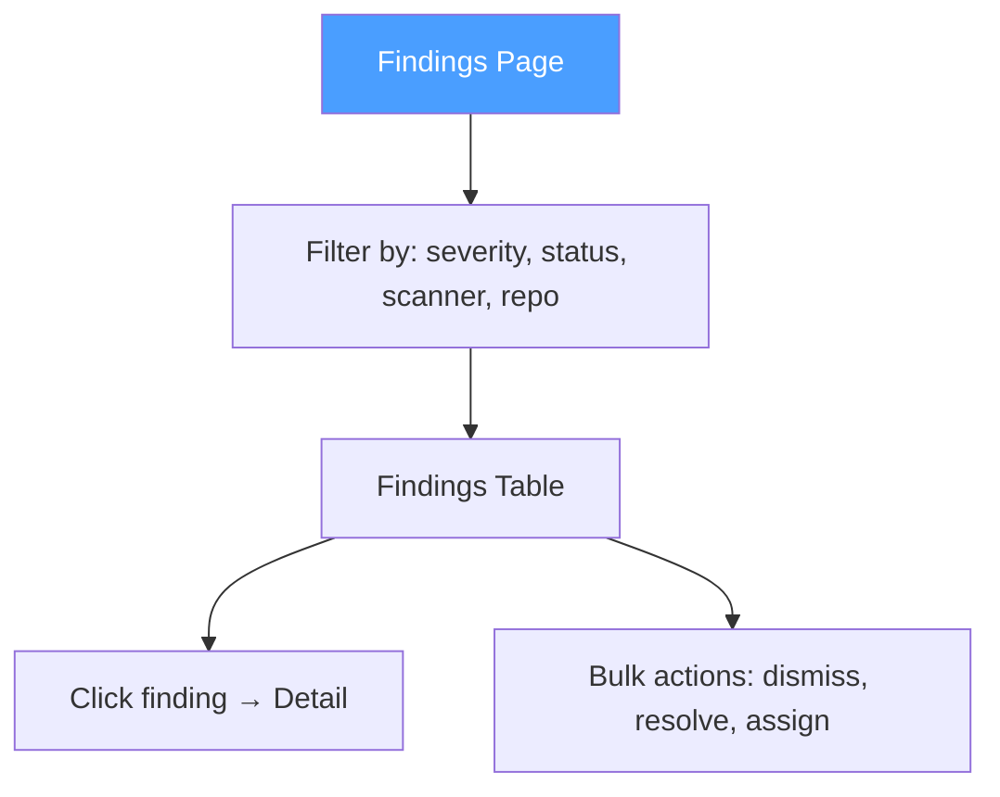
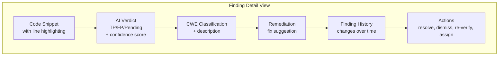

# Findings

## Overview

Findings are security issues detected by scanners. Each finding includes AI verification, CWE classification, and remediation guidance.

## Finding Lifecycle

```mermaid
stateDiagram-v2
    [*] --> open: Scan detects issue
    open --> dismissed: User dismisses
    open --> resolved: User resolves
    open --> in_progress: User starts triage
    in_progress --> open: Back to triage
    dismissed --> open: Reopens finding
    resolved --> open: Reopens finding

    note right of open: Default state\nAI verdict: pending
    note right of dismissed: Not a real issue
    note right of resolved: Fixed in code
```

## Finding List



## Finding Detail



## Finding Statuses

| Status | Description |
|--------|-------------|
| `open` | Default state, needs review |
| `in_progress` | Being triaged |
| `dismissed` | False positive |
| `resolved` | Fixed in code |

## AI Verdicts

| Verdict | Description |
|---------|-------------|
| `true_positive` | Confirmed security issue |
| `false_positive` | Not a real issue |
| `inconclusive` | AI uncertain |
| `pending` | Awaiting verification |

## Deduplication

Each finding generates a **fingerprint** (SHA-256 hash of rule + file + line + code). If a matching fingerprint exists in `finding_groups` for the same repository, it's an existing finding.

## Bulk Operations

| Action | Description |
|--------|-------------|
| **Dismiss** | Mark as false positive |
| **Resolve** | Mark as fixed |
| **Assign** | Assign to team member |
| **Re-verify** | Request AI re-verification |

## Finding Groups

Findings are grouped by fingerprint across scans. A finding group tracks:
- First seen scan
- Last seen scan
- Total occurrences
- Current status
- AI verdict
