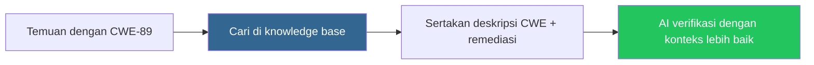

# Knowledge Base

## Overview

Knowledge Base menyediakan konteks keamanan dari NVD (National Vulnerability Database) dan CWE (Common Weakness Enumeration) untuk membantu AI memverifikasi temuan dengan lebih akurat.

## Siapa yang Butuh Ini?

- **Tim Keamanan** — memahami jenis kelemahan yang ditemukan
- **Developer** — belajar tentang CWE dan cara memperbaikinya
- **AI System** — menggunakan konteks untuk verifikasi yang lebih baik

## Apa Isinya?

| Sumber | Konten |
|--------|--------|
| **NVD** | National Vulnerability Database (CVE) |
| **CWE** | Common Weakness Enumeration (jenis kelemahan) |

## Cara Kerja

Saat temuan terdeteksi, sistem mencari entri CWE yang relevan dan menyertakannya dalam prompt verifikasi AI. Ini memberikan AI konteks yang lebih baik untuk menentukan apakah temuan tersebut nyata.

## Field Knowledge Entry

| Field | Penjelasan |
|-------|-----------|
| **CWE ID** | Identifier kelemahan (contoh: CWE-89) |
| **Title** | Nama kelemahan |
| **Description** | Penjelasan detail |
| **Severity** | Critical / High / Medium / Low |
| **Remediation** | Cara memperbaiki |

## Melihat Entri

1. Buka **Knowledge Base** di sidebar
2. Jelajahi atau cari berdasarkan CWE ID atau kata kunci
3. Klik entri untuk melihat detail lengkap

## Mute Entri

Kamu bisa mengecualikan entri dari konteks AI:

1. Buka entri knowledge
2. Klik **Mute**
3. Entri tersebut tidak lagi digunakan dalam verifikasi AI

## Tips

- **Gunakan Knowledge Base untuk belajar** — jika tidak yakin tentang suatu CWE, baca deskripsinya
- **Mute entri yang tidak relevan** — jika suatu CWE sering salah di-trigger
- **Perbarui secara berkala** — NVD di-sync setiap 6 jam

## Kesalahan Umum

| Masalah | Solusi |
|---------|--------|
| Entri tidak muncul | Tunggu sync berikutnya (setiap 6 jam) |
| CWE tidak relevan | Mute entri tersebut agar tidak mempengaruhi AI |
| Sinkronisasi gagal | Periksa koneksi jaringan ke NVD API |

## Permissions

| Aksi | Owner | Manager | Reviewer | Member |
|------|:-----:|:-------:|:--------:|:------:|
| Lihat entri | ✅ | ✅ | ✅ | ✅ |
| Mute entri | ✅ | ✅ | ❌ | ❌ |

## Langkah Selanjutnya

- Lihat [Temuan](findings.md) untuk melihat CWE yang terkait dengan temuan
- [Konfigurasi AI Models](ai-models.md) untuk mengatur verifikasi
- [Glossary](../reference/glossary.md) untuk istilah keamanan
