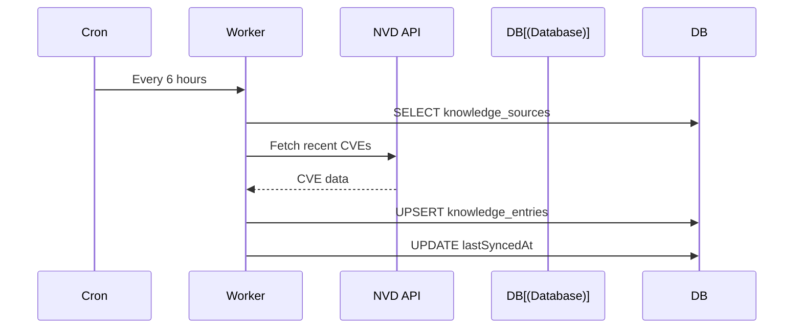
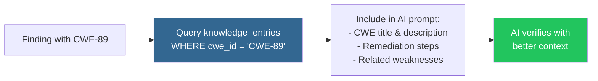
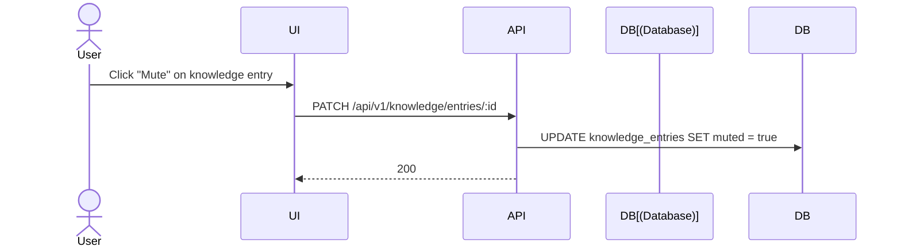

# Knowledge Base

## Overview

The knowledge base provides NVD context to enrich findings and improve AI verification accuracy.

## Knowledge Sources

```mermaid
graph LR
    subgraph "Sources"
        NVD["NVD Feed"]
        CWE["CWE Catalog"]
        Custom["Custom Rules"]
    end

    subgraph "Sync"
        Sync["sync-knowledge-base<br/>worker (every 6h)"]
        Backfill["nvd-knowledge-backfill<br/>worker (manual)"]
    end

    subgraph "Store"
        Entries["knowledge_entries"]
    end

    subgraph "AI"
        AI["AI Verification"]
    end

    NVD --> Sync
    CWE --> Sync
    Sync --> Entries
    Backfill --> Entries
    Entries --> AI

    style Entries fill:#336791,color:#fff
    style AI fill:#f59e0b,color:#fff
```

| Source | Content |
|--------|---------|
| **NVD** | National Vulnerability Database feed |
| **CWE** | Common Weakness Enumeration catalog |
| **Custom** | User-defined knowledge entries |

## Sync Flow



## AI Enrichment

During AI verification, the system enriches prompts with relevant knowledge:



## Entry Fields

| Field | Description |
|-------|-------------|
| `cwe_id` | CWE identifier (e.g., CWE-89) |
| `title` | Weakness title |
| `content` | Detailed description |
| `severity` | Critical, High, Medium, Low |
| `remediation` | Fix guidance |
| `tags` | Category tags (JSONB) |
| `muted` | Exclude from AI context |

## Mute Entry

Muted entries are excluded from AI verification context:


