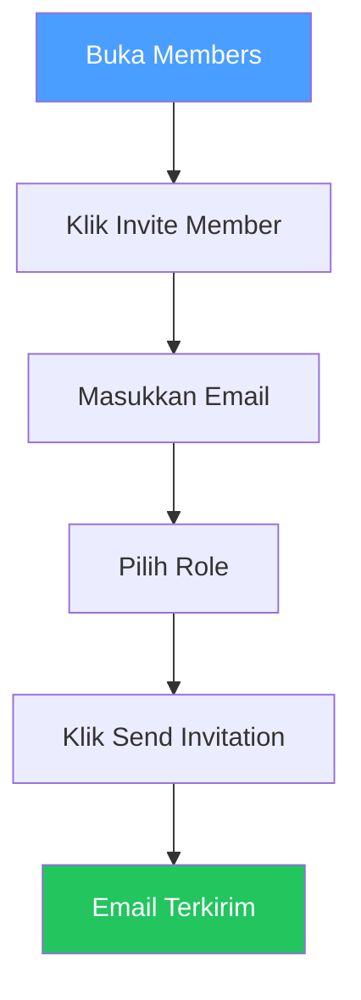

# Members

## Overview

Members adalah pengelolaan siapa yang memiliki akses ke workspace. kamu bisa mengundang anggota baru, mengubah role, atau menghapus anggota.

## Siapa yang Butuh Ini?

- **Owner** — mengelola seluruh anggota workspace
- **Manager** — mengundang anggota baru dan mengatur role

## Halaman Members

Halaman ini memiliki dua tab: **Members** dan **Invitations**.

### Tab Members

Menampilkan semua anggota workspace saat ini.

| Kolom | Penjelasan |
|-------|-----------|
| **Member** | Nama dan email |
| **Role** | Owner / Manager / Reviewer / Member |
| **Status** | Active |
| **Joined** | Kapan mereka bergabung |

### Tab Invitations

Menampilkan undangan yang belum diterima.

| Kolom | Penjelasan |
|-------|-----------|
| **Email** | Email yang diundang |
| **Role** | Role yang diberikan |
| **Status** | Pending / Accepted / Expired |
| **Sent** | Kapan undangan dikirim |

## Undang Anggota

1. Buka **Members** di sidebar
2. Klik **Invite Member**
3. Masukkan **email** orang tersebut
4. Pilih **role** (Owner / Manager / Reviewer / Member)
5. Klik **Send Invitation**

Orang tersebut akan menerima email dengan link untuk bergabung.

## Ubah Role Anggota

1. Buka **Members**
2. Cari anggota
3. Klik **Change Role**
4. Pilih role baru
5. Konfirmasi

## Hapus Anggota

1. Buka **Members**
2. Cari anggota
3. Klik **Remove**
4. Konfirmasi

Anggota akan kehilangan akses secara langsung.

## Batalkan Undangan

1. Buka **Members** → tab **Invitations**
2. Cari undangan yang pending
3. Klik **Revoke**

Link undangan akan berhenti berfungsi.

## Tips

- **Pilih role dengan bijak** — jangan berikan role Owner kecuali benar-benar diperlukan
- **Gunakan Reviewer untuk developer** — cukup untuk menjalankan scan dan meninjau temuan
- **Undang anggota segera** — agar tim bisa mulai bekerja sama lebih cepat
- **Periksa role secara berkala** — pastikan setiap anggota memiliki role yang sesuai

## Kesalahan Umum

| Masalah | Solusi |
|---------|--------|
| Email undangan tidak sampai | Minta cek folder spam, atau kirim ulang |
| Anggota tidak bisa login | Pastikan mereka sudah verifikasi email |
| Role salah | Hubungi Owner untuk mengubah role |
| Undangan expired | Kirim ulang undangan baru |

## Permissions

| Aksi | Owner | Manager | Reviewer | Member |
|------|:-----:|:-------:|:--------:|:------:|
| Lihat anggota | ✅ | ✅ | ✅ | ✅ |
| Undang anggota | ✅ | ✅ | ❌ | ❌ |
| Hapus anggota | ✅ | ✅ | ❌ | ❌ |
| Ubah role | ✅ | ✅ | ❌ | ❌ |
| Batalkan undangan | ✅ | ✅ | ❌ | ❌ |

## Langkah Selanjutnya

- [Buat Tim](teams.md) untuk mengelompokkan anggota
- [Buat Proyek](projects.md) untuk menugaskan anggota ke proyek
- Lihat [Profil](profile.md) untuk pengaturan akun pribadi
