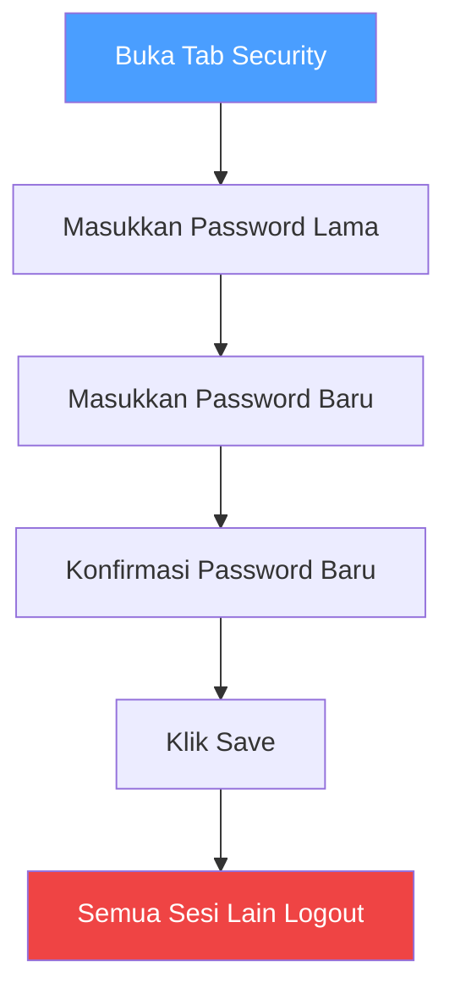

# Profile

## Overview

Profile adalah halaman pengaturan akun pribadi. Di sini kamu bisa mengubah informasi profil, mengganti password, dan mengelola sesi login.

## Siapa yang Butuh Ini?

Semua pengguna. Ini adalah halaman yang harus dikunjungi setelah pertama kali login.

## Tab Profile

| Field | Penjelasan |
|-------|-----------|
| **Name** | Nama tampilan kamu |
| **Email** | Alamat email kamu |
| **Username** | Username unik kamu |
| **Bio** | Deskripsi singkat tentang diri kamu |
| **Timezone** | Zona waktu lokal kamu |
| **Language** | Bahasa yang disukai |
| **Avatar** | Foto profil |

### Ubah Avatar

1. Buka **Profile** di sidebar
2. Klik area avatar
3. Unggah gambar baru, atau hapus yang sekarang

### Ubah Info

1. Buka **Profile**
2. Edit field yang diinginkan
3. Klik **Save**

## Tab Security

Kelola password dan sesi aktif.

### Ganti Password

1. Klik tab **Security**
2. Masukkan **password saat ini**
3. Masukkan **password baru**
4. Konfirmasi password baru
5. Klik **Save**

Semua sesi lain akan logout saat kamu mengganti password.

### Revoke Sesi

Kamu bisa melihat semua sesi aktif dan revoke yang tidak dikenal.

1. Klik tab **Security**
2. Cari sesi di daftar
3. Klik **Revoke**

| Sesi | Penjelasan |
|------|-----------|
| **Current** | Sesi aktif kamu (tidak bisa di-revoke) |
| **Other** | Perangkat/browser lain yang login |

## Tips

- **Ganti password secara berkala** — misalnya setiap 3-6 bulan
- **Periksa sesi aktif** — jika ada perangkat yang tidak dikenal, segera revoke
- **Gunakan password kuat** — kombinasi huruf, angka, dan simbol
- **Jangan share akun** — setiap orang harus punya akun sendiri

## Kesalahan Umum

| Masalah | Solusi |
|---------|--------|
| Gagal ganti password | Pastikan password lama benar |
| Sesi tidak bisa direvoke | Itu sesi kamu sendiri — tidak bisa di-revoke |
| Avatar tidak berubah | Coba ungah gambar dengan format JPG/PNG |
| Tidak bisa edit profil | Pastikan kamu login dan tidak ada error jaringan |

## Permissions

| Aksi | Semua Role |
|------|:---------:|
| Lihat profil | ✅ |
| Edit profil sendiri | ✅ |
| Ganti password sendiri | ✅ |
| Revoke sesi sendiri | ✅ |

## Langkah Selanjutnya

- [Kelola Anggota](members.md) untuk mengundang tim
- [Source Control](source-control.md) untuk menghubungkan GitHub/GitLab/Gitea
- [Dashboard](dashboard.md) untuk melihat ringkasan workspace
