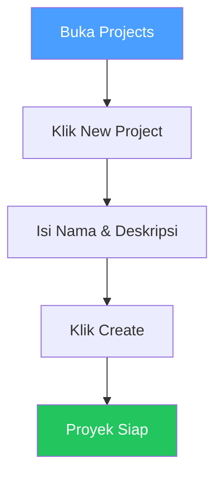
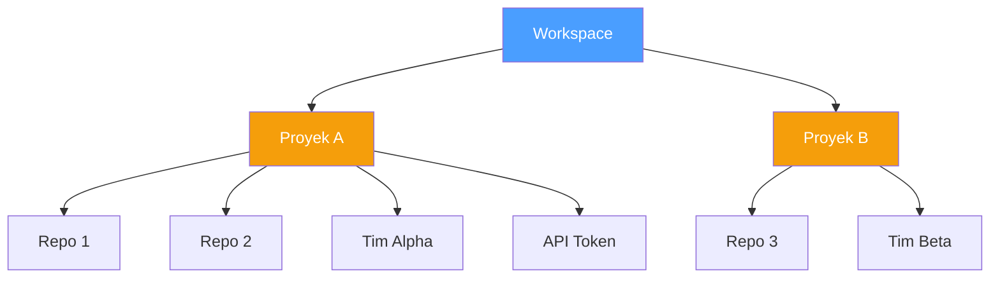

# Projects

## Overview

Projects mengelompokkan repositori bersamaan dan mengontrol siapa yang bisa mengaksesnya. Setiap proyek bisa memiliki anggota, tim, dan API token tersendiri.

## Siapa yang Butuh Ini?

- **Manager** — mengelola akses ke repositori berdasarkan proyek
- **Developer** — mengakses repositori yang relevan dengan tugasnya
- **Tim Keamanan** — memantau keamanan per proyek

## Buat Proyek

1. Buka **Projects** di sidebar
2. Klik **New Project**
3. Isi **nama** dan **deskripsi**
4. Klik **Create`

## Detail Proyek

Setiap proyek memiliki tab untuk mengelola berbagai aspek:

| Tab | Penjelasan |
|-----|-----------|
| **General** | Info proyek, repositori, tim, anggota |
| **API Tokens** | Token untuk integrasi CI/CD |

## Tambah Repository ke Proyek

1. Buka proyek
2. Buka bagian **Repositories**
3. Klik **Add Repository**
4. Pilih repository
5. Klik **Save**

## Tambah Anggota ke Proyek

1. Buka proyek
2. Buka bagian **Members**
3. Klik **Add Member**
4. Pilih anggota dan role
5. Klik **Save**

## Tambah Tim ke Proyek

1. Buka proyek
2. Buka bagian **Teams**
3. Klik **Add Team**
4. Pilih tim dan role
5. Klik **Save**

## API Tokens (untuk CI/CD)

Setiap proyek bisa memiliki API token sendiri untuk pipeline CI/CD.

### Buat Token

1. Buka proyek
2. Klik tab **API Tokens**
3. Klik **Create Token**
4. Beri nama (contoh: "CI Pipeline — main branch")
5. Klik **Create**
6. **Copy token segera** — token tidak akan ditampilkan lagi

### Revoke Token

1. Buka proyek → tab **API Tokens**
2. Cari token
3. Klik **Revoke**

## Hapus Proyek

1. Buka proyek
2. Buka tab **General**
3. Klik **Delete Project**
4. Konfirmasi

Repository tidak dihapus — hanya pengelompokan proyek yang dihapus.

## Cara Kerja Projects

## Tips

- **Buat proyek per aplikasi** — misalnya "Frontend App", "Backend API", "Mobile App"
- **Gunakan tim untuk akses** — lebih mudah daripada menambahkan anggota satu per satu
- **Buat API token per proyek** — agar akses CI/CD terisolasi per proyek
- **Jangan hapus proyek yang sedang aktif** — pastikan tidak ada scan atau CI/CD yang bergantung

## Kesalahan Umum

| Masalah | Solusi |
|---------|--------|
| Anggota tidak bisa akses proyek | Pastikan anggota atau tim sudah ditugaskan |
| API token tidak berfungsi | Pastikan token belum di-revoke dan masih valid |
| Proyek tidak muncul | Pastikan fitur Projects aktif di environment |
| Token tidak bisa dilihat lagi | Normal — token hanya ditampilkan saat pertama dibuat |

## Permissions

| Aksi | Owner | Manager | Reviewer | Member |
|------|:-----:|:-------:|:--------:|:------:|
| Lihat proyek | ✅ | ✅ | ✅ | ✅ |
| Buat proyek | ✅ | ✅ | ❌ | ❌ |
| Edit proyek | ✅ | ✅ | ❌ | ❌ |
| Hapus proyek | ✅ | ✅ | ❌ | ❌ |
| Tambah repo ke proyek | ✅ | ✅ | ❌ | ❌ |
| Buat API token | ✅ | ✅ | ❌ | ❌ |
| Revoke API token | ✅ | ✅ | ❌ | ❌ |

## Langkah Selanjutnya

- [Jalankan Scan](scans.md) pada repositori di proyek
- [Buat Laporan](reports.md) untuk proyek
- [Kelola Tim](teams.md) dan tugaskan ke proyek
