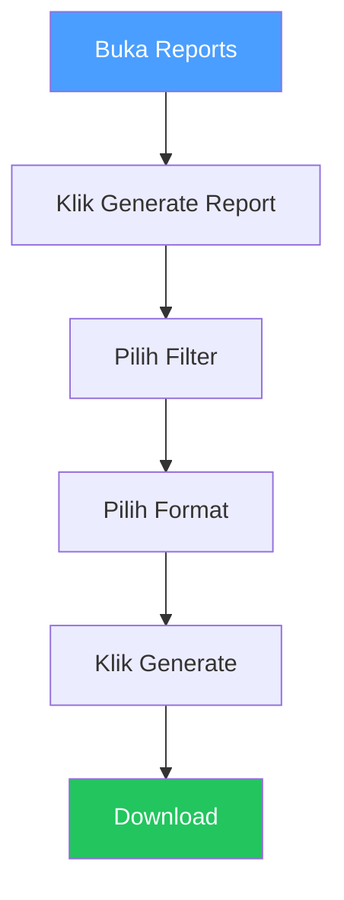

# Reports

## Overview

Reports memungkinkan kamu mengekspor hasil pemindaian keamanan dalam format PDF, XLSX, atau CSV. Laporan ini berguna untuk komunikasi dengan stakeholder, audit, atau analisis data.

## Siapa yang Butuh Ini?

- **Manager** — membuat laporan untuk manajemen
- **Tim Keamanan** — menyusun laporan audit keamanan
- **Reviewer** — membagikan hasil tinjauan ke tim

## Format Laporan

| Format | Kegunaan |
|--------|----------|
| **PDF** | Ringkasan eksekutif, audit kepatuhan |
| **XLSX** | Analisis data, kolaborasi tim |
| **CSV** | Integrasi dengan tools lain |

## Buat Laporan

1. Buka **Reports** di sidebar
2. Klik **Generate Report**
3. Pilih filter:
   - **Project** — proyek tertentu atau semua
   - **Date Range** — rentang waktu
   - **Severity** — filter berdasarkan tingkat keparahan
4. Pilih format (PDF / XLSX / CSV)
5. Klik **Generate**
6. Tunggu beberapa detik
7. Klik **Download**

## Isi Laporan

| Bagian | Yang Termasuk |
|--------|-------------|
| **Summary** | Total temuan, distribusi severity |
| **Findings List** | Semua temuan dengan detail |
| **Scan History** | Scan yang disertakan dalam laporan |
| **AI Verification** | Verdict dan confidence score |
| **Remediation** | Saran perbaikan untuk setiap temuan |

## Tips

- **Filter dengan bijak** — semakin spesifik filter, semakin fokus laporannya
- **Gunakan PDF untuk stakeholder** — format paling profesional untuk presentasi
- **Gunakan XLSX untuk analisis** — bisa di-sort, filter, dan pivot di Excel
- **Buat laporan berkala** — misalnya mingguan atau bulanan untuk pemantauan

## Kesalahan Umum

| Masalah | Solusi |
|---------|--------|
| Generate gagal | Coba filter yang lebih sempit (rentang waktu lebih pendek) |
| Download tidak bisa | Periksa pengaturan browser, coba browser lain |
| Laporan kosong | Pastikan ada data scan/temuan untuk filter yang dipilih |
| Proses lama | Normal untuk data yang sangat besar, tunggu atau kurangi filter |

## Permissions

| Aksi | Owner | Manager | Reviewer | Member |
|------|:-----:|:-------:|:--------:|:------:|
| Lihat laporan | ✅ | ✅ | ✅ | ✅ |
| Generate laporan | ✅ | ✅ | ✅ | ❌ |
| Download laporan | ✅ | ✅ | ✅ | ❌ |

## Langkah Selanjutnya

- Bagikan laporan ke stakeholder atau auditor
- Lihat [Temuan](findings.md) untuk detail lebih lanjut
- [Dashboard](dashboard.md) untuk ringkasan visual
