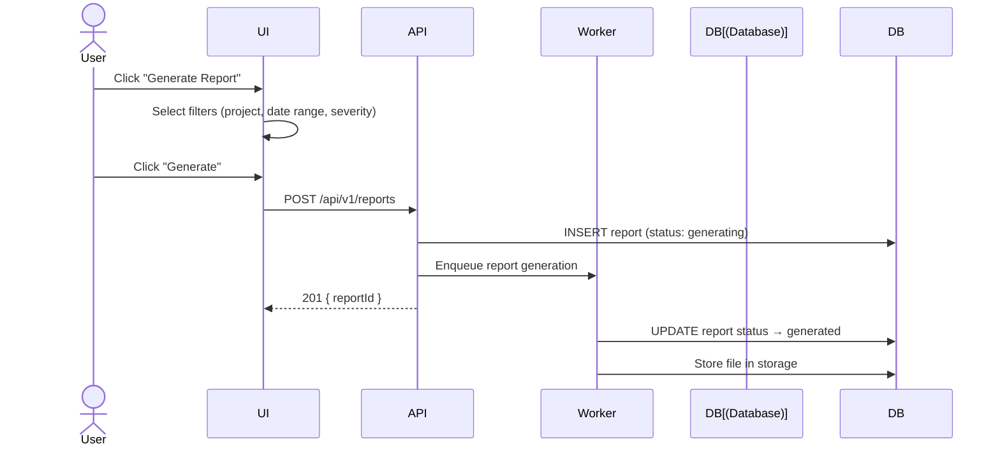
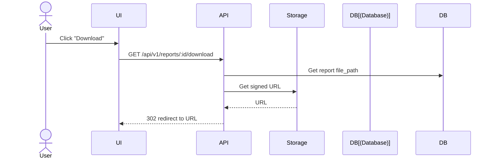

# Reports

## Overview

Reports provide exportable security summaries in PDF, XLSX, and CSV formats for compliance and stakeholder communication.

## Report Types

| Format | Use Case |
|--------|----------|
| **PDF** | Executive summary, compliance audits |
| **XLSX** | Data analysis, team collaboration |
| **CSV** | Integration with other tools |

## Generate Report

## Report Fields

| Field | Description |
|-------|-------------|
| `type` | PDF, XLSX, or CSV |
| `title` | Report title |
| `filters` | Applied filters (project, severity, date range) |
| `status` | generating, generated, failed |
| `file_path` | Storage path |
| `file_size` | File size in bytes |
| `format` | Output format |

## Download Report

