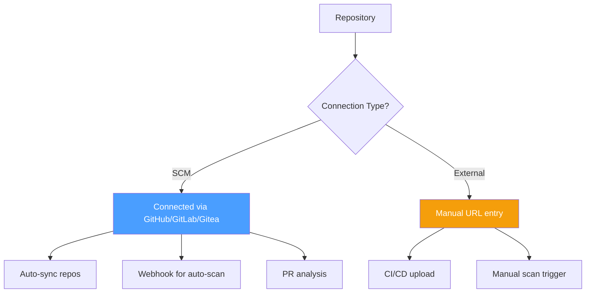
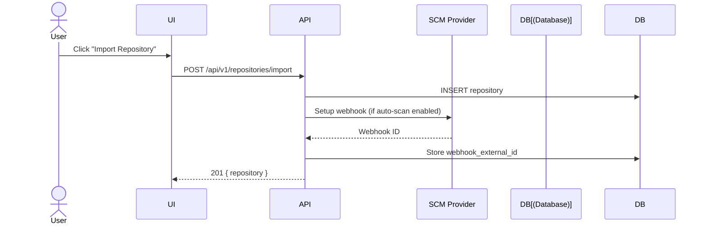
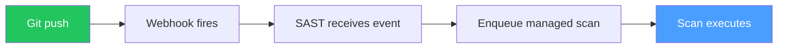

# Repositories

## Overview

Repositories connect your code to the scanning platform. Import from GitHub, GitLab, or Gitea for automated security analysis.

## Supported Providers

| Provider | OAuth | Webhooks | PR Comments | Commit Status |
|----------|:-----:|:--------:|:-----------:|:-------------:|
| GitHub | ✅ | ✅ | ✅ | ✅ |
| GitLab | ✅ | ✅ | ✅ | ✅ |
| Gitea | ✅ | ✅ | ✅ | ✅ |

## Repository Management

## Import Flow

## Connection Types

| Type | Description | Scanning Method |
|------|-------------|-----------------|
| `scm` | Connected via GitHub/GitLab/Gitea | Managed scan (git clone) |
| `external` | Manual URL entry | CI/CD upload |

## Auto-Scan

When `auto_scan` is enabled, webhooks trigger scans automatically:

## Repository Fields

| Field | Description |
|-------|-------------|
| `name` | Repository name |
| `url` | Repository URL |
| `default_branch` | Default branch (usually `main`) |
| `connection_type` | `scm` or `external` |
| `auto_scan` | Enable auto-scan on push |
| `project_id` | Associated project |
| `external_id` | SCM provider ID |
