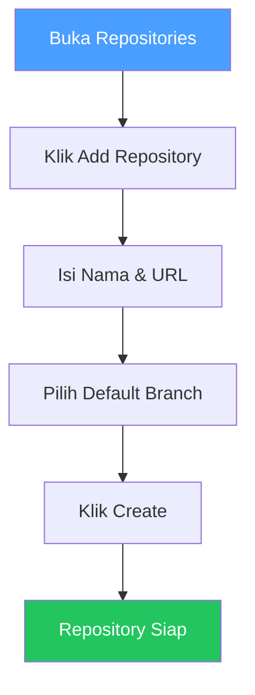
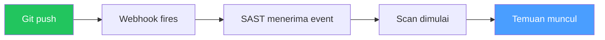

# Repositories

## Overview

Repository adalah kode sumber yang akan dipindai oleh platform. kamu bisa mengimpor dari GitHub, GitLab, atau Gitea, atau menambahkan secara manual.

## Siapa yang Butuh Ini?

- **Developer** — ingin memindai kode yang baru ditulis
- **Tim Keamanan** — ingin memantau keamanan semua repositori
- **Manager** — ingin mengetahui repositori mana yang sudah dipindai

## Dua Cara Menambah Repository

| Metode | Kapan Digunakan |
|--------|----------------|
| **SCM Import** | Hubungkan GitHub/GitLab/Gitea dulu, lalu impor repo |
| **Manual Add** | Masukkan URL repo langsung (untuk CI/CD upload) |

## Tambah Repository (Manual)

1. Buka **Repositories** di sidebar
2. Klik **Add Repository**
3. Isi:
   - **Name** — nama repositori kamu
   - **URL** — URL repositori
   - **Default Branch** — branch utama (biasanya `main` atau `master`)
4. Klik **Create**

## Impor dari SCM

1. Buka **Source Control** di sidebar
2. Hubungkan provider kamu (GitHub / GitLab / Gitea)
3. Buka **Repositories** → klik **Import**
4. Pilih repositori yang ingin diimpor
5. Tentukan proyek untuk setiap repo

## Auto-Scan

Jika terhubung via SCM, kamu bisa mengaktifkan auto-scan. Setiap push akan memicu scan secara otomatis.

## Setelah Menambah Repository

Setelah repo ditambahkan, kamu bisa:
1. **Jalankan scan** — Buka Scans → New Scan
2. **Atur CI/CD** — Buka Scans → CI/CD Setup
3. **Lihat temuan** — Buka Findings setelah scan selesai

## Tips

- **Pilih branch yang benar** — pastikan branch yang dipilih adalah branch utama yang berisi kode production
- **Gunakan nama yang jelas** — beri nama repository sesuai dengan nama di GitHub/GitLab agar mudah dikenali
- **Aktifkan auto-scan** — untuk repositori kritis, aktifkan auto-scan agar setiap perubahan terpantau

## Kesalahan Umum

| Masalah | Solusi |
|---------|--------|
| Repository tidak muncul setelah import | Tunggu beberapa menit untuk sinkronisasi, atau klik Sync |
| URL salah | Pastikan URL benar dan bisa diakses dari server |
| Branch tidak ditemukan | Periksa nama branch di repository kamu |
| Auto-scan tidak jalan | Pastikan webhook sudah terpasang dengan benar |

## Permissions

| Aksi | Owner | Manager | Reviewer | Member |
|------|:-----:|:-------:|:--------:|:------:|
| Lihat repository | ✅ | ✅ | ✅ | ✅ |
| Tambah repository | ✅ | ✅ | ❌ | ❌ |
| Hapus repository | ✅ | ✅ | ❌ | ❌ |
| Aktifkan auto-scan | ✅ | ✅ | ❌ | ❌ |

## Langkah Selanjutnya

- [Jalankan Scan](scans.md) pada repository yang baru ditambahkan
- [Hubungkan Source Control](source-control.md) untuk auto-sync dan PR analysis
- [Buat Proyek](projects.md) untuk mengelompokkan repository
