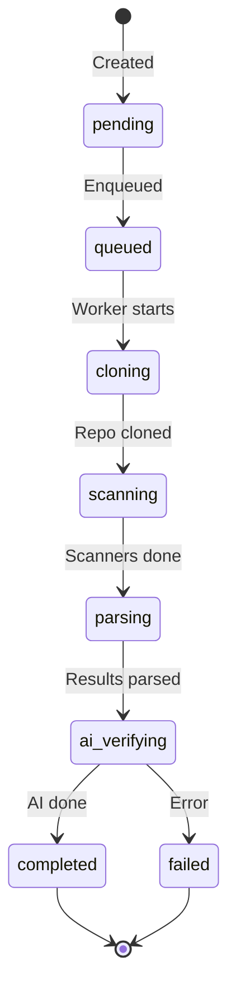
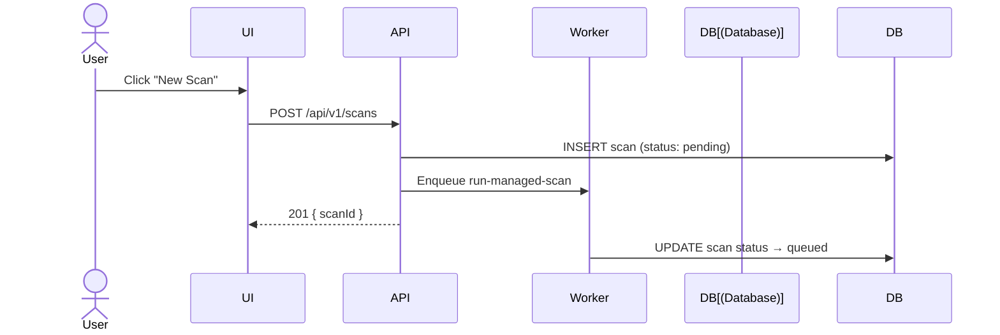
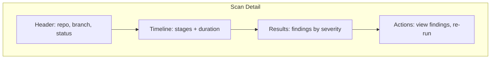

# Scans

## Overview

Scans analyze your code using multiple scanner engines and produce security findings.

## Scan Types

| Type | Trigger | Description |
|------|---------|-------------|
| **Managed** | User action | Triggered from the web UI |
| **External** | CI/CD pipeline | Results uploaded via API |
| **Scheduled** | Cron schedule | Automated recurring scans |

## Scan Lifecycle



## Trigger Scan



## Progress Events

Each scan has a timeline of progress events:

| Event | Description |
|-------|-------------|
| `triggered` | Scan initiated |
| `queued` | Added to queue |
| `cloning` | Git clone started |
| `scanning` | Scanners running |
| `parsing` | Parsing results |
| `ai_verifying` | AI verification started |
| `completed` | Scan finished |
| `failed` | Scan failed |

## Scan Detail View



## PR Analysis

When scanning a PR, the system tracks:

| Metric | Description |
|--------|-------------|
| `new_findings` | Findings new in this PR |
| `fixed_findings` | Findings fixed in this PR |
| `persistent_findings` | Pre-existing findings |

These metrics are displayed in the scan detail and quality gate evaluation.

## CI/CD Integration

```bash
# Initialize scan
POST /api/v1/scans/upload/init
{
  "repositoryName": "my-repo",
  "branch": "main",
  "commitSha": "abc123"
}

# Upload scanner results
POST /api/v1/scans/upload
FormData: scanId, scanner, file

# Complete scan
POST /api/v1/scans/upload/complete
{
  "scanId": "uuid",
  "status": "completed"
}
```
