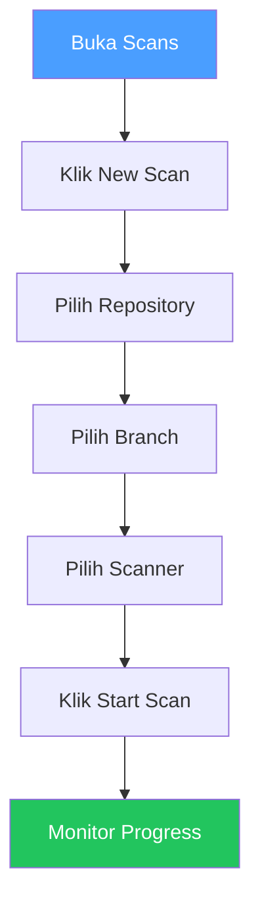
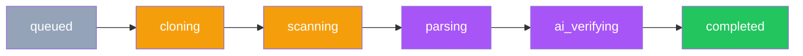

# Scans

## Overview

Scan adalah proses memindai kode sumber untuk menemukan celah keamanan. kamu bisa menjalankan scan secara manual dari UI atau mengotomasikannya melalui CI/CD.

## Siapa yang Butuh Ini?

- **Developer** — ingin memastikan kode baru sudah aman sebelum merge
- **Tim Keamanan** — ingin memantau keamanan secara berkala
- **Reviewer** — ingin meninjau hasil scan sebelum approve PR

## Dua Cara Scan

| Metode | Kapan Digunakan |
|--------|----------------|
| **Manual Scan** | Jalankan scan langsung dari UI |
| **CI/CD Scan** | Otomasi scan setiap push/PR |

## Jalankan Scan Manual

1. Buka **Scans** di sidebar
2. Klik **New Scan**
3. Pilih **repository** dan **branch**
4. Pilih scanner:

| Scanner | Bahasa | Kapan Digunakan |
|---------|--------|----------------|
| **Semgrep** | 30+ bahasa | Selalu direkomendasikan |
| **Gitleaks** | Semua | Deteksi secret (API key, password) |
| **Flawfinder** | C/C++ | Codebase C/C++ |
| **Cppcheck** | C/C++ | Codebase C/C++ |
| **Clang-Tidy** | C/C++ | C/C++ dengan build system |
| **GCC FanAnalyzer** | C/C++ | C/C++ yang di-compile dengan GCC |

5. Klik **Start Scan`

## Monitor Progress

Klik scan di daftar untuk melihat timeline:

| Tahap | Apa yang Terjadi | Durasi |
|-------|-----------------|--------|
| `queued` | Menunggu worker | Beberapa detik |
| `cloning` | Git clone sedang berlangsung | 10-30 detik |
| `scanning` | Scanner sedang berjalan | 30 detik - 5 menit |
| `parsing` | Output diurai menjadi temuan | 5-15 detik |
| `ai_verifying` | AI memeriksa setiap temuan | 1-10 menit |
| `completed` | Scan selesai | — |

## Jenis Scan

| Jenis | Cara Mulai |
|-------|-----------|
| **Managed** | Kamu klik "New Scan" di UI |
| **External** | CI/CD mengunggah hasil via API |
| **Scheduled** | Berjalan otomatis sesuai jadwal |

## CI/CD Setup

Untuk otomatisasi scan setiap push:

1. Buka **Scans** → klik **CI/CD Setup**
2. Pilih platform (GitHub / GitLab / Gitea)
3. Klik **Copy YAML**
4. Paste file workflow ke repo kamu
5. Tambahkan secrets (`SAST_API_URL`, `SAST_API_KEY`) di pengaturan repo
6. Push kode — scan berjalan otomatis

## Tips

- **Gunakan Semgrep untuk semua bahasa** — ini scanner paling komprehensif
- **Pilih branch yang tepat** — pastikan scan di branch utama (main/master)
- **Jangan scan branch feature yang belum selesai** — tunggu sampai kode stabil
- **Perhatikan durasi** — scan dengan banyak file bisa memakan waktu lama

## Kesalahan Umum

| Masalah | Solusi |
|---------|--------|
| Scan gagal | Periksa apakah repository bisa diakses dari server |
| Scanner tidak ditemukan | Pastikan scanner sudah terinstal di server |
| Scan stuck di cloning | Periksa koneksi jaringan ke repository |
| AI verifikasi lambat | Normal untuk codebase besar, tunggu atau kurangi jumlah file |

## Permissions

| Aksi | Owner | Manager | Reviewer | Member |
|------|:-----:|:-------:|:--------:|:------:|
| Lihat scan | ✅ | ✅ | ✅ | ✅ |
| Jalankan scan | ✅ | ✅ | ✅ | ❌ |
| Batalkan scan | ✅ | ✅ | ✅ | ❌ |
| Hapus scan | ✅ | ✅ | ❌ | ❌ |
| Setup CI/CD | ✅ | ✅ | ❌ | ❌ |

## Langkah Selanjutnya

Setelah scan selesai:
- Lihat [Temuan](findings.md) untuk meninjau hasil
- Buat [Laporan](reports.md) untuk stakeholder
- [Konfigurasi AI Models](ai-models.md) untuk mengatur verifikasi
