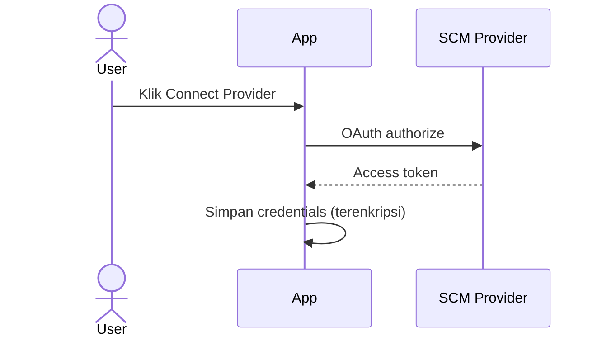

# Source Control

## Overview

Source control integration memungkinkan kamu mengimpor repositori dan mengaktifkan pemindaian otomatis. Setelah terhubung, setiap push akan memicu scan secara otomatis.

## Siapa yang Butuh Ini?

- **Developer** — ingin otomasi scan setiap push
- **Tim Keamanan** — ingin memantau semua perubahan kode
- **Manager** — ingin memastikan semua kode terpindai

## Provider yang Didukung

| Provider | OAuth | Webhooks | PR Comments |
|----------|:-----:|:--------:|:-----------:|
| GitHub | ✅ | ✅ | ✅ |
| GitLab | ✅ | ✅ | ✅ |
| Gitea | ✅ | ✅ | ✅ |

## Hubungkan Provider

1. Buka **Source Control** di sidebar
2. Klik **Connect** pada provider
3. Panduan setup akan muncul dengan langkah-langkah
4. Pilih mode koneksi
5. Ikuti langkah-langkah dan centang setiap langkah selesai
6. Klik **Connect** saat semua langkah selesai

## GitHub Setup

GitHub memiliki 3 mode koneksi:

### GitHub App (Direkomendasikan)

| Langkah | Yang Dilakukan |
|---------|---------------|
| 1. Buat GitHub App | Buka pengaturan organisasi → New GitHub App |
| 2. Set Callback URL | Copy callback URL dari panduan |
| 3. Set Permissions | Contents: Read-only, Pull requests: Read/write, Commit statuses: Read/write |
| 4. Subscribe to Events | Aktifkan Push, Pull request, Check run |
| 5. Generate Private Key | Download file .pem |
| 6. Install App | Install ke organisasi kamu |
| 7. Paste di SAST | Masukkan App ID, App slug, dan paste private key |

### OAuth App

| Langkah | Yang Dilakukan |
|---------|---------------|
| 1. Buat OAuth App | Buka Developer Settings → OAuth Apps |
| 2. Set Callback URL | Paste callback URL dari panduan |
| 3. Copy Credentials | Copy Client ID dan generate Client Secret |
| 4. Paste di SAST | Masukkan Client ID dan Client Secret |

### Personal Access Token

| Langkah | Yang Dilakukan |
|---------|---------------|
| 1. Generate Token | Buka Developer Settings → Tokens (fine-grained) |
| 2. Set Permissions | Contents: Read-only, Pull requests: Read/write, Commit statuses: Read/write |
| 3. Copy Token | Copy segera — hanya ditampilkan sekali |
| 4. Paste di SAST | Paste token di modal Configure |

## GitLab Setup

### OAuth Application (Direkomendasikan)

| Langkah | Yang Dilakukan |
|---------|---------------|
| 1. Buat Application | Buka GitLab Settings → Applications → New |
| 2. Set Redirect URI | Paste redirect URI dari panduan |
| 3. Set Scopes | Centang `api` (wajib untuk MR notes, commit statuses) |
| 4. Save & Copy | Copy Application ID dan Secret |
| 5. Paste di SAST | Masukkan Application ID dan Secret |

### Personal Access Token

| Langkah | Yang Dilakukan |
|---------|---------------|
| 1. Buat Token | Buka User Settings → Access Tokens |
| 2. Set Scopes | Centang `api` (wajib) dan `read_repository` |
| 3. Copy Token | Copy segera — hanya ditampilkan sekali |
| 4. Paste di SAST | Paste token di modal Configure |

## Gitea Setup

### OAuth Application (Direkomendasikan)

| Langkah | Yang Dilakukan |
|---------|---------------|
| 1. Buat Application | Buka Site Administration → Applications → New |
| 2. Set Redirect URI | Paste redirect URI dari panduan |
| 3. Save & Copy | Copy Client ID dan Client Secret |
| 4. Paste di SAST | Masukkan Client ID, Client Secret, dan Base URL |

### Access Token

| Langkah | Yang Dilakukan |
|---------|---------------|
| 1. Buka Token Settings | Buka User Settings → Applications |
| 2. Generate Token | Set nama dan pilih scopes |
| 3. Required Scopes | `user: Read`, `repository: Read/Write`, `issue: Read/Write` |
| 4. Paste di SAST | Paste token dan Base URL di modal Configure |

## Setelah Terhubung

| Fitur | Penjelasan |
|-------|-----------|
| **Repository Sync** | Repo otomatis sinkron setiap 30 menit |
| **PR Comments** | Temuan diposting sebagai komentar PR |
| **Commit Status** | Status pass/fail pada commit |
| **Import Repos** | Impor repo langsung dari SCM |

## Putuskan Koneksi

1. Buka **Source Control**
2. Klik **Disconnect** pada provider
3. Repository terputus (data tetap tersimpan)

## Tips

- **Gunakan GitHub App** — lebih aman daripada PAT karena tidak memerlukan token user
- **Atur permissions minimal** — berikan hanya permissions yang benar-benar dibutuhkan
- **Periksa webhook** — pastikan webhook aktif setelah koneksi dibuat

## Kesalahan Umum

| Masalah | Solusi |
|---------|--------|
| OAuth gagal | Hubungkan ulang provider di Source Control |
| Repo tidak sinkron | Klik Sync pada koneksi provider |
| PR comments tidak muncul | Pastikan koneksi SCM aktif dan permissions cukup |
| Webhook tidak jalan | Periksa pengaturan webhook di GitHub/GitLab/Gitea |

## Permissions

| Aksi | Owner | Manager | Reviewer | Member |
|------|:-----:|:-------:|:--------:|:------:|
| Lihat koneksi | ✅ | ✅ | ✅ | ✅ |
| Hubungkan provider | ✅ | ✅ | ❌ | ❌ |
| Putuskan koneksi | ✅ | ✅ | ❌ | ❌ |
| Impor repo | ✅ | ✅ | ❌ | ❌ |

## Langkah Selanjutnya

- [Impor Repository](repositories.md) dari SCM yang sudah terhubung
- [Jalankan Scan](scans.md) pada repo yang sudah diimpor
- [Setup CI/CD](scans.md#cicd-setup) untuk otomasi scan
