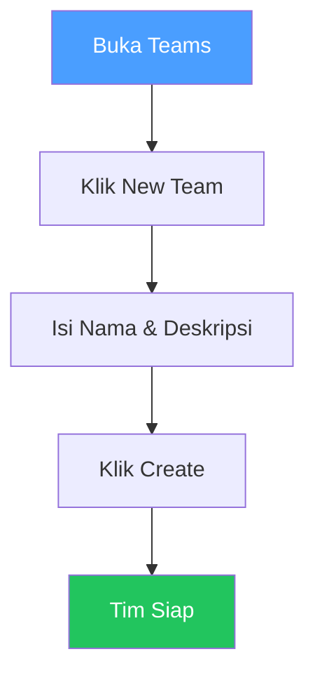
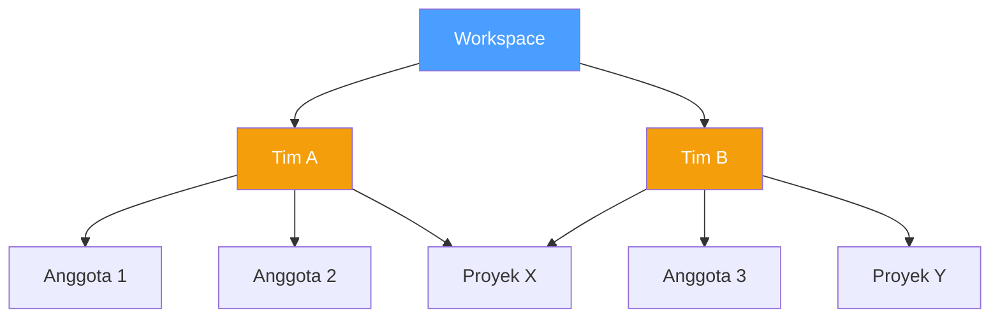

# Teams

## Overview

Teams memungkinkan kamu mengelompokkan anggota untuk pengelolaan akses yang lebih mudah. Daripada menambahkan anggota satu per satu ke proyek, kamu bisa menugaskan seluruh tim sekaligus.

## Siapa yang Butuh Ini?

- **Manager** — mengelola struktur tim dan akses proyek
- **Owner** — mengatur organisasi workspace

## Buat Tim

1. Buka **Teams** di sidebar
2. Klik **New Team**
3. Isi **nama** dan **deskripsi**
4. Klik **Create**

## Tambah Anggota ke Tim

1. Buka tim
2. Klik **Add Members**
3. Pilih anggota dari daftar
4. Klik **Save**

## Tugaskan Tim ke Proyek

1. Buka **Projects** → buka proyek
2. Klik tab **Teams**
3. Klik **Add Team**
4. Pilih tim
5. Pilih role (Admin / Member)
6. Klik **Save**

Semua anggota tim sekarang memiliki akses ke proyek tersebut.

## Cara Kerja Teams

## Edit Tim

1. Buka **Teams**
2. Klik **Edit** pada tim
3. Ubah nama atau deskripsi
4. Klik **Save**

## Hapus Tim

1. Buka **Teams**
2. Klik **Delete** pada tim
3. Konfirmasi

Anggota tidak dihapus dari workspace — hanya pengelompokan tim yang dihapus.

## Tips

- **Buat tim berdasarkan fungsi** — misalnya "Tim Backend", "Tim Security", "Tim DevOps"
- **Gunakan tim untuk akses proyek** — lebih mudah daripada menambahkan anggota satu per satu
- **Jangan buat terlalu banyak tim** — cukup 3-5 tim untuk workspace kecil

## Kesalahan Umum

| Masalah | Solusi |
|---------|--------|
| Anggota tidak bisa akses proyek | Pastikan tim sudah ditugaskan ke proyek |
| Tim tidak muncul di proyek | Pastikan fitur Teams aktif di environment |
| Salah tambah anggota | Buka tim → hapus anggota yang salah |

## Permissions

| Aksi | Owner | Manager | Reviewer | Member |
|------|:-----:|:-------:|:--------:|:------:|
| Lihat tim | ✅ | ✅ | ✅ | ✅ |
| Buat tim | ✅ | ✅ | ❌ | ❌ |
| Edit tim | ✅ | ✅ | ❌ | ❌ |
| Hapus tim | ✅ | ✅ | ❌ | ❌ |
| Tambah anggota ke tim | ✅ | ✅ | ❌ | ❌ |
| Tugaskan tim ke proyek | ✅ | ✅ | ❌ | ❌ |

## Langkah Selanjutnya

- [Buat Proyek](projects.md) dan tugaskan tim ke proyek
- [Kelola Anggota](members.md) untuk menambah anggota ke tim
- Lihat [Knowledge Base](knowledge-base.md) untuk referensi keamanan
