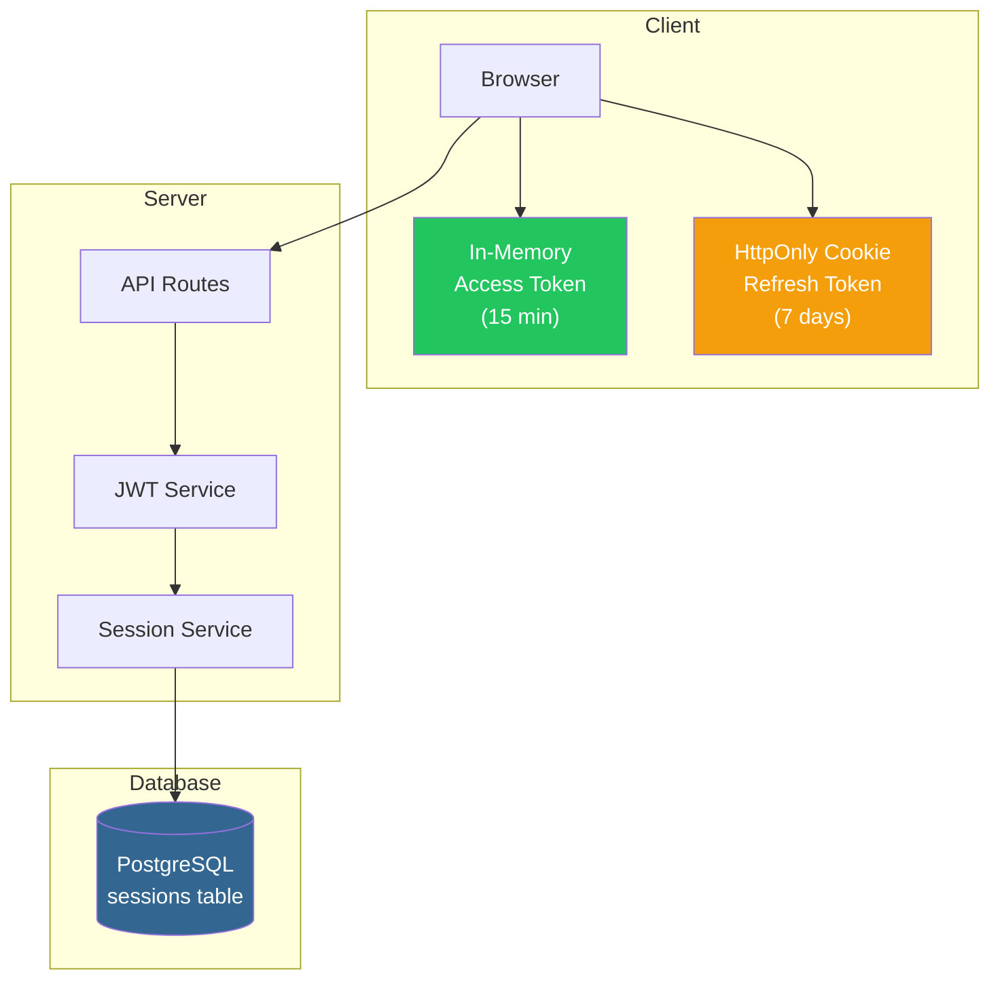
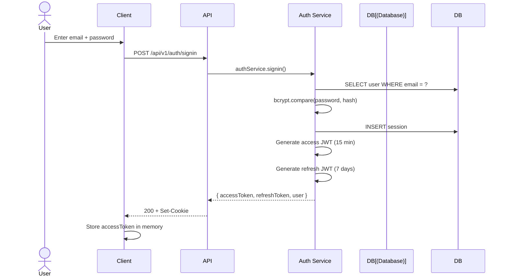
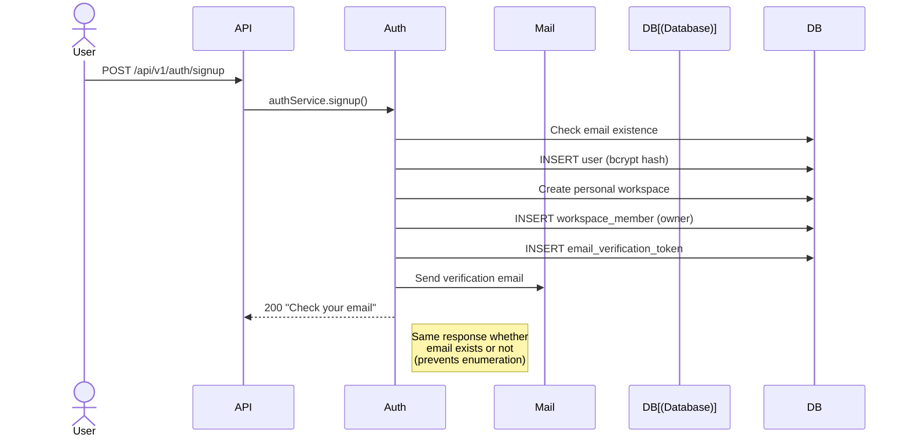
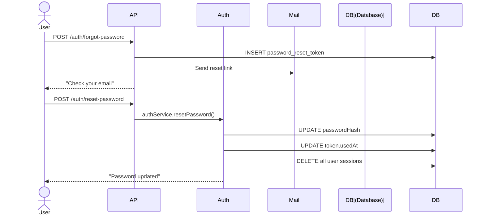
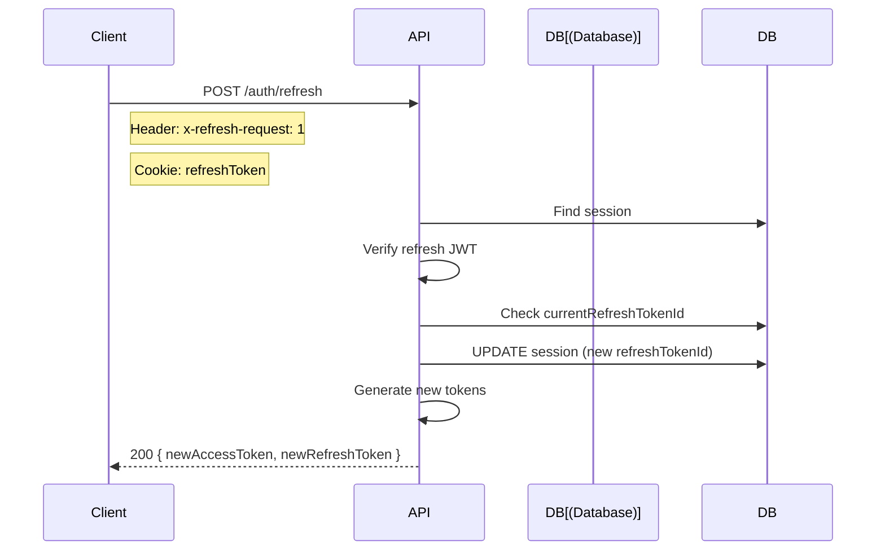
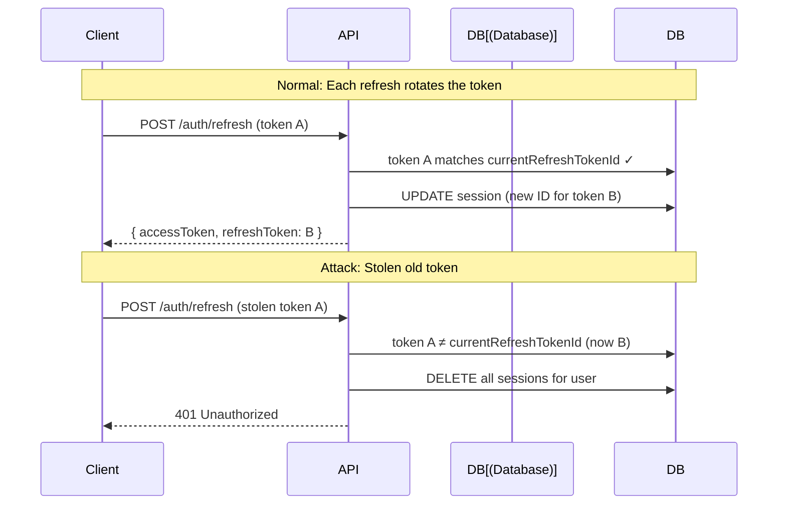
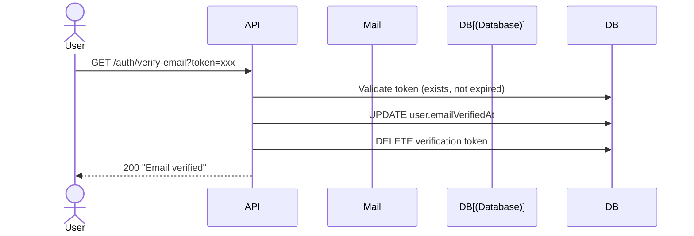
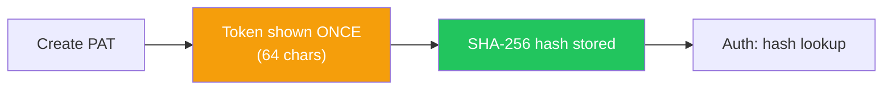

# Authentication

SAST Integration uses JWT-based authentication with refresh token rotation and reuse detection.

## Auth Architecture



## Sign In



**Request:**

```bash
POST /api/v1/auth/signin
Content-Type: application/json

{
  "email": "user@example.com",
  "password": "your-password"
}
```

**Response:**

```json
{
  "success": true,
  "data": {
    "accessToken": "eyJhbGciOi...",
    "refreshToken": "eyJhbGciOi...",
    "user": {
      "id": "uuid",
      "email": "user@example.com",
      "name": "User Name"
    }
  }
}
```

## Sign Up



**Request:**

```bash
POST /api/v1/auth/signup
Content-Type: application/json

{
  "name": "John Doe",
  "email": "john@example.com",
  "password": "SecurePassword123!"
}
```

## Password Reset



## Token Refresh



## Refresh Token Rotation + Reuse Detection



**Key security features:**
- Each refresh generates a new `refreshTokenId`
- Presenting an old `refreshTokenId` = token was stolen
- On detection: **all sessions for the user are deleted**
- CSRF protection: `x-refresh-request: 1` header required

## Email Verification



## Personal Access Tokens (PAT)

For API automation:



- Token shown to user **only once** at creation
- Only SHA-256 hash stored in database
- Configurable expiry
- Can be revoked at any time

## Password Security

| Mechanism | Implementation |
|-----------|---------------|
| Hashing | bcryptjs with cost factor 12 |
| Minimum length | 8 characters |
| Storage | Only bcrypt hash, never plaintext |
| Reset flow | Token-based, single-use, 1-hour expiry |
| Timing safety | bcrypt.compare is timing-safe |
| Enumeration prevention | Same response for existing/non-existing emails |
